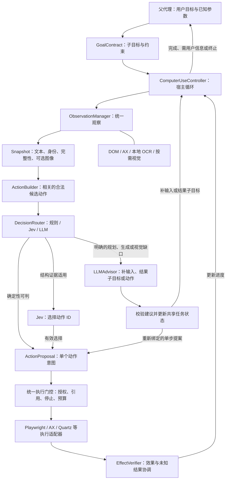
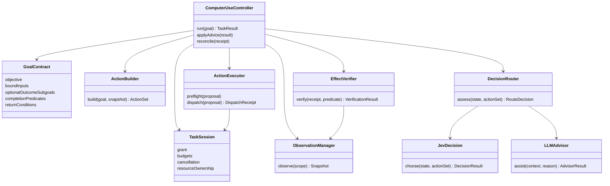
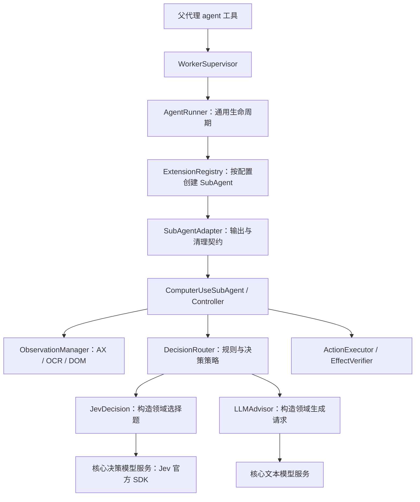
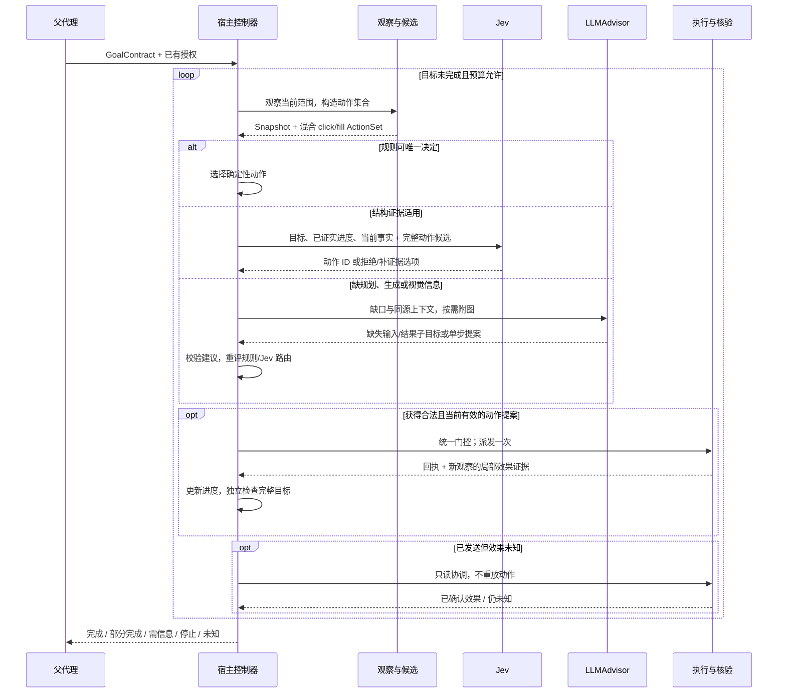
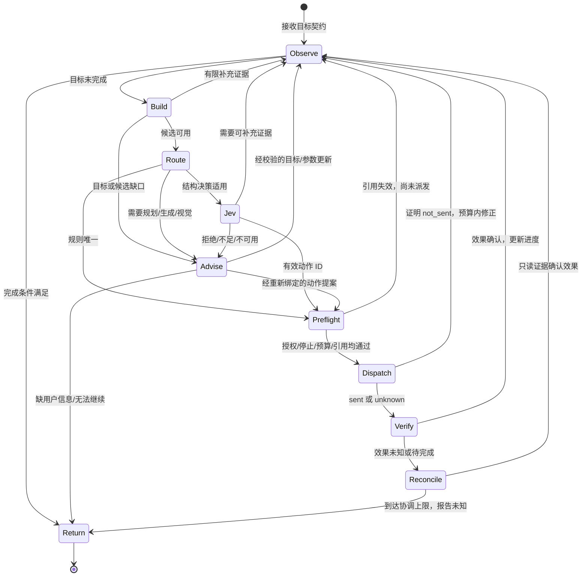

> 状态：进行中（2026-10-09：S0–S3 按各自范围收口，Jev 仍默认禁用；S4 DOM 与原生通道已实现，双模型原生 fake HTTP 九项通过，真实 Advisor 批次 1 成功 / 1 未知失败 / 7 未运行；语义历史、紧凑视图和动态 focus 离线验收及评审完成；无桌面诊断经用户明确授权后 48/48 行完成（51 次调用、0 桌面操作，当前输入 12/12、旧输入 6/12、Advisor 组 11/12，仅为冻结状态选择判定）；排期调整为先真实 native 矩阵，矩阵停批改为已知失败继续，fake HTTP 9/9 与经授权真实批次 9/9 通过（34 次调用，Jev 2/6 跳过运算符后自行 Clear 并经 Advisor 纠偏），两项规划修复评估后暂不修；2026-10-10：按请求打开/复用任意 App 并绑定窗口（S4-B）与 AX 快照通用完成核验（S4-V）离线验收完成，无画像点击与分窗口基线（S4-V2）离线验收完成；自然语言→GoalContract（S4-N）离线验收完成，端到端验收进行中，S4-G3 移至 S6 交付前；选定视觉/通道能力、规划稳定性、S5–S6 尚未完成）。

> 2026-10-02 范围调整：N2 与 SDK 已退役，移除旧 engine/executor、供应商模型声明和专用 transport 适配。当前保留调用方为 Computer Use、普通 LLMAgent 与非 GUI 测试 SubAgent；下文已完成阶段的 N2 验证数字仅为历史记录。
> 2026-10-03 当前决策：S3 按下文“当前计划”收口，验证 Jev 作为可回退策略环节的边际价值。历史批次按原协议的判分保留；`conflicting` 三例预期缺少充分任务契约支持，不作为 Jev 错误或宿主缺陷证据，不据此新增身份一致性拦截。
> 2026-10-04 设计调整：Jev 定义为核心模型，配置、官方 SDK、协议和连接由核心管理；移除 `model_route` 插件扩展列入 S3-M。插件仅经核心决策接口提交问题和候选。插件自行定义的模型仍由插件管理，不要求为其注册核心模型类型。S3-M 已按该边界实现，最终验收见实施记录；S3 原始评估结论不变。
> 2026-10-04 动作选择调整：S4 不再要求上游预列每一步 operation/role。宿主根据当前 UI 能力与已绑定输入构造可混合 click/fill 的完整候选，Jev 选择下一动作，逐步观察并核验目标；Advisor 仅处理明确的信息/规划/生成/视觉缺口。截至该日代码仍为 v1 里程碑执行，详见 §4.6；新设计见 §4.7 和 S4-R1–R4，2026-10-07 首批进展见 S4 实施记录。
> 2026-10-05 调用层简化：该重构已于 2026-10-06 验收，见 [模型调用层简化](../done/model-call-simplification.md)。该用户确认的设计取代本文旧目标中的模型 HTTP 线级治理要求：独立 DecisionModel + 任务薄包装，SDK 负责网络，普通可观测性不阻断模型；UI/工具审计保持。S3/S3-M 历史记录不改，S4 未开始。
> 2026-10-07 排期明确：S4 下一批为 S4-AX，接通“真实 macOS AX 观察 → Jev 选择 → AXPress/Quartz 操作 → AX 读回核验”，先以 Calculator/TextEdit 验收；不等待完整 Advisor 或 S5。既有 M7 原生实测使用其他定位模型，不作为 Jev + AX 已完成证据。
> 2026-10-07 契约收敛：用户确认无外部兼容需求，统一为目标驱动 `GoalContract`（schema_version=2），移除 v1/Milestone 与双循环；见 [已完成的契约统一](../done/computer-use-goal-contract-unification.md)。本决策取代下文历史记录中的 v1 兼容承诺；旧实验报告保留，当前可执行 benchmark 使用新 revision。
> 2026-10-09 排期调整：用户确认 S4-G3（同进程恢复、跨任务资源生命周期、统一接入套件）是治理门槛，不在“Jev 操作电脑”能力关键路径上；当前任务缺用户值时以 `needs_input` 明确结束，父代理可另开任务（G3 完成前计数重置为已知代价）。故先做真实 native 矩阵与按证据修复，G3 移至正式 S5 系统比较之前完成，仍是 S4 出口与 S6 交付门槛，不降级、不移入 backlog。
> 2026-10-09 再调整：用户确认 G3 三块（同进程恢复、跨任务资源生命周期、统一接入套件/能力清单）在冻结诊断与 native 矩阵中均未触及，S5 配对比较也不依赖，故整体移至 **S6 交付之前**完成（S6 门槛本已要求 G1–G3，不降级、不移入 backlog）；第一片设计保留待实施。端到端可用性缺口优先：先做按任务动态选择/启动并绑定 App 窗口，再做自然语言→GoalContract，最后以“用户一句话→完成任务”场景验收。
> 2026-10-09 通用化：用户确认 App 不限范围，按请求解析并打开/复用（复用用户实例，多实例/多窗口即停止，插件启动的 App 结束后保留，禁止名单不操作），见 S4-B；无画像 App 的完成核验以 AX 快照全窗口匹配为默认（只看值、相对基线新出现、唯一），OCR/视觉模型判断为后备，见 S4-V；S4-N 只写期望值与条件类型。
> 完整目标设计尚未全部实现、尚未完成整体实机验收。生产默认与基线 A 不变，新子代理显式 opt-in。

# 计划：Computer Use 子代理的宿主循环与策略阶梯（S0–S6）

## 0. Harness 接续交接（2026-10-09）

用户因 Codex 额度即将用完，要求将工作交给 DeepSeek Harness。**本次仅交接，
不是授权执行此前被拒绝的真实模型批次。** 不需要重做已完成的实现或从 S4 开头重跑。
交接前工作区干净，最近实现提交 `8a10ab28`，配方/准备记录提交 `1ec16d05`；
本节的文档提交会在它们之后。计划仍 active，S4 不仅剩评估。

### 已完成与未完成

- 已完成并离线验收：单一 schema_version=2 `GoalContract`（不保留 v1/双契约兼容）、
  DOM/原生 AXPress 与 Quartz 通道、文本 Advisor、最近十条语义执行记录、紧凑候选
  视图与短别名、共享读数核验表、有界动态 focus 生命周期。生产默认仍不启用此策略。
- 真实原生历史结果：上一批 **1 成功 / 1 未知失败 / 7 未运行**。成功项经 Advisor
  纠偏后由 Jev 完成 `7×8=56`；失败项选右括号后效果未确认而停批。不是 HTTP 调用
  失败，也未证明由窗口移动造成；后续历史/视图/focus 改进尚无真实收益结论。
- 尚未完成：S4-G3 同进程恢复及预算/授权/资源连续性、自然语言目标契约生成、选定
  场景所需视觉/通道能力、原生多次/移窗/Quartz/TextEdit 与规划稳定性整体验收。
  （2026-10-09 更新：原生九例矩阵真实批次已 9/9 通过；当前未完成为动态 App/窗口绑定、
  通用完成核验、自然语言→GoalContract、端到端验收、选定视觉/通道能力与规划稳定性，G3 移至 S6 前。）
  S5-App 的 DOM 优化、Cua Driver、AX/OCR 融合、观察稳定性仍是有条件受控比较，
  不是已实现能力或这次无桌面诊断的前置安装要求。

### 当前停点与直接下一步

1. **无桌面诊断已完成（2026-10-09）。** 用户明确确认存档 Calculator AX 数据、
   目标、候选与历史发往 `api.typesafe.ai`（Jev）及 `dashscope.aliyuncs.com`
   （Qwen Advisor），以及 60 次调用/$0.25 估算额度后，同一冻结配方运行一次：
   48/48 行完成，51 次调用用量全部已知，约 $0.0455，0 桌面操作，未停批。
   明确按钮定位 12/12、旧整体目标输入 6/12、当前紧凑输入+语义历史 12/12、
   Advisor 候选/focus 11/12。完整结果见
   [诊断报告](../../../backend/benchmarks/computer_use/reports/20261009-s4-decision-diagnostic/README.md)
   及下文 S4-R4 第六批。不要对同一输出目录再次准备或运行。
2. 证据只覆盖冻结状态上的选择：旧输入在 `7` 后跳过运算符、在 `787` 继续输入，
   当前输入均选对，但多因素同时变化不能归因；Advisor 唯一错误是其直接候选 `8`。
   不证明 UI 效果、新观察下的规划稳定性或 G3 恢复。
3. **调整后顺序**（2026-10-09 用户确认，见顶部排期调整）：
   1. **S4-R4 第七批：真实 native 矩阵**。复用 `benchmarks/computer_use/s4_ax.py`
      当前 revision `s4-ax-focus-1`（已含语义历史、紧凑视图与 focus），沿用九例：
      Calculator AXPress/Quartz 各三次、TextEdit fill 三次，每组一例移窗。先冻结
      新配方并跑 fake HTTP 九例，证明当前源码接线；再按批明确授权真实调用。
      重点看新鲜观察下的多步规划、Advisor 直接给候选时的跳步、`787` 类修复路径和
      效果未确认的右括号类停止。**已完成（2026-10-09）**：fake 9/9，经授权真实批次
      9/9 通过（34 次调用、约 $0.026）；Jev 在 2/6 例仍跳过运算符，但自行 Clear 并经
      Advisor 纠偏完成，见下文第七批。
   2. **按证据修复**：只修实测暴露的问题，每项 TDD、§10 验证、独立评审后再复测。
      **2026-10-09 评估后暂不修**（运算符跳步、复核接管 Equals 均有可用恢复路径，候选
      修法依赖 Calculator 专用字符串启发式），理由见第七批“修复评估”。
   3. **S4-B 动态 App/窗口绑定**（离线验收完成）：`task_input.target` + 策略配置、解析/
      启动或复用、同进程换窗跟随；见 S4 下“S4-B”。
   4. **S4-V 通用完成核验**（离线验收完成）：无画像 App 用 AX 快照全窗口匹配核验完成，见“S4-V”。
   5. **S4-V2 无画像点击与分窗口基线**（离线验收完成）：见“S4-V2”。
      **S4-N 自然语言→GoalContract**（离线验收完成，2026-10-10 用户确认改为插件内转换）：父代理只给
      自包含的一句话（可选 `target`），插件用任务文本模型一次转为简述再确定性补齐契约，
      输入值须出自原文；调用与耗时计入任务成本。见“S4-N 第一片”。
   6. **端到端验收**（进行中）：“用户一句话→完成任务”三例（Calculator、有画像 TextEdit、
      无画像 TextEdit 代替备忘录，避免 Notes 多窗/同步干扰）；见“S4 端到端验收”。
      先冻结+离线接线，再桌面 fake HTTP，再按批授权真实模型。
   7. **S4-G3**（2026-10-09 移至 S6 交付前）：同进程恢复、跨任务资源生命周期与统一接入
      套件/能力清单；第一片设计见下文“S4-G3 第一片”。

   真实调用均需按批明确授权，沿用既有 `TYPESAFE_API_KEY` / `BAILIAN_API_KEY`，
   不把凭据写入文档或日志。

### 接续入口、Tests 与验证

- 现行行为先看 [设计文档](../../design/computer-use.md)，研究依据见
  [Jev 开源项目比较](../../research/jev-computer-use-comparison.md)。本计划下文的
  “S4-R4 第六批”保留完整实施/评审记录，历史失败报告不重写。
- 代码入口：`backend/benchmarks/computer_use/s4_replay.py`；生产循环位于
  `backend/plugins/agent-computer-use/src/agent_computer_use/controller.py`，同目录
  `model_view.py`、`jev.py`、`advisor.py` 负责模型输入/选择/规划，
  `channels/native.py` 负责原生通道。新增诊断测试在插件 `tests/test_jev.py`。
- 最近完整验证：诊断定向 **15 passed**；后端 **5753 passed / 1 skipped /
  21 warnings**；E2E **18 场景 / 71 步**；修改 Python pyright、backend/CLI lint、
  web lint/tsc-b、开发服务日志、docs/diff 全通过。两轮独立评审无遗留问题。
  完整数字与日志路径已在下文和已提交报告记录；`/tmp` 日志可能随环境切换丢失。
- 本次交接只改 docs，`python3 scripts/check_docs.py`（51 文件）和 diff 检查通过；
  独立 review-and-refactor 第 1 轮无可操作问题、无修改，协调者核对后提交。
  后续行为变更继续遵循 TDD、§10 全部适用验证清单、
  项目独立评审及分逻辑子任务提交规则；纯文档交接不重复跑生产测试或付费诊断。

## 1. 目标、范围与本次决策

目标是在不降低任务完成和执行可靠性的前提下，减少界面操作中的主 LLM 往返、
图像上传与总等待时间。采用 **宿主驱动循环：规则直接处理确定性步骤，适用的
结构化决策优先 Jev，需要规划、生成或视觉理解时调用 LLM，补齐信息后重新评估并回到快速路径**。

两条选择轴分开设计：

- **谁作决策**：规则 / Jev / LLM；LLM 不再默认每步规划，Jev 不再仅是 D2 控件选择器。
- **如何观察和操作**：Playwright/DOM、macOS AX（即 Accessibility）、OCR、视觉。
  LLM 也可以只读 DOM 文本；Jev 也可以选择 OCR 候选。不能把 LLM 等同于截图点击。

“结构信息足够”指当前目标和决策所需证据足够，不是有一棵 AX/DOM 树就放行。
Jev 负责选择，宿主负责授权、动作构造、状态、派发和完成核验。
目标是成功任务的端到端效率，不是最大化 Jev 使用率。

本次取代 2026-09-26 版“LLM 每步提出 StepIntent、Jev 仅条件性 D2 实验”的目标架构；
D2 回放仍作为阶段验收，但不再是最终范围上限。S0 起即建立目标级宿主循环，
S3 接入 Jev 并验证有限候选任务上的最小回退与边际收益，S4 验证完整多步目标和
LLM 规划介入后恢复，S5 再评价跨任务/应用的系统采用收益。
同日边界复核进一步采用现有通用 SubAgent extension 入口：ladder 是 Computer Use
内部策略，不再给 AgentRunner / GroundingConfig 新增 ladder 专用分支。
2026-09-29 补充：插件暂按可信进程内 Python 代码处理。Computer Use 插件交付必须同时
完成 §2.6 的核心统一治理及跨插件验收；不能仅靠插件自觉调用 check/上报 usage 宣告接线完成。
本次只修订设计和验收，不把目标架构描述成已实现的现行能力。

依据：[调研](../../research/computer-use-strategy-ladder.md)、
[现行设计](../../design/computer-use.md)、
[M8 收口](../../../backend/benchmarks/computer_use/reports/20260925-m8-closeout/README.md)。
M8 的真实任务失败还涉及规划、流程和预算，不能把定位正确率当作任务成功率。
本文件包含未来设计和实施计划；现行设计文档只在能力实际落地后更新。

**复用资产**：M2 frame/image 与显示器映射、M7 AX、GroundingAdapter、AgentRunner、
SubAgentContext、执行白名单、审批、停止清理、SpendLedger 与独立 benchmark。
本计划已收编 [backlog](../../backlog.md) 的 OCR/编号预检、AX 选择复验。
保留已落地的多显示器身份与 crop 语义；M2 窗口完整位于一台活跃显示器，
AX 副屏效果仍需单列验收，不从几何支持推定。

**非目标**：Linux 实机支持、
不可信插件的 OS 沙箱/进程隔离、Safari safaridriver、任意用户 profile 接管、
新增业务 API/CLI、原生 computer 协议/UI-TARS、通用历史压缩、动态几何高频压测。
当前范围内的引用过期、图像历史、焦点与迟到回包处理不能因此省略。

## 2. 界面操作架构

### 2.1 父代理、子代理、模型与执行器

父代理理解用户任务并通过既有 agent 委派入口交付目标。Computer Use 子代理由
`ComputerUseController` 持有循环，不把长时运行交给一个无限的 LLM tool loop。
名字表示职责，不能据类图机械地一类建一个文件。



静态图片是早期职责示意，不表示已同步本轮字段/流程调整；以本文 Mermaid、§4.7 和实施状态为准。

静态总览：[架构 PNG](../../assets/computer-use-strategy-ladder/04-architecture-diagram.png)
· [SVG](../../assets/computer-use-strategy-ladder/04-architecture-diagram.svg)。
PNG 可用 macOS「预览」打开，SVG 可用浏览器打开，不依赖 Canvas。

### 2.2 UML 类图：逻辑职责



[类图 PNG](../../assets/computer-use-strategy-ladder/01-class-diagram.png)
· [SVG](../../assets/computer-use-strategy-ladder/01-class-diagram.svg)。
图中的具体名称说明运行时协作，不要求 Controller/Router 导入这些具体类；
静态依赖及装配边界以 §2.5–2.6 为准；TaskSession 只引用核心持有的运行状态。

### 2.3 现有代码接缝与模块边界

现有 `LLMAgent._get_tools()` 与 `AllowlistExecutor` 已把“提供给模型的工具”
和“允许执行的工具”对齐，但列表在一次 run 开始时生成，并非逐界面动态重建。
现有 grounding 分支围绕 screenshot/locate/reference action；这些不是新循环已经实现的证据。

**采用已有 `extension → SubAgentAdapter → SubAgent` 接缝**，不新增
`if grounding.mode == "ladder"`。现有实现见
[Runner](../../../backend/core/src/tank_backend/agents/runner.py)、
[SubAgent 契约](../../../backend/core/src/tank_backend/agents/subagent.py)、
[适配器](../../../backend/core/src/tank_backend/agents/subagent_adapter.py)。
Runner 负责通用工厂、任务上下文、权限、桌面锁、取消、输出和清理；
Computer Use 内部负责通道、规则/Jev/LLM 路由、候选和核验。
Runner 可识别 desktop 等能力声明，但不识别 ladder 算法、Jev 或 OCR。

S0 第二批已新增 `backend/plugins/agent-computer-use/`，manifest type 为 `subagent`；
`ComputerUseSubAgent` 实现 `run(request, context)` / `aclose()`，
内部组合 `ComputerUseController`；目前只有离线骨架，默认工厂无真实通道。
这是 Tank 进程内的领域实现，不要求另启进程或增加一次 LLM 请求。
生产默认及 split/ax/integrated 的领域行为保持原路径；公共治理按 §2.6 接入，
不复制旧的政策实现。冻结的实验基线 A 保留原 revision，不用新运行时冒充原基线。



插件内部按职责组织：`agent.py` 对接 SubAgent；`controller.py` 持有目标循环；
`observation.py`、`action_builder.py`、`decision_router.py`、`executor.py`、
`verifier.py` 提供领域服务；`jev_decision.py` 和 `llm_advisor.py` 构造领域问题并调用核心模型接口；
`contracts.py` 放小型数据契约；`channels/` 放新 DOM/OCR 适配器。
这里只确定职责边界，按实际规模拆文件，不先造通用 D1–D5 框架。
取消此前 `tools/computer_ladder.py` 作为混合入口的落点：策略控制器不继承 BaseTool，
不注册成 LLM 工具；只有需要复用 ToolManager 时才增加薄工具适配层。

**复用有边界**：直接复用现有 AX 枚举/刷新/派发、frame/坐标和 GroundingAdapter 能力；
不整段复用 AXSession 的“枚举后调用 LLM 选编号”，也不沿用总附图的 feedback。
Advisor 复用 `LLM.complete_response(tools=..., retry=False)`，保留严格解析、
当前图像装填与共享记账；不复制 `chat_stream`，不嵌套一个自动执行工具的 LLMAgent。

现有 extension 工厂只接收 `factory(config)`，不会自动注入核心 ToolManager、
命名 LLM profile 或其白名单。目标设计保留工厂校验私有配置及选择协议/通道适配器；
资源创建、凭据解析、模型发送及动作派发必须在运行时经 §2.6 的任务服务完成。
工厂/import 不启动模型请求、浏览器、桌面输入或其它任务副作用。插件仍提供领域适配器，
但不再创建绕过核心治理的独立调用链，也不获取完整 AppConfig/ToolManager 服务定位器。
SubAgentContext 是运行时注入入口，插件按构造参数只向内部组件传入其需要的小型接口。

核心层可能需要修改，但只修改通用契约：

以下输入、上下文和结果外壳已在 S0 首批实现（见 §8 实施记录）；插件恢复仍待实现。

- 通过通用 request.context 传递组装后的任务约束/工作区指令；S0 首批已补齐此前
  extension 分支只传 agent_def.system_prompt 的缺口。
- 父代理的可选结构化任务输入通过 `agent.task_input → SubAgentRequest` 传递；
  核心只校验通用类型/大小、保存并绑定审批，Computer Use 校验 GoalContract 内容。
  不要求通用 AgentTool / Runner 理解 PDF 导出、候选或里程碑。
- Adapter / Supervisor 接收通用任务结果与停止原因，区分执行结束和目标完成。
  旧 extension 的 `final_answer` 契约保留，新增版本化 TaskResult 接受 partial/unknown/needs_input，
  不能伪装成 final_answer，或仅因流结束就报告成功；已有插件契约保持兼容。
- 如支持补用户信息后继续，核心保存通用任务记录、累计预算和授权引用，插件保存并解释
  自己的版本化进度；恢复后由插件重新观察并绑定控件。
  不能只追加聊天消息重新运行。首期不承诺跨进程恢复，不保存并重用原生 AX 句柄。

Brain 只接通用委派与结果通知。若启用“GUI 统一委派”策略，按 computer 工具类别限制
主代理的直接调用；不把 Jev/AX 路由写进 Brain，语音回复打断与后台任务停止保持区分。

### 2.4 JevDecision：领域决策与核心模型服务（2026-10-04 目标设计）

插件侧 `choose(goal_state, snapshot, action_set) → DecisionResult` 负责当前界面的决策语义；
Jev 的 provider 配置、固定版本、凭据、官方 SDK、HTTP 客户端和响应协议归核心。
领域选择器没有独立 observe-act 循环，不执行 UI，也不自行改用其它供应商。
一次 choose 最多请求一次 Jev，不能调用时零请求；回退由明确的领域策略管理。

1. 插件检查统一目标/进度、观察及候选绑定，构造状态、问题和完整动作选项；
   none/ambiguous/need_more_context/escalate 是调用方提供的选项，不是 Jev 固有动作。
2. 插件调用核心提供的任务绑定决策接口；核心按命名 profile 装配 Jev 官方异步 SDK，
   处理配置、模型/端点、凭据和资源。插件不传供应商 URL/key/版本或原始 HTTP JSON。
3. 核心负责 SDK 请求与响应适配、任务状态检查、单次发送、用量记录和可选实验结算；
   协议错误仍记录已知用量。返回类型明确的选择结果与统计，不泄漏 SDK/HTTP 对象。
4. 插件检查选项仍属于当前 ActionSet，并绑定原目标/观察版本；宿主执行器检查当前
   引用后派发。模型只提出建议，动作成功必须由新观察和后置条件核验。

接口按能力提供文本生成和有限选择，统一 profile 引用、生命周期、错误及用量记录；
不把 Jev 强行包装成聊天输出，不为未来 Score/Noul 或框架替换先造大接口。
方法名在 S3-M 实施时确定，插件不依赖底层 SDK，以便未来在核心内部替换模型库。
核心不理解 click/fill 或 GoalContract；这些作为普通结构化证据与选项交给模型。

**当前实现（2026-10-05）**：插件 `JevSelector` → `TaskDecisionModel` → 独立
`DecisionModel` → 官方 SDK；文本调用同样在 SDK 层绑定任务。旧 HTTP Route/Transport
和桥接已清理，配置不再需要 provider 字段。模型调用级记账/取消与可选 Langfuse 取代
线级审计；UI 执行仍独立门控。详细当前契约与验收见调用层简化计划，历史成绩不改。

### 2.5 依赖方向复核：抽象与具体实现

前版 Runner 新增 ladder 分支属于领域职责泄漏；具体表现是高层生命周期依赖具体策略
（DIP 问题），并让扩展策略反复修改 Runner（OCP 风险）。OCP 针对预期变化轴，
不是禁止修改任何代码；实现类、协议适配器和插件装配工厂知道具体实现是正常的。
本计划只隔离已确定的变化轴，不引入统一所有模型/通道的框架。

以下是设计歧义及接入缺口，不是宣称尚未实现的新模块已经存在代码缺陷：

1. **Router 与模型实现**：Router 依赖小型结构化选择契约 `choose(...) → DecisionResult`；
   Advisor 保留独立 `assist(...) → AdvisorResult` 契约。JevDecision 与测试 fake 实现前者，
   LLMAdvisor 实现后者；插件工厂选择并注入实现，不由 Controller/Runner 判断 provider 名称。
   Jev 请求字段、SDK 答案解析和供应商错误归核心适配器；领域校准策略由工厂注入，按模型/问题/任务族
   校准后给出接受/拒绝及原因，Router 处理这些领域结果。原始分布保留作诊断，不能成为
   高层遍历 `answers.*.confidence` 的依赖；错误、模型弃权和宿主拒绝仍分开记录。
   规则/结构化选择/生成建议的分支本身是领域策略，可以保留。
2. **观察与执行能力**：ObservationManager 调度已注册的观察源，ActionExecutor 调度
   已注册的动作后端；OCR 只实现观察，不强迫它实现无意义的 click。AX/DOM 可同时提供
   两种能力。Controller/ActionBuilder 读语义角色、动作能力、完整性和引用有效性，不读取
   AX 原生属性、Playwright locator 内部字段或 OCR 引擎对象。来源标签和不同 typed refs
   可以保留；仅对应边界适配器解释原生句柄与坐标。首期局部注册映射/构造注入即可，
   不要求通用插件发现框架；新增实现但语义能力不变时不修改控制循环。
3. **任务外壳与领域状态**：AgentTool/Runner/Supervisor 只理解通用输入/结果外壳、
   生命周期和版本化的不透明插件进度；GoalContract、里程碑和界面回执由插件解释。
   图中的 TaskSession 是引用 SubAgentContext 的领域会话，授权、取消、deadline 和
   任务累计账本沿用同一对象，不能另复制一套同作用域计数。恢复时核心恢复通用资源与预算，
   插件恢复领域进度；核心不按 AX/DOM 类型反序列化原生句柄。
4. **核验与业务流程**：ActionBuilder/EffectVerifier 使用有限动作模板及有明确语义的
   predicate evaluator；PDF 导出是目标契约与完成条件的用例，不成为 Controller 内的
   `if app == ...` 流程。确有应用特例时局部实现并装配，不放进通用 Runner 或账本。
   不支持的完成条件返回 unknown/需补充，不能执行 LLM 生成的任意核验代码。
5. **协议与共享治理**：现有 LLM 是 Chat Completions 客户端，见
   [complete_response](../../../backend/core/src/tank_backend/llm/llm.py)；
   Jev 是核心内独立的 SDK 决策适配器，不继承聊天 LLM；普通 LLM 与 Jev 均由核心配置及装配。
   两者复用已有任务授权、取消、预算和观察事件契约；共享治理不代表共享请求/响应 schema。
   通用预算接口接收已校验的请求额度与用量，不解析 Jev/ChatCompletion 原始 JSON。
   核心协议适配器在 SDK 的实际发送边界接入准入/捕获/结算；
   不能仅靠插件调用后报告 USAGE。具体配置与生命周期见 §2.6。
6. **实验设施与生产依赖**：当前
   [SpendSession](../../../backend/core/src/tank_backend/benchmarks/spend_http.py) 的请求白名单和
   usage 解析绑定 Chat Completions；[driver](../../../backend/core/src/tank_backend/benchmarks/driver.py)
   明确拒绝 extension 的 request_limits，并仅给内建客户端挂 HTTP 捕获；
   [RequestBudget](../../../backend/core/src/tank_backend/benchmarks/request_budget.py) 仅有 planner/locator。
   这些是接入缺口，不能删拒绝条件就声称兼容。实验层通过通用接入契约核验每个客户端
   的请求准入/捕获/结算，具体协议校验由适配器承担，不按新插件名写特殊放行。
   生产插件不反向导入 benchmarks。2026-09-29 用户复核后明确：core 只共享无策略的
   TokenUsageLedger；SpendLedger 的 trial/batch、预留/价格/journal 全部保留在实验层。
   生产默认只统计，显式旧 token_budget 配置兼容；实验策略经可选准入接口注入，
   由同一调用 ID 关联实际用量与实验结算，不重复计数。

更换同契约实现应只影响适配器、插件装配/配置及对应测试；新增业务能力或改变契约时，
修改领域策略是合理的。采用小型 Protocol 或有类型的 callable 验证这些边界，
不要求每个辅助函数都有 ABC，不为尚不存在的供应商预建实现。

### 2.6 可信 agent 插件的核心统一治理（2026-09-29，目标设计）

#### 范围、现状与设计原则

本节约束 Computer Use、现有 `type=subagent` 插件及旧 `type=agent` 插件的公共运行机制。
可信表示插件遵守接口及接入规范；进程内 Python 仍可自行访问系统，能力接口不是安全沙箱。
不引入隔离 worker、RPC、容器或 Python monkey-patch。将来明确接入不可信插件时另立计划，
不能把当前命令执行沙箱或 manifest permissions 宣称为插件隔离。

本节最初记录的接线缺口已由 S0 分批实现；现行出口清单见
[现行设计](../../design/computer-use.md#s0-保留调用方与出口清单2026-09-30)。
以下仍包含 S4/S6 的恢复及真实通道目标；不能将 S0 核心接线验收视为全阶段完成。

核心拥有公共规则、状态和机制。模型归属遵循“谁定义、谁管理”：核心定义的模型
（包括 Jev）由核心持有配置、SDK、协议和连接；插件只借用模型调用接口。插件自行定义的
模型由插件管理自己的配置/SDK/资源，不必成为核心 provider 或 `model_route` 扩展；
任务内调用仍按既有插件契约接入停止、用量和资源清理，管理归属不意味着重复任务账本。
Computer Use 插件保留领域问题、策略、原生适配和效果证据。
复用现有 ToolApprovalPolicy、审批执行器、AllowlistExecutor、SubAgentAdapter、WorkerStore
和账本原语，必要时最小提取到核心中立模块。Runner 只装配/管理生命周期，不增长成
认识 Jev、AX、OCR 或应用流程的巨型控制器；生产核心不导入插件包或 benchmarks。
不为每条规则造一个服务，不按供应商重复实现同一检查，也不要求所有能力都包装为 BaseTool。

#### 任务绑定的窄接口与装配

保留 `factory(config)` 与 `run(request, context)` 的外壳。核心在派发批准后创建一个
任务运行时，绑定 task_id、原授权、累计账本、deadline、取消、策略快照和事件关联标识；
通过 SubAgentContext 提供执行、模型调用和事件所需的窄接口，以及资源/恢复生命周期操作。
这些是职责契约，名称和文件数由实现决定；不用任意字符串 `get_service()` 或全局单例。
观察器不能改变执行状态，插件只能读取预算快照、请求受控操作和上报领域事件，不能自行
增加授权、清空账本或覆盖 cleanup=confirmed。旧可写字段通过兼容适配收敛，不能长期保留
两套治理所有者。每个运行时绑定一个任务；切换模型、拆目标或恢复不重新创建总预算。

可信适配器通过类型明确的接口装配进受控服务；插件给出所需能力声明与配置，宿主依据
注册信息和原策略确定有效权限。模型输出和页面数据不能自报 permission 后即获得该权限。
核心持有底层执行入口/transport 的调度权，插件控制器拿到的是受控调用面。
核心 API 能力版本在进入任务、创建资源前校验；不兼容配置明确拒绝，不静默绕开治理。

#### 公共职责及边界

1. **执行与授权**：核心统一执行白名单、审批继承、文件/网络/桌面等策略、参数范围、
   撤权/取消/deadline 和动作次数检查。已有工具走现有执行链；新原生适配器通过同一
   政策源的受控入口接入，不能拿到 desktop 权限便自动获得 shell/filesystem/network。
   插件负责把动作映射成声明的能力与资源目标，并做控件身份/代次等领域 preflight；
   核心在异步 preflight 后、实际派发前再次检查公共条件。只读观察、能力探测和核验读回
   同样经核心检查读取范围、停止与观察配额；不因没有 UI 副作用而绕过授权，插件仅决定
   观察源和解释证据。原生适配器须在最终输入边界
   使用核心提供的检查/派发协作接口，禁止仅在外层 await 前检查。原生操作已发送时，
   取消等待不能改写为 not_sent；核心保存回执，插件负责只读核验业务效果。
2. **模型调用与唯一记账**：核心统一请求 ID、准入、并发、真实 HTTP 发送计数、取消、
   捕获与用量记录。生产默认只统计，累计 token/费用预留和 trial/batch 是显式注入的
   benchmark 策略；旧用户 token_budget 配置仅作兼容。核心 Jev/LLM 适配器负责协议请求构造、原始响应
   usage 校验与语义结果解析，向核心提交类型明确的用量；账本不解析供应商 JSON。
   SDK 隐式重试必须关闭，所有实际尝试都经过发送边界，零配额零发送。模型结果只有
   在协议校验和用量记录后才交给控制器；显式实验策略还需结算，未知用量保留预留并停止批次。
   token 记录、UI、日志、benchmark 读取同一调用记录；重复 usage 事件不重复计数。
   任务与实验批次上限可组合，同一请求关联各账本结算，不能各自产生不一致的调用身份。
3. **配置、凭据与数据范围**：插件校验领域配置；核心校验批准的 provider/模型版本/
   端点、数据类别、上传大小、凭据引用及回退范围，解析密钥并提供受控客户端。
   使用核心模型的插件只引用命名 profile，不接触凭据引用解析或密钥；插件自有模型自行管理其凭据，不在配置快照/日志/进度中复制密钥。重定向、SDK 辅助
   请求及回退也须经过目的地政策，不能只核验初始 URL。插件标记文本/图像等数据类别，
   核心统一准入、脱敏和产物保存/清理策略；无法识别的类别拒绝外发，不能假装通用脱敏
   能识别所有屏幕秘密。浏览器导航、下载等网络/文件效果必须另声明并走对应策略；
   无法限制的真实桌面应用行为明确暴露其授权范围，不能宣称 OS 级文件/网络隔离。
4. **协议、重试与恢复**：核心统一版本/大小/类型校验、任务/调用/尝试 ID，以及拒绝、
   取消、超时、未发送、已发送、效果未知等结果外壳；插件保留细化原因及领域证据。
   核心不自动重放有未知副作用的调用。插件可建议重试，但由核心核验 not_sent 或
   已声明且有证据的安全重复条件并扣除共享次数；不承诺外部系统 exactly-once。
   Supervisor 统一保存任务记录、原授权/策略引用、累计预算、未决回执和版本化不透明
   插件进度。同进程恢复须重新检查授权并重新观察/绑定原生引用；needs_input 与可恢复
   暂停必须显式区分。跨进程恢复仍不承诺，重启后中断任务不能被当作新预算重跑。
5. **资源与限额**：核心统一登记资源所有权、任务租约、在飞操作与有序清理，管理并发、
   调用/动作上限、输出/事件/产物字节限额和有界队列。浏览器/page/客户端/子进程的
   创建与登记作为一个生命周期操作；借用用户资源只解除附着，不擅自关闭。
   插件提供具体关闭/释放/核验回调，核心处理超时、重复取消、迟到完成及隔离状态；
   清理异常不得阻止其余已登记资源被尝试清理。共享客户端有宿主所有权，不能被某任务
   关闭。进程内可信插件的 CPU/内存为监测及协作限制，不声称能抢占阻塞线程或硬封顶；
   停止/撤权后禁止新增业务操作；核心保留有独立短时限的最小清理通道，仅可释放已登记
   的本任务资源/持键，不能启动新目标、模型请求或业务核验。任务 deadline 耗尽也须尝试
   此清理；失败或仍有在飞效果则保留隔离。硬性 OS 配额与宿主崩溃后的可靠回收另需
   隔离运行时，不混入本期验收承诺。
6. **事件、日志与审计**：核心生成任务/请求/动作关联、开始/结束/失败、时延、用量和
   清理事件，统一送至现有日志、Bus、追踪和持久化；插件只补领域路由/里程碑/核验证据。
   observer 不拥有账本、不触发审批、不向执行路径回写状态。普通遥测故障可降级且
   有界丢弃；结算/必需审计写入失败则在下一次发送或派发前失败关闭，不能丢失关键
   回执后继续动作。哪些记录为必需由核心任务/实验策略明确，避免让日志后端偶发故障
   任意改变领域语义。结束时保留已知部分结果，并记录无法确认的效果和清理。

#### 迁移与完成门槛

先建立真实调用边界上的公共机制，再迁移调用方；禁止仅定义 Protocol 后仍由插件
手写同样的 check/record/retry/日志。兼容层可转换旧事件和配置，但不能另维护权限决策、
累计预算或结算。由非 Computer Use 的 fake 插件验证核心接口无领域依赖。

- **S0-G1**：在核心提取/复用统一执行政策和任务服务，治理动作与模型 transport，接通
  注册、凭据引用、资源登记、事件及唯一记账；以 fake native + 真实 SDK/HTTP 测试验收。
  不允许真实通道先自行发送请求/动作，再事后补记审计；未接线能力拒绝启用。
- **S0-G2**：Computer Use 的通用检查/账本/资源/事件迁到核心服务；现有 subagent 插件
  通过 SubAgent 接口使用同一政策与调用原语。旧 engine 插件不再支持。
  LLMAgent 原路径复用同一执行政策和记账基础，不改变提示、工具语义或默认选择；
  梳理 SDK 的隐式调用、压缩、重试及环境初始化，覆盖每个实际出口而非只主模型请求。
  未迁移插件可以暂时保留 legacy 标识和旧准入限制，但本计划交付前须迁移或明确禁用；
  不能同时宣称所有 agent 插件已统一且保留可运行的旁路。
- **S4-G3**：完成同进程恢复、跨任务资源生命周期与统一接入测试套件；真实 AX/OCR/DOM、
  Jev/Advisor 适配逐一验证与核心服务接线。所有实际启用的能力、HTTP 客户端、原生派发
  入口都须有清单、责任实现、验证命令和证据；未使用能力明确拒绝，不增加空实现。
- **S6 交付门槛**：G1–G3 及下方 Tests 公共治理项目必须通过；不得以 GUI 成功率、
  单个插件通过或目录完成代替。延期核心治理会使 Computer Use 插件继续保持未完成/
  实验状态，不能无声交给 backlog 后标记本插件完成。默认切换仍需另做生产变更。

现有类图/静态图片表达领域职责；公共执行与模型服务的所有权以本节为准，不将图片中
插件持有 Executor/Advisor 的连线解释成可绕过核心的底层访问权。本次不新增框架图或
预建服务目录，实施时按确有调用方的职责最小拆分。

#### 本次设计审查记录（2026-09-29）

基线 `d0d1e969`，审查范围为本计划及 docs 索引的可信插件治理增补；
由 code-reviewer 以 review-and-refactor 模式审查，未修改源码。

- 第 1 轮：R1（中）§2.4 的客户端/结算归属与核心唯一治理冲突，已改为核心发送与结算，
  插件仅负责协议；补充决策无效但用量已知仍结算的验收。
- 第 1 轮：R2（中）只读观察的公共门控和停止后的最小清理例外不明确，已补齐观察授权、
  独立有界清理及禁止借清理执行业务操作的契约/测试，同时覆盖旧 LLMAgent 公共原语路径。
- 第 2 轮：复核完整文档及上述修订，无新增可操作或遗留问题，按规则停止。
  第 1 轮是对他人设计的独立评审；修订后的第 2 轮是评审者自检，不称为再次独立验收。
- 验证：`python3 scripts/check_docs.py` 通过（45 files），`git diff --check` 通过。
  本次仅 docs 变更，按仓库例外不运行代码测试；现有静态图未改，职责解释见 §2.6。
  这是设计审查，G1–G3 的运行时治理与公共套件尚未实现，不代表实现或真实通道验收。

## 3. 提供给 LLM 的接口与一致的数据结构

### 3.1 工具接口和宿主内部能力

父代理看到的是“委派 computer-use 目标”和既有状态/停止入口，不必逐个调用 OCR、
Jev 或 Playwright。子代理内 LLMAdvisor 可表达稳定的四类语义请求，名称为设计草案：

- `launch_app(app)`：在授权范围打开/激活应用，宿主绑定身份并自动返回初始观察。
- `observe(scope, focus?, detail=auto)`：只读观察，可请求局部细节；宿主决定传感器与图像附件。
- `act(scope, observation_id, action, target, value?, expected_effect?)`：
  提出一个动作，action 为有限枚举，target 为语义目标或本次宿主引用。
- `wait(scope, condition, timeout)`：有限等待和只读回查；condition 使用支持的条件类型。

首期使用单次 `LLM.complete_response` 返回结构化 AdvisorResult；
function calling schema 可以用于表达上述请求，但不会自动注册或执行一个 BaseTool。
返回 need_observation 时由控制器有限补观察，返回 action_proposal 时经执行器门控；
返回目标补充时先校验再更新状态。模型回复只是提案，控制器负责调度。
Advisor 每次调用至多接受一个副作用提案，随后归还宿主循环；补充观察也有次数和时间上限。
它还可用结构化回复提出 `goal_patch`、`need_observation`、`needs_user_input` 或 `unable`。
不得提供可绕过约束的 shell、任意页面脚本、裸坐标点击或模型自行调用 Jev 的第二条通路。

schema 首期保持稳定，状态通过 `allowed_next_ops` 与拒绝原因反馈；提示仅辅助模型。
控制器/执行器校验请求操作白名单、参数、当前状态、作用域和授权。即使操作上轮可用，
观察过期或结果待协调时也不能执行。多个副作用调用不并发投递到同一桌面会话。

OCR/AX/Playwright/Jev 默认是内部服务，不必变成主 LLM 的独立工具。
观察只收集证据，绝不因为识别到按钮就点击；act 提案经控制器调度定位、执行和核验。
若后续证据要求复用 ToolManager 的工具执行入口，observe/act 可各加薄 BaseTool 适配器，
只做参数转换和服务调用；不在工具内再启动 Jev/LLM 的第二套任务循环。
规则/Jev 路径始终可以直接调用同一领域服务，不必伪造 LLM tool_call。

### 3.2 GoalContract：目标与输入，不预列操作脚本（2026-10-04 目标设计）

S3 历史输入 schema_version=1 要求有序 Milestone，属于已规划步骤执行器。
2026-10-07 用户决定全部迁移：当前唯一 `GoalContract` 使用 schema_version=2，
旧输入直接拒绝，不保留生产兼容层。归档实验结果不重写；迁移后的可执行输入、
候选及调用数量使用新 revision，不声称复现原 S3 结论。

新契约要求：

- 原始用户意图、objective、任务/目标身份与作用域；
- 必要输入及用途，例如 display_name=Ada；输入绑定值/内容引用不携带隐含操作顺序；
- 明确约束、允许副作用与已有授权引用；可选的结果子目标及其依赖，不是逐点击脚本；
- 由受支持核验器解释的完成条件、结果证据来源和返回条件。

不要求父代理提供下一步操作类型、控件角色、页面具体标签或操作次数。父代理能给出
目标契约时直接执行；只有自然语言且无法提取必要输入/核验条件时，才请求一次有明确
产出的 Advisor 帮助。自然语言→契约的模型调用和耗时必须计入完整任务成本。
不让 Jev 生成文本、任意工具参数或核验程序，也不强制为每步调用 LLM 生成候选。

例如“把显示名称改为 Ada 并保存，其他资料不变”：已给定值 Ada 和保存后的目标状态，
不用预告先打开个人信息、fill 哪个框、再 click 保存。每步从当前页面重建候选；当前页面
是否已到资料表单、是否有待保存修改、是否满足目标，由观察及进度证据表达。

完成条件描述期望，不能当作已观察事实。核验器应在动态找到目标后绑定实体/控件及
应用可观察的保存证据；输入框暂时显示 Ada 不等于持久化成功。若实际通道无法取得
所需证据，返回受限/unknown 或请求补充，不把完成条件降为“工具调用成功”。

Advisor 可提出结果子目标、输入补充或有限动作提案；建议先校验再更新有版本的任务状态。
它不能扩大授权、重置预算、删除未知回执或改弱原完成条件。新业务偏好返回用户确认；
已有目标可明确推导的局部操作由子代理继续，避免每次换页面都请求上游重新规划。

### 3.3 Snapshot：统一外壳，按需内容

每次模型输入沿用同一版本化结构；DOM、AX、OCR 不强行伪装为同一种原生对象。
初期使用有范围的完整快照，增量协议属于实测后优化，避免过早引入漏更新问题。

```json
{
  "schema_version": 1,
  "observation_id": "obs-42",
  "scope_ref": "window-7",
  "generation": 3,
  "status": "ready",
  "summary": "文档窗口，导出菜单已展开",
  "capabilities": {"dom": "unavailable", "ax": "available"},
  "focus_ref": null,
  "elements": [
    {"ref": "target-12", "kind": "control", "role": "menuitem",
     "label": "导出 PDF", "source": "ax", "actions": ["click"]}
  ],
  "completeness": {"scope": "export-menu", "truncated": false},
  "allowed_next_ops": ["observe", "act", "wait"],
  "images": []
}
```

内部还保留 session、应用/窗口/page/frame 身份、观察时间、原生版本/导航代次、
crop/display/image 元数据、祖先与上下文、来源和可执行性证据。
`images` 为已绑定图像附件的描述/引用；仅给文件路径字符串不算模型已经看到图片。

规则/Jev/LLM 使用同源状态的不同视图：主 LLM 看目标相关摘要，Jev 看当前问题和候选，
宿主保留可追溯的完整范围。界面内容一律作为不可信数据，不可改写任务或外发授权。
OCR 文字框标为 text_region，不能自动变成可点击 control。
本地截图留档不等于模型图片输入；OCR 可以全程本地而模型只接收文字。

只在需要视觉理解/定位/核验时附局部图像。阶梯不沿用固定 ImageBlock 的
`LocateSession.feedback()`；过期图像不默认反复发送，保留动作、结果及观察 id。
通过真实 SDK 序列化/HTTP 测试验证当前请求和后续历史中的图像。生产 A 历史不变。

### 3.4 候选动作、模型回复与执行结果

- `ActionSet`：绑定 goal_version、observation_id、candidate_set_id、作用域和截断标志。
  候选从当前元素能力、目标约束及已知参数生成，可同时包含不同操作；不读取 benchmark 真值或隐藏步骤脚本。
- `ActionProposal`：宿主生成 id，绑定动作、TargetRef、参数引用、前置条件、
  局部可核验效果和效果类别。Jev 选择整条动作 id，不分别任意拼接 action/target/value。
  局部效果与最终目标完成分开；如打开表单只证明进入该界面，不要求一次动作完成整个目标。
- `TargetRef`：DomRef 保留 context/page/frame/locator；AXRef 保留应用/窗口/原生元素；
  ImagePointRef 保留 session/frame/display/crop/图像点。展示行号不是身份。
- `DecisionResult`：candidate_id / none / ambiguous / need_more_context / escalate；
  后四项是宿主显式列出的控制选项，不是假定 Jev 原生返回这些状态。
  保留模型版本、按问题类型定义的分布统计和 usage，不要求所有类型都有 confidence；
  原始统计只供适配/校准及诊断，高层消费校准后的接受/拒绝与原因，不读取供应商字段。
- `AdvisorResult`：补充证据请求、输入/结果子目标补充、一个动作提案或返回原因。
  必须绑定所依据的目标和观察版本；迟到回复重新检查，不能直接派发。
- `LocateResult`：found / not_found / ambiguous / unavailable / stale / error。
- `DispatchReceipt`：not_sent / sent / unknown；只有证明零副作用才可报 not_sent。
- `VerificationResult`：achieved / not_achieved / unknown，附证据；pending 是 unknown 的原因。
  暂时未见变化不等于明确未达成。模型建议完成必须经过宿主核验。
- `TaskResult`：完成/部分完成/需用户信息/停止/结果未知，含已证实目标进度、动作回执、证据、
  未决副作用与资源清理状态；工具成功返回不等于任务成功。

## 4. 谁来判断：规则、Jev 与 LLM

### 4.1 可审计的决策顺序

每次循环都遵循以下顺序，而不是先请求 LLM 判断该用哪个模型：

1. 检查停止、授权、硬预算、未决副作用；需要协调时只读处理，不产生新动作。
2. 观察并检查目标及可选结果子目标，更新已证实进度；目标满足则返回，无需模型投票。
3. 若缺少可由只读操作补齐的证据，有限补充观察；重观察不重置恢复计数。
4. 从当前范围内元素能力和绑定输入构造完整动作；仅当目标意图及依赖也明确时规则直达。
   候选唯一、按钮同名或“可点击”本身不足以证明该动作就是当前该做的事。
5. 通过结构适用性检查且 Jev 已启用/授权/可用时，优先 Jev 选择下一动作。
6. 候选无法构造、Jev 拒绝或选择未通过门控时，先识别具体缺口：可补证据则有限只读观察，
   缺用户信息则返回；只有明确的规划/生成/视觉缺口才调用 Advisor。证据充分而选择未解决时，
   可按显式策略使用同候选 F；无可补信息则退出。权限、停止、预算、未知副作用不能靠更强模型绕过。
7. Advisor 结果校验并写入同一 GoalState，再重新评估规则/Jev 路径；不能永久黏在 LLM 模式。

选择结果失败后，不用相同输入反复问 Jev；只有新证据、候选或目标版本变化才重判。
Jev 服务不可用在当前范围内缓存，避免每步重试。恢复计数、模型调用与升级次数都有限。
如模型不可用且规则无法处理，返回受限结果，不承诺视觉或 LLM 永远可兜底。

### 4.2 “结构信息足够”的操作定义

`DecisionRouter` 首先检查可测事实：目标/参数是否已绑定、观察身份/版本是否当前、
候选上下文/完整性是否足够、是否能列出相关合法动作、是否需要生成新内容或复杂推理、
是否有检查效果的能力、当前任务族是否在已验证的适用范围内。

检查通过只表示“允许尝试 Jev”，不能证明语义一定充分。宿主硬约束、模型拒绝、
按任务族/动作风险校准的选择门槛及事后核验共同约束错误。
confidence 不能跨问题/通道当作统一正确率；不得预设通用 0.9 阈值。

规则负责精确计数、日期/数值比较、引用/权限校验。Jev 处理闭集语义选择；
LLM 处理开放内容生成、缺失局部规划、多跳理解与必要的视觉理解。
“控件列表完整”也不代表业务内容完整，例如比较图片或解释图表仍可能需要图像。

每次路由记录原因码，例如 rules_unique、jev_eligible、missing_parameters、
scope_incomplete、no_viable_actions、needs_generation、needs_visual_context、
decision_abstained、no_progress、effect_unknown、provider_unavailable。
语义信息不足时按 §4.7 的具体缺口分流；缺用户输入、偏好或授权就返回，不能让模型猜，
也不先付费调用 Advisor 再确认同一个已知缺口。

### 4.3 候选构造：操作能力 × 可用参数的有界实例化（目标设计）

ActionBuilder 不再读取当前 Milestone.operation 作为全局过滤条件。按以下次序构造：

1. **元素与能力**来自当前观察通道：可用按钮/链接产生 click；可编辑文本框可产生 fill。
   首批仍只实现已有 click/fill，不把 scroll、快捷键、任意脚本和新工具一并扩进来。
2. **参数**来自有用途标记的任务输入或已核验的 Advisor 内容，不能用所有历史字符串
   随意填入字段。明确控件绑定只生成对应填入项；尚无精确绑定时，在声明的表单/字段
   范围内对类型兼容的控件生成少量备选，名称/用途/值一起交给模型选择。兼容只是允许
   形成提案，不代表语义正确；不靠宿主硬编码同义词或按 benchmark gold 排除错误候选。
   缺必要内容时记录参数缺口，不产生空值或编造值；仍可保留有效的导航 click 候选。
3. **动作实例化**得到不可变的完整元组：operation、target_ref、参数/输入来源、页面
   作用域、当前观察版本、局部效果核验方式。每个候选有 ID 及自包含可读说明；模型
   看得到角色/标签/祖先/当前值/操作/待填值，执行器使用宿主保留的真实引用映射。
4. **排除与完整性**依据启用/编辑状态、执行范围、显式禁止约束和已有值等可检查事实；
   已满足的 fill 不重复提出。明确依赖未满足的提交动作不能放行；无法从页面推导的
   业务约束保留为目标信息或升级，不伪称已通过宿主校验。不要只凭关键词删去导航入口。
   记录原范围与过滤原因，超过候选限额返回截断/需缩小观察范围，禁止把 top-k 当完整集。
5. **重复与歧义**保留不同原生身份及祖先/所属表单；同名不等于同一元素。若上下文仍
   不足以区分则补证据/退出，不随意择一，也不让排序把多解变唯一。旧 v1 的重名即停
   行为仍是历史基线，不能把新设计说成现有实现。

同一轮因此可以同时提供 `click(打开设置)`、`fill(某字段, 已给定值)` 等不同操作。
不生成“所有元素 × 所有操作 × 所有值”的无界笛卡尔积；控件能力、输入用途和作用域
限制组合。当参数绑定或有效候选无法可靠构造时交 Advisor 补一次具体缺口，不把每步
调用 LLM 编写动作选项作为默认实现。候选对目标是否有用由规则/模型判断，能执行不等于该执行。

局部效果核验来源必须随模板定义：fill 可核验绑定字段值；导航 click 可核验绑定的
页面/区域转换，保存等提交需与任务目标相符的应用回执/读回。不假设任意 click 的效果
都是“页面有变化”。未知流程没有适用核验方式时先补证据/Advisor，不执行后随意编造条件。
无进展依据目标相关状态、动作回执和已识别局部效果；重复状态、循环返回、已失败动作
受次数/时间边界限制。新观察 ID 不清空历史，也不代表任务有进展。

### 4.4 D1–D5 与新增动作选择的范围

- D1 通道选择：能力与动作规则先行；不为每步额外增加 Jev 请求。
- D2 目标选择：稳定 id/none/ambiguous；保留独立回放以隔离定位选择误差。
- **下一动作选择**：在 GoalContract、当前页面与进度证据下，从可混合操作的完整
  ActionProposal 中选择一个；不是先由固定里程碑选定操作再只选控件。此能力在 S4 实现，
  当前 S3 代码仍是 §4.6 的 v1 语义目标选择。
- D3 核验：确定性后置条件优先，模型只辅助解释证据；独立 benchmark validator 单独实现。
- D4 恢复/升级：宿主状态机、预算与校准门控决定，不由一个模型分数接管。
- D5 连续执行：目标循环逐步观察和验证；仅短、可预测、每项可校验的序列允许 batch。
  预期对话框可作为新一步继续，不能用共享旧 frame 的盲批处理跨越变化。

Jev 不生成任意文本，不取得执行权限；LLM 不通过更换模型扩大范围。
目标是减少强 LLM 往返，规则本来能判的步骤不新增 Jev 调用。

### 4.5 典型场景推演

- **已知参数的 PDF 导出**：父代理交付格式、目录、文件名和不覆盖约束。
  控制器读取 AX/DOM，规则处理唯一精确目标；菜单语义选择交给 Jev。
  打开预期保存对话框后重新观察，继续填写、保存和核验本次产物，不因换界面强制调用 LLM。
- **出现未给定的业务选择**：例如导出时必须选择用户尚未指定的加密策略。
  先判断原任务能否确定；不能确定则返回父代理补用户信息。若只是陌生控件含义或
  局部流程不清楚，则 Advisor 解释当前证据/补结果子目标，校验后继续规则/Jev。
- **需生成文字，但控件结构完整**：Advisor 按已知要求生成待填内容并绑定参数；
  后续字段选择、填写和核验仍由宿主与规则/Jev 推进。需要生成文字不等于需要图像。
- **自绘画布目标依赖外观**：AX 没有有效标签，OCR 也不能表达目标的形状/空间关系，
  直接请求局部视觉证据和定位提案；宿主绑定当前图像坐标并派发。
  进入结构完整的后续对话框后重新评估 Jev，不保持全程视觉模式。
- **点击保存后超时**：回执表明可能已派发，进入只读效果协调；
  确认本次保存完成则推进，证据不足且到达上限则报告未知，不换模型再次点击保存。

### 4.6 当前 Jev 用法复核（2026-10-04，现状与后续分开）

**当前决策内容**：`decision_question` 发送完整 GoalContract、Snapshot、binding 和证据说明；
只问一个 `next_action` Choice。问题是“在所给完整动作中选一个，或选一个控制结果”。
ActionBuilder 先用当前里程碑的 operation/role 过滤控件，用已提供的 input_key 绑定 fill 值。
因此当前不是从所有工具中自主决定下一步，也不是 Jev 自己生成填写内容；在一次选择中，
候选通常是同一操作和固定参数下的不同目标。当前 payload 虽含完整目标，但没有单列当前
里程碑 ID/索引和已完成步骤，这是多步目标扩展前应补齐的语义信息，不能仅靠候选倒推。

**选项形态**：候选 key 是本次生成的动作 ID，值包含完整 `id/target_ref/operation/value`；
通过 snapshot 找到控件名称与状态。另外四项是 `none`、`ambiguous`、`need_more_context`、
`escalate`。模型回复不是可直接执行的任意工具调用：宿主必须查回本次候选，验证绑定及
引用后才调用 DOM/原生执行器。当前真实受控范围支持 click/fill，没有任意 shell、生成文本、
全局键盘操作或批量工具序列授权；这些不能由“下一动作选择”名称推定已支持。

**当前循环**：observe → 检查完成 → 构造当前里程碑候选 → 规则或模型选动作 →
派发 → observe 核验 → 推进里程碑。规则命中时不问 Jev；派发后最多两次只读观察仍
未证实效果就返回 unknown，不再次选择并重放。在 `jev-fallback` 模式下四种有效控制
结果都进入同候选 F；它们目前不是自动补观察、补规划的四条恢复分支，F 也退出则结束。
只用 `jev` 模式时没有 F；SDK 迁移先保持这些已验证语义。

**现有实例：关闭优惠邮件但保留安全提醒，然后应用**。
初次 DOM 观察有两个可用按钮“取消营销订阅”“停用安全提醒”，以及禁用的“应用”；
两个提醒状态均为 on。当前里程碑已指定 click/button，目标文字为“关闭优惠邮件”，
规则不能精确匹配。Jev 的动作选项是 `click(ref_取消营销订阅)`、`click(ref_停用安全提醒)`
及四个控制选项；禁用的“应用”不入候选。Jev 选前者，宿主执行；新观察确认优惠邮件
off、安全提醒 on 且“应用”启用。下一里程碑精确匹配“应用”，规则直接点击，重新观察
确认 Applied=yes 和完整目标后结束。该 S3 fixture 每臂重复三次，J3 每次只需一次 Jev。

**填写实例**：已给定“显示名称=Ada，再保存”，当前里程碑是 fill/textbox 且参数 Ada
已绑定。页面唯一“显示名称”文本框时规则直接 fill，无模型。如果当前里程碑标签与
页面多个文本框不精确匹配，候选可为 `fill(ref_A, "Ada")`、`fill(ref_B, "Ada")`；Jev
只能选择目标，不能把 Ada 改为另一内容，也不能在本轮改成 click。后者是机制示例，
不是声称 S3 已做真实 Jev 填写歧义对照；缺少 Ada 则先返回需参数，不让 Jev 编造。

**评价与调整方向**：有限、可执行、可核验的候选选择适合作为策略的一环；它能减少
逐步生成工具参数和视觉定位的需求，但当前作用更接近“已规划步骤的语义目标选择”。
任务步骤与完成条件由上游/测试先给定，不等于自主完成自然语言任务。候选未召回、值未
提供、任务需新规划/视觉或没有可靠核验时，此机制不能独立解决；不把这些错误归给选择模型。
S3 已表明串行 Jev→F 对明确退出任务增加成本与等待，不应无条件把每个决定都交给 Jev。

本段记录 2026-10-04 的设计；2026-10-07 已取消 v1 兼容路径。当前唯一目标路径使用当前
目标/可选子目标、已证实进度、未决效果和最近动作，不要求操作步骤索引。候选的
可读名称、角色、操作、绑定值均自包含；原生引用与执行版本继续由宿主管理。新增模型上下文
和按原因处理弃权属于独立行为变更，须分别测试/冻结，不修改 S3 数据。不能仅凭模型的
`need_more_context` 自动再观察：必须有具体可补证据；真正缺用户输入时返回用户，需规划
时交 Advisor；只有候选证据完整而模型未解决的选择才考虑同候选 F。每个分支先定义可观察
条件及回归，避免再扩大拒绝标签竞赛。Jev 保持 opt-in，不由本次归属迁移提高采用范围。

### 4.7 目标驱动循环实例与路由边界（S4 首批闭环已实现，完整恢复待实现）

任务：“把显示名称改为 Ada 并保存”。以下是计划验收场景，不是 S3 实测结果；
输入仅含目标、Ada、作用域和可核验的保存条件，不提供 click/fill 顺序。

- **观察 A**：设置首页有“个人信息”“通知设置”入口。宿主按按钮能力生成两个 click
  及控制选项；Jev 据目标选“个人信息”，宿主执行并确认资料表单出现。
- **观察 B**：表单有“公开称呼”文本框（旧值 Bob）、可点击“返回”、禁用的“保存”。
  输入用途允许填到资料名称字段；候选至少包含 `fill(公开称呼, Ada)` 与 `click(返回)`。
  Jev 在不同操作之间选 fill。SDK 不做 UI 动作，宿主检查引用后派发并读回 Ada。
- **观察 C**：表单值为 Ada，“保存”启用。已满足的 fill 不再提出；Jev 或能够证明
  保存前提已满足的规则选择 `click(保存)`，宿主执行并核验当前任务的保存回执。
- **观察 D**：可靠证据满足完整目标才返回完成；只有字段变化、按钮变灰或模型自称
  完成不够。保存结果未知时只读协调，不能换模型再次点击。

相同目标换布局、入口名称或出现有明确含义的正常中间页时，每次重建候选；不要求父代理
再给一条精确操作。若页面需要用户未提供的邮箱、必须生成简介、含不支持的输入控件、
或目标只在视觉中可见，报告具体缺口并调用 Advisor/请求用户输入，而不是猜值。

规则可以处理已确定意图的精确目标，但不能因为页面有一个“保存”就跳过需要填写的字段。
模型上下文显式区分目标、已观察事实、最近已执行动作、已证实局部进度与尚未满足条件。
`next_action` 仍只选一个完整动作/控制结果，不产生多动作序列，也不允许 Jev 输出新的操作参数。

保留四种控制结果作诊断，执行分流依据具体缺口：有可补证据才有限 observe；需生成或
规划才请求 Advisor；缺用户信息就返回；没有可行动项且无新证据则停止。只有证据充分、
候选完整但选择未解决时，才按显式策略尝试同候选 F；硬停止和未知副作用禁止回退执行。
验证不以某个控制标签名称正确率为目标，而检查任务效果、调用次数、错误动作和退出依据。

## 5. 观察、通道与截图点击如何选择

### 5.1 能力探测不必等到 LLM 启动应用

会话开始即可检查已安装后端、现有授权、可绑定的运行中窗口和宿主拥有的浏览器连接；
不需要先调用模型。打开/激活应用后自动绑定 scope 并观察；导航、换窗口、权限改变、
连接丢失或目标失效后，刷新相应能力缓存。静态“支持 AX”不能保证当前页面目标可操作。

能力探测只读；不能试点按钮来证明通道可用。需要用户授予系统权限时返回明确原因，
不静默请求无限重试。缓存区分 available / unavailable / unknown，并记录范围和失效条件。

### 5.2 按目标与动作选择通道

- **DOM / Playwright**：Tank 管理的 Chromium 页面，DOM 能提供目标、状态、动作和读回。
  一个 locator 路径贯通观察、定位、执行与核验；身份包括 context/page/frame/导航代次。
  不依据相同 URL 或窗口标题附着用户浏览器，不用 force 点击绕过遮挡/禁用检查。
- **AX / Accessibility**：原生窗口有可用语义控件时优先使用。保留 role、祖先、值、焦点、
  原生身份和动作证据；属性未列出 AXPress 不能直接证明动作不支持，按真实接口结果处理。
  AX 候选的几何派发也可走 Quartz，但必须保持绑定与派发前检查。
- **OCR**：DOM/AX 缺少目标文本，而目标可由可见文字、邻近上下文和几何范围限定时，
  使用本地 Vision OCR。OCR 只产生文字区域，是否可作为动作候选由宿主结合目标判定。
  重复标签、孤立数字、小字和文本父子重叠必须可拒绝；不能把 OCR 结果等同控件树。
- **视觉**：自绘画布、无标签图标、空间布局或图片内容影响决策，结构/文字证据不足时，
  按需给视觉 LLM 局部图像。视觉建议仍绑定 ImagePointRef 并经过执行门控。
  有 AX 标签的图标不因外观是图标就强制走视觉。

通道可以提供互补证据，但不固定盲走 DOM→AX→OCR→截图四次失败。
路由先排除不适用通道，再按当前动作尝试；有完整结构证据时不额外调用 OCR/Jev/视觉。
`observe` 可以内部采集 OCR 并只回文本，是否附图由明确的证据需要决定。

### 5.3 三种“截图”必须区分

1. 本地捕获用于 OCR、留证或状态核验：未必有图像模型请求。
2. AX/OCR 已确定目标后转为宿主坐标执行：未必需要 LLM 看图。
3. 模型理解图像并定位：需要实际图像附件、匹配的 frame/crop/display 元数据。

只有目标必须依赖视觉证据、且没有足够的语义引用可执行时，才使用模型截图定位点击。
按键/输入等动作也应检查焦点与状态，不为它们强制上传截图。
图像在源头裁剪/按需发送；请求记录区分本地截图数与实际图像上传数。

### 5.4 引用、派发与恢复

观察的 scope generation、原生元素状态和当前任务版本共同判断引用有效性；
相同像素、窗口大小或 URL 不是有效性的充分条件。旧观察引用、错窗口/页签、
跨会话坐标、导航前 locator 结果都须重新绑定，不能仅调高 confidence 继续用。

在真正调用 OS/浏览器之前再次检查目标、焦点、动作可用性、授权、停止及预算。
检查通过后仍可能竞态变化；靠执行回执和效果读回处理，不宣称有跨系统原子性。

- `not_found / unavailable`：按原因补观察或改适用通道，计入同一步恢复预算。
- `ambiguous`：先补作用域/上下文，不能换坐标通道跳过已知歧义。
- `not_sent`：有证据证明没有派发，才允许受控修正后重试。
- `sent / unknown`：读取本次动作相关证据；加载中有限等待。
  未确认结果前不重放可能有副作用的动作，也不换模型再提交一次。
- 已确认可安全重复的动作可在前置条件与预算内重试；超时本身不是安全重复证据。
- batch 每项独立回执；部分成功只恢复未完成部分，不能重放整批。

## 6. UML 时序图与状态图

### 6.1 一个目标内的多步协作



Jev 拒绝后按 §4.7 的具体缺口补证据、退出或调用 Advisor/F，不直接执行；同一轮不是必须依次调用两个模型。
Advisor 提供可验证动作时经门控执行；只补参数/目标时才重新构造候选。
[时序图 PNG](../../assets/computer-use-strategy-ladder/02-sequence-diagram.png)
· [SVG](../../assets/computer-use-strategy-ladder/02-sequence-diagram.svg)。

### 6.2 宿主持有状态，换模型不重置任务



所有状态都受任务级停止、授权撤销、时间与调用上限约束；停止后先收束在飞工作、
清理与报告，不直接继续下一轮。未知效果进入协调态时不开放新的副作用动作。
[状态图 PNG](../../assets/computer-use-strategy-ladder/03-state-diagram.png)
· [SVG](../../assets/computer-use-strategy-ladder/03-state-diagram.svg)。

## 7. 配置、预算、生命周期与可观测性

### 7.1 显式启用与模型配置

新增 opt-in Computer Use 子代理定义，使用现有
`extension: agent-computer-use:agent`（名称草案）；
私有配置经现有 subagents 解析器交付工厂；具体存储形状遵循现有 AppConfig，
领域配置由插件解释，公共运行时政策和凭据由核心解析（§2.6），不建立第二套全局配置。
ladder 属于该子代理内部策略，不加入 GroundingConfig 的 mode 枚举或 Runner 条件分支。
插件 manifest 声明实际需要的 desktop/network 等权限，数据外发目的地另按配置限制；
文件读回等能力按任务授权，不能借桌面权限扩大。通道配置独立于决策策略：

- `control_policy = adaptive`：规则优先，适用时 Jev，按需 Advisor，是新架构的目标模式。
- `control_policy = llm_only`：规则可直接处理的步骤照旧，其余由 Advisor 判断，作为同宿主对照。
- `decision_profile`：仅引用核心命名模型配置。provider/模型版本/端点/凭据与能力声明
  在核心统一模型配置入口管理，核心校验并装配官方 SDK；插件不注册 Jev 路由或校验供应商字段。
- `advisor_profile`：生成模型配置引用，经核心受控模型服务复用 LLMProfile/LLM 客户端；
  Runner 不解析 Jev 等领域协议，模型配置解析放在核心的配置/调用服务中。

以上均为待实现字段。沿用生产默认，不凭环境变量中有密钥就启用 hosted Jev。
adaptive 启动须明确决策配置和数据授权；统一模型配置不等于统一成 ChatCompletion 协议，
核心以能力区分文本生成与决策配置。已授权运行中服务不可用时，按明确的 fallback 配置使用 Advisor；
规则仍能完成则无需模型，否则返回受限结果。不得偷偷更换外发目的地或模型版本。

### 7.2 共享预算与协议

2026-09-29 用户复核后：本节 token/费用预留与金额上限只属于显式实验策略；生产
core 默认只统计，旧用户 token_budget 作为可选兼容策略，不引入 trial/batch。

TaskSession 引用 SubAgentContext 的任务账本，并向 Goal、Action、Operation 分配上限；
这些是子范围计数，不是重建任务总额度。同一任务中的子目标拆分、
重观察、模型切换、换通道和恢复均不重置累计计数。模型外部调用、等待和工具执行
受总 wall time 约束；到期仅允许 §2.6 的独立有界清理，模型迟到结果不可产生新动作。

初始实验沿用单动作最多 4 个不同通道尝试、总计最多 2 次重定位的保护边界，
它们是上限而非必须走满的策略。另在 S0 manifest 明确每目标动作数、总模型请求数、
Advisor 次数、证据补充次数、连续无进展次数和只读协调时间；S5 前冻结并做敏感性分析，
不把这些初始数值写成通用最优值。

Jev hosted 协议由核心官方 SDK 适配器对接 `/v1/systemone` 的 state + questions，
Choice/Score/Noul 与各自统计字段分别映射；首期只实现实际需要的类型。
none/ambiguous/escalate 等属于宿主定义的候选控制选项。
固定模型版本，禁止 SDK 隐式重试；先 fake HTTP 检查真实请求与错误路径。

沿用 reserve → request → settle 纪律；现有 SpendSession 不是协议无关入口（见 §2.5）。
Chat Completions 与 Jev 分别校验请求和解析 usage，Jev 使用 input_tokens/output_tokens，
再向共享预算原语提交已校验用量。协议原始字段不泄漏到账本。模型回复在结算和协议校验后才可
形成可执行提案；用量未知保留预留、停止实验批次，并保留已有动作效果。
现有 ledger 的货币记账不等于硬性费用封顶：付费实验须冻结价格/请求上限、
保守预留和未知用量策略，不能仅凭 token 上限宣称保证某金额。

### 7.3 停止与资源归属

停止/撤销/超时：拒绝新派发，取消并等待在飞请求，处理迟到的浏览器/OS 回执，
释放本任务按下的键/鼠标并记录清理结果。取消等待不等于已经取消远端副作用。
无法确认清理或效果的 scope 隔离，返回部分完成/未知；不得以新 GoalState 掩盖。

关闭本任务拥有的 browser/page；用户原有资源只解除附着，不擅自关闭。
本期仅支持管理的 Chromium；未来附着用户会话须另做身份/授权设计。
回滚实验配置影响新会话；在飞会话先按既有策略收束，不能中途换控制器重放任务。

### 7.4 日志与指标

记录 task/goal/action/attempt、goal_version、observation_id、candidate_set_id、
scope/generation、候选来源/数量/截断、路由与拒绝原因、模型版本/输入模态、
LLM 介入次数和原因、快速路径恢复、派发/核验/清理状态、预算预留与实际用量。

同时记录成功率、误操作、每阶段及端到端 wall time、主 LLM/Jev 请求数、
实际图片上传数/bytes、token、可计价费用及未计价部分。减少 LLM 次数不等于必然更快：
Jev 网络往返、候选构造和重复观察可能抵消收益。日志按现有敏感数据策略脱敏，
不为可观测性默认持久化所有界面全文/图片。

## 8. 实施阶段与 Tests

S0–S6 是依赖顺序，不是已经完成的声明。S0–S2 优先离线 fixture/fake provider/本地浏览器；
S3 hosted 回放和 S4–S5 live pilot 在材料、数据目的地、模型版本与预算冻结后逐批授权。
沿用串行执行、零自动重试、独立评分与归档纪律；它不为常规已授权可逆动作新增确认弹窗。
本次修订不执行桌面实验或付费请求。

### S0：目标契约与宿主循环骨架（2026-09-30 已完成）

- 冻结 GoalContract、Snapshot、ActionSet、AdvisorResult、结果/回执、预算与资源契约；
  用 PDF 导出、明确输入、陌生弹窗、未知效果等 fixture 演示目标粒度和退出条件。
- 建立 type=subagent 插件工厂，经现有 extension 分支接入；Runner 不导入控制器、
  Jev 或 OCR。复用既有输出/取消/桌面锁，补通用结构化输入、结果与必要的恢复契约；
  验证清理及模型 HTTP 预算真实接线，不能假定插件自动继承旧 LLMAgent 的门控。
- 用 fake observation、Jev、Advisor、OS 驱动完整状态机，不依赖真实模型才能测试；
  Advisor 先单次结构化回复，不为内部领域服务强制增加 BaseTool 包装。
- 落实 §2.5–2.6 的构造注入和状态归属，完成 S0-G1/G2 公共治理与调用方迁移；
  接通插件全部模型客户端的实验请求准入/HTTP 捕获，
  分开协议校验与预算原语，消除 production → benchmarks 反向依赖。
  保留旧实验入口拒绝未接线 transport 的行为，不以插件名称特判绕过。
- 实现有限 ActionBuilder 与门控；先证明无需每步 LLM 生成候选，能携带已知参数推进。
- **退出条件**：确定性步骤零模型调用；已知多步目标在 fake Jev 下无需 Advisor；
  一次 Advisor 补参数后回到规则/Jev；停止、授权拒绝、旧回复均零越界派发。
  生产 A/其它 grounding 模式及既有 SubAgent 插件契约回归不变；
  正常/未知/需信息/停止的终态不混淆，真实 SDK 消息链可审计。G1/G2 未通过则 S0
  保持进行中；前两批离线验收不替代核心统一治理验收。

#### S0 首批实施记录（2026-09-28）

已实现的通用接缝：

- `agent.task_input → WorkerStore → Supervisor → Runner → SubAgentRequest`：
  可选 JSON object，64 KiB UTF-8 / 16 层嵌套上限，拒绝非 JSON 类型及非有限数；
  拷贝后保存，审批 token 绑定规范化输入，修改参数须重新审批；只接受 extension agent。
- `request.context` 传入组装后的任务 prompt、匹配的工作区规则和安全规则。
- 新 `TaskResult` 以版本化元数据返回 completed / partial / unknown / needs_input / stopped，
  插件细节保持不透明；持久化、前台返回、状态查询、后台通知和现有 HUD 均保留终态区别。
  旧插件 `final_answer` 继续有效，裸 unknown 或缺失 DONE 仍不构成有效结果。
- 清理完成后才交付结果；清理失败保留已收到的证据、标记 unknown 并隔离桌面。
  `needs_input` 当前是返回父代理的终态，不是可恢复暂停；拒绝通过旧聊天历史入口
  重启 extension，避免重建授权和累计预算。
- 两个增量迁移新增可空的输入/结果列，兼容已有 worker 记录。

Tests：`test_subagent.py` 覆盖真实 AgentTool/Supervisor/Runner/SQLite 链路、输入
审批绑定及五种终态；迁移测试从旧 revision 升级；现有 `chat.feature` 增加两条
隔离契约场景。模型与桌面边界使用 fake，不将这些测试记为 ladder 实机验收。
验证：后端全量 5190 passed / 1 skipped；最后两项结果边界修正后，相关 92 项
定向回归全过（含新增清理异常用例）。Cucumber 全量 18 场景 / 71 步通过，
最后修改后两条契约场景再跑通过。web lint / `tsc -b --noEmit`、backend/CLI ruff、
改动 Python 文件 pyright、开发服务 reload 日志、docs check 和 diff 检查均通过。
协议及生成产物未改。初次沙箱运行的端口/网络失败在具备权限的完整复跑中消除；
旧审批测试改用真实 DispatchResult，生产 A/N2/SDK 回归保留。

后续[三轮代码评审与两轮重构](../done/computer-use-s0-review.md)已完成：补齐清理期间
停止/超时及多来源异常证据保留，统一公开序列化，修正空摘要状态文案；最终后端
5220 passed / 1 skipped，E2E 18 场景通过，第三轮独立复审未发现新增可操作问题。

首批结束时待办为插件/领域契约、有限 ActionBuilder、fake 宿主循环、通用插件恢复与
模型治理接线。第二批推进前四项，见下文；通用恢复、模型客户端请求准入/HTTP 捕获
和共享预留结算仍未实现。没有新增 Ladder/GroundingConfig 专用 Runner 分支，
也没有放开 benchmark 对未接线 extension transport 的拒绝。

#### S0 第二批：插件与离线宿主循环（2026-09-28，回归通过）

本批落地有限的 click/fill 语义契约与插件工厂，构造注入观察源、执行器、选择器及
Advisor。先用 fake 通道验证循环；默认工厂尚无真实通道时明确返回 unavailable，
不把离线能力当作生产桌面支持。现有 Runner、生产配置和实验 transport 拒绝条件不变。

1. 目标/观察/候选契约与有限 ActionBuilder：已知输入绑定完整动作；作用域、完整性、
   重复目标和 OCR 只读区域失败关闭。
2. 宿主循环：逐里程碑核验，规则优先、可替换选择器、Advisor 仅补缺失输入或选择
   当前动作；重新观察和派发门控；未知效果不重放；保留部分结果与清理证据。
3. 插件工厂及既有 extension 链路集成，私有配置严格校验，默认显式返回未接线。
4. Tests：插件内离线行为测试及现有 chat.feature 扩展，覆盖零模型确定性流程、
   多步选择、一次补参后恢复、过期回复、停止/撤权/预算、未知效果和有限退出。
5. 最终执行 §10 全部适用验证清单，再由 code-reviewer 做有界 review-and-refactor。

已实现包：[agent-computer-use](../../../backend/plugins/agent-computer-use/README.md)。
结果回执绑定目标版本、观察、scope/generation 与候选集，里程碑核验保留证据来源；
同一语义状态的选择器弃权不会因观察 ID 更新而反复请求。实际可用的 Advisor 补丁
仅限已声明但未绑定输入，不包括完整目标生成、里程碑修改或视觉提案。

验证：新增插件 52 项通过；后端全量 5299 passed / 1 skipped（包含当时的 50 项新增测试），
最后两项候选歧义/回执来源测试和修正后再跑插件 52 项全过。E2E 全量 20 场景 / 79 步通过；
web lint / `tsc -b --noEmit`、backend/CLI ruff、新 Python 文件 pyright、开发服务日志、
docs check、diff 检查通过。未改协议，无需协议生成检查。锁文件仅新增本地插件，
`uv lock --check --offline` 与 frozen offline 安装均通过；未更新已有依赖版本。
E2E 首轮与红灯测试添加重叠而失败，完成实现后的完整复跑已通过。
本批验证没有付费模型或真实桌面输入。

代码评审：独立 code-reviewer 以 `review-and-refactor` 模式检查基线 `6d736d27`
至 `958e4c27` 的完整任务差异，第 1 轮未发现可操作问题，依规则立即结束评审，
没有源码修复或无必要重构。重点复核异步派发前门控、unknown 效果留痕/不重放、
当前作用域完成核验，以及通用 Adapter 的取消证据和清理归属。
评审后在最终源码上重跑后端全量：5301 passed / 1 skipped；backend core/插件 ruff
及插件源码/测试 pyright 通过。未改源码的 web/CLI、E2E、服务日志和锁文件检查
复用上述通过记录；评审记录补入后再跑 docs check。真实通道和模型边界仍未验证。

真实 AX/OCR/DOM、Jev/LLM SDK、HTTP 请求准入/捕获/共享预留结算和通用恢复留待
后续批次；本批不完成整个 S0，也不触发付费或桌面实验。

#### S0 第三批：核心模型请求治理（2026-09-29，基础切片回归与评审通过）

> 后续边界修订：用户指出整份 SpendLedger 下沉混入了 trial/batch。现行实现已按
> [token 用量与策略边界清理](../done/token-accounting-boundaries.md) 调整：core 使用纯计数
> TokenUsageLedger，SpendLedger 完整回到 benchmarks；下面记录保留首批实施与评审历史，
> 不再代表当前账本归属或生产默认限额。

本批先实现 G1 的模型 HTTP 边界，作为后续 G1 执行/资源治理与 G2 迁移的依赖；
不把本批通过等同于 G1/G2 完成。保留生产默认与未接线 extension 实验拒绝。

1. 将 SpendLedger 原语下沉至生产核心中立模块，benchmark 兼容导出保持原行为；
   新入口支持有界并发预留，沿用同一用量/费用计算及未知用量保留策略。
2. 提供任务绑定的受控 HTTP transport：发送前检查授权/停止/期限、目的地、协议、
   上传大小与预留；响应原始 usage 经协议适配校验和结算后才返回 SDK。
   无可信用量或传输结果未知时保留预留并停止；不提供隐式重试或自动重放。
3. Tests：真实 AsyncOpenAI SDK + fake HTTP，验证零额度零发送、并发预留守恒、
   原始用量校验、重定向/辅助请求拒绝、撤权/取消/关闭后零新增发送及凭据不入记录。
   首期仅接通非流式 Chat Completions；其它协议/流式请求明确拒绝。
4. 最后执行 §10 全部适用验证清单与有界 code-reviewer 评审，记录证据及剩余边界。

实现边界：新入口位于 `tank_backend.llm.model_transport`，账本位于
`tank_backend.core.spend_ledger`；原 benchmark import 保留兼容导出。
该入口仅接受宿主批准的精确 HTTPS 端点、模型和文本 Chat Completions 请求，
由宿主提供经核验的 token/价格上界与凭据引用解析结果；不把自行估计的 token
数量宣称为提供方硬上界。客户端须显式关闭 SDK 重试（本批测试使用 `max_retries=0`）。
未知用量停止、已确认未发送释放、实际发送计数和重复关闭的清理结果均有定向测试。
已有 `SubAgentBudget` 仅接收同一调用 ID 的兼容用量投影，禁止重建 transport 重置账本。

尚未接入 Runner 的生产装配或插件工厂，未放开 extension benchmark；Jev、流式、
图像/工具 payload、SDK 辅助接口、公共原生执行/资源登记/必需审计与同进程恢复仍未接线。
本批不替代 G1/G2 或真实 GUI 验收，也没有发起付费请求或真实桌面动作。

验证（评审前）：后端全量 5342 passed / 1 skipped；随后增加清理等待期间撤权用例并
修正最终检查位置，模型/账本定向 104 项通过。web lint、`tsc -b --noEmit`、backend/CLI
ruff、全部改动 Python 文件 pyright、开发服务 reload 日志、docs check、diff check 通过；
E2E 20 场景 / 79 步通过。协议和生成物未改。全量输出暴露的飞书测试后台任务泄漏已
先加失败断言，再改为正常 stop/drain；其 58 项测试及类型检查通过，单独提交。
现有第三方弃用和 coroutine RuntimeWarning 仍在；最终全量无未处理后台异常或失败项。
代码评审已完成两轮（review-and-refactor）：第一轮先红测复现并修复两项取消竞态：
已完成 HTTP 响应遇 caller cancellation 时保留可信已知用量；重复取消及并发关闭
不再二次取消底层清理，也不会跳过清理完成登记。新增四项确定调度回归，无真实 HTTP。
第二轮复核上述修复及完整任务差异，无剩余可操作问题后停止；修复由评审者自行复查。
评审后后端全量 5346 passed / 1 skipped，模型/账本定向 108 项通过；web lint/tsc、
backend/CLI ruff、改动文件 pyright、开发服务日志检查及 E2E 20 场景 / 79 步均通过。
全量仍有第三方弃用和 coroutine RuntimeWarning；无未处理后台异常或失败项。
上述结果仍仅覆盖本批模型边界基础切片，G1 执行/资源/审计、生产装配、G2 迁移与
真实 GUI 验收继续保持未完成。

#### S0 第四批：核心执行与资源生命周期（2026-09-29，基础切片回归与评审通过）

本批推进 G1 的原生执行基础切片：任务绑定的操作注册、异步预检后的统一门控、
有界执行记录与可注入的必需审计、停止后的资源清理。通过通用 SubAgentContext /
Adapter 接入 Computer Use 的离线观察和动作，不按插件名修改 Runner。
模型生产装配、全部调用方迁移、真实通道和恢复仍属于后续工作，不将本批视为 G1/G2 完成。

1. 核心运行时绑定原 task_id / 授权 / 账本，注册可信适配器操作；执行前及异步预检后
   检查权限、停止、期限和次数。核心保留调用状态，异常或取消后的可能效果不可伪装成未发送。
2. 登记本任务资源；关闭期间拒绝业务调用，重复关闭共享结果，清理失败仍尝试其余资源，
   复用 Adapter 的清理失败传播与桌面隔离。借用资源仅登记明确的解除附着回调。
3. Computer Use 观察、最终动作预检和派发通过核心入口；插件保留语义候选、引用验证
   和业务效果核验。默认真实通道仍不可用。
4. **Tests**：逐项先红后绿；核心测试覆盖非 GUI 操作、跨任务拒绝、异步撤权、审计失败、
   次数限额、未知回执、清理异常及重复取消；既有插件测试覆盖真实 Runner 链路。
5. 执行本文 §10 完整验证清单的全部适用项，再执行最多三轮 review-and-refactor，
   记录验证边界与剩余工作。

已实现 `agents.task_runtime` / `agents.task_resources`：每个 Context 使用原授权和用量账本，
Adapter 绑定任务 ID 并在清理前关闭业务入口。可信适配器注册 typed 操作，核心负责
异步预检后的门控、共享动作/观察次数与有界调用记录。`returned` 仅表示适配器返回，
业务完成仍由插件核验；异常/取消留下的 unknown 动作不能重放。必需审计可由宿主注入，
失败或取消会阻止后续业务调用；普通 observer 失败不改变执行结果。

Computer Use 的观察/派发和资源清理已接入上述核心服务；默认工厂仍无真实通道。
注册资源按逆序有界释放，单项异常/超时继续尝试其他资源，重复关闭共享结果；
借用资源登记 detach 回调，不能登记共享宿主客户端的关闭函数。不合作的外部回调
只能报告清理未知并隔离，不能宣称被强制终止。资源创建与登记的原子接口、持久审计、
异步有界遥测队列、细粒度文件/网络政策复用、模型生产装配、G2 迁移和恢复仍待实现。

Tests：新增核心运行时行为用例，覆盖非 GUI 操作注册、原权限、跨任务绑定拒绝、
预检范围校验/撤权/取消/期限、读写限额、必需审计失败/取消、普通遥测异常、unknown
禁止重放、清理异常/超时与重复取消；真实 SDK + fake HTTP 验证运行时关闭后零发送。
既有 Computer Use / Runner / Supervisor 测试核验接线与结果持久化，新增非 GUI 插件
清理异常时核心仍释放资源的回归。本批无付费模型、真实桌面或浏览器操作。

评审前验证：后端全量 5381 passed / 1 skipped；E2E 20 场景 / 79 步通过。
web lint/tsc、backend/CLI ruff、所有改动 Python 文件 pyright、开发服务日志、
docs check 和 diff check 通过。首轮全量唯一失败是运行期间继续修改源码导致冻结
哈希失效；保持源码不变后的完整复跑通过。全量仍有第三方弃用及 coroutine
RuntimeWarning，没有失败项；未改协议。

独立代码评审：`code-reviewer` 以 review-and-refactor 模式检查 `f562fd25..6bd0a997`
完整任务差异，第 1 轮无可操作或未解决问题，立即结束；没有源码修复或无必要重构。
评审复核全量/E2E 日志并独立执行 diff check，通过；未变代码的其余验证复用上述记录。
实施提交为 `5e5580d3`，领域语义、生产默认与账本政策保持原边界。本批不完成整个 G1/G2。
下一批继续模型生产装配及 G1 剩余接线，再推进 G2 调用方迁移；真实通道/恢复按后续阶段验收。

#### S0 生命周期职责收敛（2026-09-29，回归与评审通过）

根据用户对 runtime/resources 二选一关闭的反馈，统一关闭责任：核心 Adapter 拥有
任务 runtime，具体 SubAgent 的 `aclose()` 仅释放自身资源，不关闭借用的 runtime。
Computer Use 不再保存可空 runtime 引用或决定清理入口。保留既有插件接口，不新增基类框架。

1. Adapter 先停止并关闭 runtime，再释放插件资源；即使前一步失败仍尝试插件清理。
   同步创建输出迭代器失败也进入清理。保留结果证据、取消处理及桌面隔离。
2. Computer Use 无论运行与否都使用同一资源清理路径，关闭后拒绝再运行；
   默认工厂仍只装配对象、不创建真实外部资源，原有注入资源用法保持兼容。
3. **Tests**：先红后绿覆盖核心停止在飞操作后才释放插件资源、运行前关闭、
   插件关闭不关闭宿主 runtime、关闭后拒绝启动，以及同步启动失败的核心清理。
   回归现有取消/超时/清理失败/结果持久化与 N2 SDK 用例。
4. 最后执行本文 §10 完整验证清单全部适用项，并完成最多三轮 review-and-refactor；
   更新设计/索引及验证记录，按逻辑子任务提交。

实现已去除 Computer Use 保存 runtime 引用、登记自身清理和二选一关闭的逻辑。
Adapter 统一在关闭输出迭代器后关闭 runtime，再调用插件资源清理 hook；
每一层失败仍尝试下一层。SubAgent 公共契约明确插件只释放自有资源，
未开始运行也可清理，重复关闭安全；关闭后的 Computer Use 拒绝重新运行。

Tests：6 项新增用例验证运行前/后插件清理不关闭宿主 runtime、关闭后零观察/派发、
实际 Runner 链路先停止在飞操作再释放插件资源、同步创建迭代器失败仍清理、
runtime 清理失败后插件仍释放且保留 TaskResult。定向回归含 N2 SDK 共 216 项通过。
全量后端 5387 passed / 1 skipped，E2E 20 场景 / 79 步通过；web lint/tsc、backend/CLI
ruff、改动文件 pyright、开发服务日志、docs check、diff check 通过。保留现有第三方弃用
及 coroutine RuntimeWarning；无协议变动、无真实桌面或付费请求。

独立 code-reviewer 按 review-and-refactor 审查 `adcc02e0..5952aa17` 完整差异，
第 1 轮无可操作问题后停止；复核 N2 SDK 清理兼容性及全量/E2E 日志，独立 diff check
通过。没有源码修改，其他验证复用上述通过结果。实现提交 `336f004e`；本次只收敛
生命周期责任，不代表 G1/G2 完整治理或真实通道验收完成。

#### S0 SubAgent 基类资源管理（2026-09-29，回归与评审通过）

用户确认宿主拥有 runtime、SubAgent 基类拥有插件资源集合、具体子类只登记资源。
本批将集合、关闭状态及默认清理实现上移至 SubAgent；宿主 runtime 责任保持不变。

1. 基类提供资源登记、关闭状态检查与统一 `aclose()`，复用 TaskResources 的逆序、
   超时、失败继续与重复关闭共享结果；不把借用的 context/runtime 登记成自有资源。
2. Computer Use 仅初始化基类、登记通道资源和执行领域循环，不再自行维护清理状态。
   N2 SDK 同步迁移，登记 producer / SDK / computer / client 的释放回调，保持先停止
   producer 再释放 SDK/环境/客户端；供应商细节留在适配器，移除重复清理循环。
3. **Tests**：先红后绿验证只实现 run 的子类即可安全清理、未运行关闭、关闭后拒绝
   登记/运行、逆序释放、失败继续、重复关闭/取消共享结果；N2 SDK 验证失败重复关闭
   不伪装成功、初始化失败及取消收尾，回归实际 Runner/Computer Use 链路。
4. 最后执行本文 §10 全部适用验证清单及最多三轮 review-and-refactor，更新设计、索引
   和验证记录，按逻辑子任务提交。此变更不代表 G1/G2 全迁移或真实通道验收。

基类现提供 `own_resource` / `check_open` / 默认 `aclose`，持有资源集合和关闭状态；
Computer Use 与 N2 SDK 均移除自有清理实现，调用基类构造并登记释放回调。
N2 SDK 保留供应商专用 producer 停止与 close/aclose 适配，公共超时/逆序/失败继续
交给基类；不再在 run 内提前释放插件资源，直接消费者也须在 finally 调用 aclose。
N2 清理错误统一标识失败资源，不复制原始供应商异常文本；重复关闭保留失败结果，
修复旧实现首次清理失败后再次关闭被当作成功的问题。runtime 仍由宿主负责。

Tests：7 项新增用例覆盖只实现 run 的子类继承清理、逆序及失败/超时继续、
取消等待不取消释放、N2 重复关闭保留失败、真实 SDK 生产任务先停止再关闭
SDK/环境/客户端，以及 run 不提前关闭插件资源。直接 SDK 测试消费者显式承担关闭责任。
定向 223 项通过；后端全量 5394 passed / 1 skipped；E2E 20 场景 / 79 步通过。
web lint/tsc、backend/CLI ruff、全部改动 Python 文件 pyright、开发服务日志、
docs check、diff check 通过。仍有既有第三方弃用及 coroutine RuntimeWarning；
无协议修改、无付费模型或真实桌面调用。

独立 code-reviewer 以 review-and-refactor 检查 `766e4df0..6f533a7e` 完整差异，
第 1 轮未发现可操作问题后结束。复核两个实际子类的继承、部分初始化与 N2 停止顺序、
全量/E2E 日志及测试契约；独立 diff check 通过，未修改源码，其余检查复用上述结果。
实现提交 `903e2a03`。最终职责为宿主关闭 runtime、SubAgent 基类统一管理和关闭
插件资源、具体子类只登记资源及领域释放回调；完整 G1/G2 与真实通道仍按后续计划验收。

#### S0 第五批：宿主装配文本模型服务（2026-09-29，回归与评审完成）

以现有 extension agent 的显式 `model` profile 引用为准入入口，Runner 为原任务装配
受控文本模型服务，通过 runtime 提供给插件；没有 model 引用时不创建模型资源。
仅支持已治理的非流式文本 Chat Completions，不改变内置 agent 与 legacy SDK 路径。

1. 严格解析已声明 profile（不回退 default），在插件工厂和 HTTP 资源创建前验证
   网络授权、精确 HTTPS 端点、模型、输出上限及兼容配置；凭据仅由宿主解析持有。
2. 受控客户端关闭 SDK 重试，复用 TaskModelTransport 与原预算；runtime 统一登记
   清理，插件只获得文本调用面，任务结束后拒绝新增调用。
3. **Tests**：真实 Runner → 通用 fake SubAgent → 真实 SDK → fake HTTP，先红后绿
   验证文本请求、唯一用量、无隐式默认/重试、配置/撤权/停止零发送、异常与资源释放。
4. 最终执行 §10 完整 Verification Checklist 的全部适用项，完成最多三轮
   review-and-refactor，更新现行设计、索引与本记录。此批不等同 G1/G2 完成；
   多 provider/协议、持久审计、调用方全迁移与真实通道仍待后续验收。

实现：复用 extension 定义已有的 model 引用；Runner 将网络权限纳入原审批范围，
严格查找 profile 并在插件工厂前验证。runtime 提供单个 TaskModel 文本调用面，首次
调用才创建 SDK/HTTP，统一登记清理；客户端不接受调用方自选端点/密钥/工具/图片。
不隐式回退、不重试、不跟随重定向；无效回复保留 transport 已记录的用量，对外异常
不复制供应商响应。原任务预算保持唯一，默认只记录用量；生产 A 与旧插件路径未迁移。

Tests：新增 25 项用例覆盖 Runner 装配与审批权限、缺失/不兼容 profile 在工厂前拒绝、
无新额度/撤权/取消/期限/关闭时零发送、在飞请求收尾、已知/未知用量、无效回复、
重定向/429/503 零重试、跨任务和重复配置拒绝。定向 196 passed；全量后端
5419 passed / 1 skipped，E2E 20 场景 / 79 步通过。web lint/tsc、backend/CLI ruff、
改动文件 pyright、开发服务日志及 docs check 通过；全量后仅做两处行长修正，
再跑定向/lint/pyright 全通过。保留第三方弃用及 coroutine RuntimeWarning，未改协议。
无付费模型、真实桌面或浏览器通道调用；G1/G2 完整接线仍未完成。

独立评审（review-and-refactor，基线 `e14b7838`，实现/文档至 `1937b508`）：
第 1 轮发现 R1：携带 legacy function_call 的 stop 文本回复会被错误接纳；
无工具执行风险，但违反纯文本回复约束。真实 SDK 回归先红后绿，补一条拒绝条件，
并在现有用例中同时覆盖 tool_calls/function_call；两者均保留已知用量。
修复由评审者完成，第 2 轮为其自检，无新增或遗留可操作问题，停止评审。
最终完整后端 5421 passed / 1 skipped / 21 warnings，E2E 20 场景 / 79 步；
web lint/tsc、backend/CLI ruff、5 个改动文件 pyright、开发服务日志、docs check、
diff check 全部通过。首次 E2E 被沙盒 Chromium 启动权限阻止，正常权限复跑通过；
不将该次环境失败视为产品通过证据。仍未实测付费模型或真实 Computer Use 通道。

#### S0 文本模型调用复用（2026-09-29，回归与评审完成）

根据用户复核，TaskModel 保留任务约束和文本结果校验，模型请求构造复用现有
LLM.complete_response，不再独立调用 SDK。LLM 支持注入宿主持有的 SDK 客户端；
借用客户端不重复初始化追踪、不另建连接，清理由其原所有者承担。

1. **Tests**：先验证注入客户端实际发送、无额外初始化，以及自建/借用客户端关闭责任。
2. 将 TaskModel 接入 LLM 单次补全，保留 retry=False、任务 transport 的唯一用量与
   runtime 清理；回归已有权限、取消、期限、未知用量、无效回复和重定向测试。
3. 最终执行 §10 完整 Verification Checklist 的全部适用项及最多三轮
   review-and-refactor；同步现行设计和本记录。此次重构不扩大协议或真实通道范围。

已实现 LLM 的可选借用 client 注入及按所有权关闭；默认自建客户端路径仍初始化
追踪。TaskModel 懒创建受控 SDK 客户端后注入 LLM，调用 complete_response(retry=False)，
保留原 transport 记账与严格文本结果校验。新增 4 项测试验证注入无额外初始化、
自建/借用关闭责任、temperature 省略/数值及两次请求唯一计量。重构前定向 196 项通过，
重构后含新增用例 198 项通过；后端全量 5425 passed / 1 skipped，E2E 20 场景 / 79 步。
web lint/tsc、backend/CLI ruff、4 个改动 Python 文件 pyright、开发服务日志、docs check
与 diff check 通过；未改协议，无真实模型或 Computer Use 通道调用。

独立评审（review-and-refactor，基线 `e7b89af9`，实现/文档至 `bca336fa`）：
第 1 轮核对客户端借用与关闭所有权、请求构造复用、零重试及唯一 transport 计量、
取消与关闭边界、严格文本回复校验和原自建客户端兼容性，未发现可操作问题，立即结束。
无源码修复；复用上述未变化源码的完整验证证据，评审记录更新后 docs/diff check 通过。
既有 21 项 warning 与 1 项 skipped 保留；验证仍为真实 SDK 加 fake HTTP，
不证明付费提供方或真实 Computer Use 通道可用。

#### S0 第六批：模型调用记录与有界遥测接线（2026-09-29，回归与评审完成）

补齐受控模型请求到 Runner/Bus 的普通遥测链路。transport 沿用真实发送与账本的
同一 call_id，生成不包含凭据、请求/响应正文的开始/终结事件和有界只读记录。
此批不把普通事件总线当作必需审计；持久化审计及 G2 全迁移仍待后续实施。

1. **Tests**：真实 SDK + fake HTTP 先红后绿覆盖成功、准入拒绝、取消/未知用量、
   已知用量但回复无效、观察器故障、事件关联与记录容量。
2. Runner 为 extension 接入核心事件观察器，向现有 Bus 发布调用事件和 normalized
   llm_usage；使用有界投递，队列满时丢弃普通遥测，不影响权威任务账本。
   保持已有调用方 observer 行为，复用 TokenUsageObserver 验证去重及统计一致。
3. 最终执行 §10 完整 Verification Checklist 全部适用项和最多三轮
   review-and-refactor；更新现行设计、索引及本记录。无协议或生产默认模型变动。

实现：TaskModelTransport 发出 model_call 开始/终结事件，保留最近 128 条不可变
ModelCallRecord；returned 只代表 HTTP/用量可信，后续语义拒绝不会抹去用量。
TaskObserver 由 Runner 通用装配，转发 task_model_call 与规范化 llm_usage 并记录
安全日志；不记录正文/凭据/端点，保持原 observer 接收事件。Bus.post_bounded 在
当前排队达到 256 时拒绝新增普通遥测，poll 后恢复，不修改控制消息的原 post 行为。
现有 TokenUsageObserver 验证同一 call_id 去重和未知用量；它仍不拥有任务预算。

Tests：新增 11 项用例并增强原 Runner 集成断言，覆盖调用身份一致、拒绝/取消/未知
状态、观察器故障/撤权、128 条记录滚动不丢累计计量、满队列恢复、语义回复无效仍
保留用量。定向 214 passed；后端全量 5436 passed / 1 skipped / 21 warnings；
E2E 20 场景 / 79 步通过。web lint/tsc、backend/CLI ruff、7 个改动 Python 文件
pyright、开发服务日志、docs check、diff check 均通过。无协议变动、付费模型或
真实 Computer Use 通道调用。全局事件治理、必需持久审计及 G2/G3 仍未完成。

独立评审（review-and-refactor，基线 `4e6f6024`，实现/文档至 `647c85c4`）：
第 1 轮核对终结状态与同一调用身份、异常/取消结算、记录滚动与累计账本分离、
观察器故障隔离及字段白名单、有界投递的锁边界、未知用量和遥测去重，未发现
可操作问题，立即结束。无源码修复，复用上述未变化源码的完整验证证据；
评审记录更新后 docs check 与 diff check 通过。普通遥测允许丢失，不替代持久审计，
既有同步 observer 无法被抢占；本轮不扩展 G2 或真实通道的验收结论。

#### S0 第七批：必需审计持久化与发送前接线（2026-09-29，回归与评审完成）

复用 TaskRuntime 的必需审计钩子，向统一数据库追加任务调用记录。Supervisor 装配
extension 的审计写入；直接 Runner 使用者须显式提供审计回调，不默认为已持久化。

1. **Tests**：先红后绿验证真实数据库重开后记录仍在、旧数据库迁移与原 worker 数据
   保留；实际 Supervisor/Runner/SDK 链路验证 HTTP 前已有审计意图且终结用量一致。
2. 共用 ExecutionRecord 承载原生/模型审计元数据，模型准备、发送意图、终结各自写入；
   不保存凭据、端点或正文，不把 unknown 发送意图当成已确认发送/可安全重放。
3. 必需写入失败/取消/超时使任务运行时拒绝后续业务；异步写入后的最后发送检查仍
   校验权限/取消/期限。已知用量先记账，终结写入失败不抹掉实际用量，不交付成功结果。
4. 最终执行 §10 完整 Verification Checklist 全部适用项和最多三轮
   review-and-refactor，更新现行设计、索引及证据。跨进程恢复与 G2 全迁移仍未完成。

已实现 worker_audit_events 追加表与 Alembic 迁移、WorkerStore 提交/分页读取接口。
Supervisor 为 extension 装配异步数据库审计；ExecutionRecord 复用原生和模型元数据，
TaskRuntime 串行/有界提交并锁定失败。模型在准备和发送意图提交后才触达 HTTP，
终结写入前已完成原账本计量，transport 关闭等待终结审计。Adapter 拒绝被插件捕获
审计错误后伪装的成功。直接 Runner 未注入 audit 的调用不宣称持久化；线程内迟到
提交不能强制撤销，只能追加证据，业务门控保持关闭。

Tests：新增 12 项测试覆盖数据库重开、旧库升级、worker 关联与分页；Supervisor 的
原生/模型真实调用链；准备/发送意图/终结三阶段写失败、已知用量保留、取消/撤权/
审计超时零发送、关闭等待终结写入。定向 221 passed；完整后端
5448 passed / 1 skipped / 21 warnings；E2E 20 场景 / 79 步通过。web lint/tsc、
backend/CLI ruff、13 个改动 Python 文件 pyright、开发服务日志、docs/diff check 通过。
初期回归发现审计类别字段与 observe(kind) 参数冲突，改名 category 后相关用例及
完整回归通过。无协议变动、付费模型或真实 Computer Use 通道调用。
本批未覆盖 legacy 全部出口、审计容量/保留策略或跨进程恢复，G1/G2/G3 仍未完整验收。

独立评审（review-and-refactor，基线 `7e91c887`，完整工作区差异）：
第 1 轮发现并由评审者修复 R1：准入拒绝后的终结审计未纳入 transport 关闭等待；
R2：已有内存 SQLite 路径在线程审计时访问不同连接/空库；R3：Supervisor 将
audit_failed 终止原因覆盖为通用缺少终结错误。三项先红后绿，分别改为跟踪全部请求
结算、同一 Database 实例共享内存连接并串行化事务、保留受控终止原因。
补充拒绝路径关闭、文件/内存 Supervisor、跨线程提交/回滚隔离和错误原因回归。
第 2 轮为评审者对其修复的自检，无新增或遗留可操作问题，结束评审。
最终完整后端 5451 passed / 1 skipped / 21 warnings，E2E 20 场景 / 79 步；
web lint/tsc、backend/CLI ruff、14 个改动 Python 文件 pyright、开发服务日志、
docs check 和 diff check 全部通过。内存库不具备文件重开持久性，文件库连接池不变。
评审时提交曾受 1Password 签名代理阻塞；2026-09-30 按原签名设置重试成功。
存储/迁移提交 `8556ed10`，运行时审计接线提交 `80759ae2`；未绕过签名。

#### S0 收敛清单（2026-09-30，已完成）

本轮以 S0 退出条件为终点，不再以单个基础批次代替 G1/G2 验收。

- [x] 工厂前校验核心运行时 API 版本与能力声明；不兼容版本零资源创建。
- [x] 统一模型协议适配与实际 HTTP 准入，覆盖所保留调用方的主请求和辅助请求；
  共享任务身份、账本、审计、取消与关闭，禁用隐式重试及未声明目的地。
- [x] 原生/工具执行复用公共授权与现有文件、命令、网络政策；读取也门控，
  释放仅限本任务持有资源；资源/事件/输出边界有公共回归。
- [x] Computer Use、非 GUI fake、N2 SDK、旧 N2 和 LLMAgent 的出口逐项迁移或明确
  禁用；未迁移入口不能以默认关闭之外的隐式旁路继续冒充已治理能力。
- [x] 实验入口按可验证的能力接线准入；所有启用模型请求受共享配额与 HTTP 捕获，
  零额度、辅助调用、未知用量和取消边界通过真实 SDK/fake HTTP 测试。
- [x] **Tests**：核心公共治理套件覆盖保留的各调用方，同一授权/用量/审计断言；
  离线领域用例验证规则零模型、多步 Jev、一次 Advisor 后恢复以及所有终态。
- [x] 最终执行 §10 完整 Verification Checklist 全部适用项与最多三轮
  review-and-refactor；逐项记录证据后才标记 S0 完成，S1–S6 保持各自未完成状态。

本轮兼容迁移与流式治理评审（2026-09-30，基线 `2769eb92`）：已保留 N2/N2 SDK
兼容迁移，公共 LLM 绑定、实验捕获与流式停止实现提交 `2b80cf80`；此前相关实现
提交为 `8f0f2dfd`、`81dc675d`、`341072d7`。未增加 provider/model 统计维度。
review-and-refactor 第 1 轮修复 R1：单个 HTTP chunk 中多个 SSE frame 会让 SDK
缓冲帧绕过取消/关闭检查，现按原始 SSE 行交付且每次交付前检查；R2：响应头交接时
transport 关闭可能留下未交付流并使关闭超时，现交接后复查停止状态并释放响应。
两项真实 SDK + fake HTTP 回归均先红后绿，覆盖正常双帧、取消/关闭阻止后续帧和
响应头关闭竞态；第 2 轮为评审者自检，无新增或遗留可操作问题，停止本轮评审。
最终后端 5490 passed / 1 skipped / 21 warnings，E2E 20 场景 / 79 步；
web lint/tsc、backend 与两 N2 插件 lint、CLI lint、类型检查、热重载日志、
docs check、diff check 通过。未变化文件复用此前类型检查证据，评审修改三文件重新通过。
历史阶段状态（已由文末 S0 收尾验收取代）：当时跨调用方公共验收和设计文档
尚未收口，未宣称 S0 完成；真实模型/桌面及 S1–S6 不在当时验收范围。

### S1：AX 观察、动作候选与一个 OCR 后端（2026-09-30 已完成）

- 扩展 AX 稳定身份、祖先/焦点/值、完整性与作用域；在原范围检查歧义后再截取候选。
- 首期仅 macOS Vision OCR，pyobjc 惰性加载，复用 M2 frame/display/crop。
  不承诺零依赖，不同时接 RapidOCR，不提前融合 AX/OCR。
- 冻结中文、小字、孤立数字、重复标签、父子文本、图标与无目标 golden set；
  按应用/布局族留出校准和 holdout，避免相似帧泄漏。评估目标召回及完整动作候选覆盖。
- **退出条件**：候选召回、误匹配/误动作、歧义拒绝、top-k 保留、定位误差有报告；
  结构文字路径的真实模型请求不夹带图片。OCR 未过冻结门槛则禁用或仅辅助并记录，
  不把更高 Jev confidence 当作修复漏候选的方法。

#### S1 实施切片与冻结门槛（2026-09-30）

- AX：复用现有枚举，补祖先/焦点及完整性；插件维护任务内原生引用身份，
  展示重排不换身份，消失后重现不复用旧引用。作用域绑定窗口及 display/frame。
- 候选：全范围先检查歧义，再做最多 32 条 shortlist；保留总数/截断信息，
  截断集合不得变为规则唯一。OCR 仅提供 text_region，不自动成为可执行控件。
- Vision：惰性加载可选 pyobjc Vision，固定 accurate、中英语言、关闭语言纠错；
  只处理宿主已绑定 PNG，通过 M2 Observation 映射坐标；不读取私人桌面或发送付费请求。
- Golden set：冻结合成应用/布局族（校准为表单/菜单，留出为工具栏/面板），覆盖中文、
  小字、孤立数字、重复标签、父子文本、图标、无目标。合成帧仅证明该样本集，
  不代替实机应用泛化；真值只在测试/benchmark，生产候选构造不得导入它。
- 预先冻结门槛：AX 可行动目标与完整动作候选覆盖 100%，歧义/无目标/不完整拒绝
  100%，错误动作 0，top-k 保留精确目标 100%；坐标转换误差不超过 1 点。
  OCR 两个 split 分别要求精确文字目标召回 ≥95%、误匹配为 0、匹配框中心在真值
  框内；任一不通过则仅辅助。即使通过，OCR 仍不拥有执行能力。
- **Tests**：逐切片先红后绿；原生 AX/Vision 边界 fake，覆盖截断、重排、焦点/值变化、
  重复/父子/无目标、crop/副屏、缺依赖、PNG 身份、治理拒绝/取消及真实 SDK HTTP
  无图片。另以本地 Vision 跑冻结合成帧并存逐例输出，不使用网络模型。
- **最终步骤**：执行 §10 完整 Verification Checklist 的全部适用项，保存结果，
  按仓库要求完成最多三轮 review-and-refactor 后才更新 S1 状态。

### S2：管理的 Chromium 语义闭环（2026-09-30 本地验收完成）

- 一个 Playwright 管理实例、一条 locator 路径，绑定 page/frame/导航代次；
  文本观察、动作候选、点击/填写、读回闭环，不依赖 Quartz 窗口标题映射。
- 受控页面覆盖重渲染、重复文本、遮挡、禁用、导航和 iframe；无法确认 frame 范围时拒绝。
- **退出条件**：真实本地浏览器集成通过；默认 backend 无 extras 可启动；
  权限/取消/预算在派发前生效，不访问用户日常 profile。

#### S2 实施步骤（2026-09-30，已完成）

基线 `26bd91b4`。复用现有 Controller / TaskRuntime，不增加核心的浏览器分支。

1. 增加惰性可选 Chromium 通道：独立临时 context、固定 page/frame、文本观察、
   身份绑定 locator、点击/填写与页面事实读回；工厂仅显式配置时装配。
2. **Tests**：逐项先红后绿验证真实本地页面闭环、重复文本、重渲染、导航、iframe、
   遮挡/禁用、同 URL 不同页签、断连，以及权限/取消/预算和资源关闭。
   无 extras 的普通运行可显式 skip；专用 Chromium job 必须实际运行、不得 skip。
3. 更新使用/测试说明和本计划验收证据；完整计划继续 active。
4. **最终验证**：执行 §10 的完整 Verification Checklist 中全部适用项，然后按仓库
   要求进行至多三轮 review-and-refactor，核对最终 diff、测试证据与提交。

### S3：Jev 策略接入、最小回退与有限任务净收益

#### S3 当前计划（2026-10-03，取代历史批次中的后续工作建议）

**目标**：在同一宿主、观察、完整候选集和效果核验下，验证“规则优先，适用步骤尝试
Jev，正常弃权时回退到同一个受控生成式决策器”是否减少完成任务所需的时间/费用及
主模型调用，且没有增加错误动作或降低任务完成能力。不是最大化 Jev 调用率，也不是
证明 Jev 在拒绝分类、通用推理或视觉定位上更强。DOM/AX 候选化、引用绑定和宿主
治理的收益须与 Jev 自身的边际收益分开；生成式模型也可以读相同的语义候选。

**已完成，不再重复立项**：

- [x] 固定版本 Jev Choice、宿主 JSON transport、配置/Runner 装配、凭据隔离、
  共享用量/审计/预算/取消边界；显式 opt-in，生产默认不变。
- [x] 当前快照与完整 ActionSet 的绑定、返回值校验、规则绕过模型，以及真实 Jev
  选择 → 受控 Chromium 点击 → 新快照读回的基本可行性。
- [x] 基本规则/Jev/廉价生成式选择器回放与连接开销诊断；这些是有限合成证据，
  没有证明 Jev 对完整策略有净收益。已跑过的样本只作为开发/历史证据。
- [x] 过期引用、效果未知、清理等确定性宿主边界的真实浏览器 + fake HTTP 回归。
  这些保障属于宿主，不应靠不断调用真实 Jev 来重复证明。

**当前实现边界（2026-10-04）**：[工厂](../../../backend/plugins/agent-computer-use/src/agent_computer_use/factory.py)
已通过组合 selector 装配 `llm` / `jev-fallback` 两个显式实验模式，提供同候选、同证据的
受控 F 回退。旧 `jev` 模式保持原行为。完整 Advisor 的规划、补信息和视觉恢复尚未实现，
属于 S4；本轮只验证有限候选策略，不将其称为自然语言任务的完整端到端系统。

##### 用例与证据处置

- `sufficient`：保留为接线/明确目标下的基础闭环；三个受控布局不是广泛能力样本。
- `missing`：保留“无依据不猜测”的目标；具体 none/ambiguous/need_more_context/
  escalate 是独立诊断。除非产品确需不同后续行为且定义清楚互斥条件，不把类别名称
  偏好当成主要失败或整批停机条件。
- `conflicting`：三例退出当前模型正确性与宿主缺陷证据集合。Identity 与 Secondary
  identity 不必互斥，输入未声明同一唯一字段/同等可信/不得覆盖；外部预期不能依靠
  作者未传达的假设。保留原始请求、动作、判分与费用，但将该预期标为无效/待重定义，
  不把历史 failed 改写成 passed，也不继续据它推导新产品约束。
- `stale` / `no_effect`：作为宿主引用生命周期与后置条件未确认测试保留；主要由
  确定性模型替代来验收。后者应报告 unknown，不能把点击回执当任务成功，也不能
  因未知效果盲重放。模型看不到随后发生的故障，不将此归为模型预判能力测试。
- 取消“补跑剩余 8 个旧实时用例”作为 S3 收尾前提；旧日志不续跑，不再扩展同类玩具
  冲突或拒绝标签付费批次。保留程序原判分是审计要求，不代表原判分依据合理。
- 不以此歧义用例推动通用身份一致性/来源优先级功能。真正业务前置条件来自明确的
  产品需求，需另行定义和评审；不是当前 S3 的新增阻塞项。

##### R1–R4 工作与验收状态（2026-10-04）

1. **S3-R1：可回退的最小策略切片（已完成，2026-10-04）**
   - 明确可调用 Jev 的范围：现有规则不能唯一决定，当前目标/必要参数已给出，
     观察与候选完整、当前且受支持，动作是现有完整 click/fill 模板。规则能处理的
     步骤零模型；缺候选/需要新信息或规划的步骤不强迫 Jev 猜测。
   - 在现有插件/任务上下文中装配受控生成式候选决策器 F。允许“直接 F”和
     “先 Jev，正常弃权后 F”两条可配置实验路径；这是从 S4 前移的最小切片，
     仅选择相同候选或明确退出，不生成任意工具调用、不扩权/重置预算。
   - 同一决策最多一次 Jev 和一次 F；一次回退结束后由宿主重新评估下一步，
     不变成永久 LLM loop，不因刷新观察 ID 而无界重复。记录路由、未选择/回退原因。
   - 正常弃权与操作故障分开；fallback 不得绕过取消、撤权、deadline、预算、
     必需审计或实验未知用量停止。动作已发但效果未知时只读核验/退出，不能把 F
     当作重放入口。已知用量的可恢复选择错误是否进入 F，必须预声明并测试。
   - 验收：真实 Runner/配置/共享账本路径接通；规则零调用、Jev 直接完成、Jev
     弃权后 F 完成、双方拒绝后合理退出、硬停止零后续调用均有确定性集成证据。

2. **S3-R2：面向路由价值的任务与评分（已完成，2026-10-04）**
   - 从实际工作流整理一组少量、可复现的有限候选短任务：规则可处理、需要有限
     语义选择、Jev 应交回 F，以及证据不足应退出。输入需求与预期必须逐例人工核对；
     不通过人为模糊目标制造模型需求，也不把未声明的业务规则写进 gold。
   - 可完成任务检查最终效果；不可行动负例检查正确退出。两者分开报告，不把
     拒绝算业务完成；所有计划/失败/unknown/未运行数量公开。候选漏召回单独归因。
   - 使用相同目标、公开证据、候选生成、动作后端、校验器、初始状态和资源限额。
     先审查协议再看模型结果；开发样本与未使用评估样本分离，禁止边跑边改评分。
   - 此阶段以已实现的管理 Chromium、现有 GoalContract 短任务为界；若 goal 的
     构造由人或上游模型完成，说明并计入共同成本或明确排除范围，不能冒称自然语言
     用户任务的完整端到端收益。native AX、多应用长流程不作为本阶段门槛。

3. **S3-R3：包含回退成本的同条件对照（已完成，2026-10-04）**
   - H3：同宿主/规则/候选，非确定性步骤直接 F；J3：同宿主先 Jev，未选择时用
     同一个 F。若 F 本身就是廉价生成式模型，不重复增加同义实验臂；否则保留同位置
     廉价选择器对照，避免只挑昂贵模型衬托 Jev。规则已处理、未进入 Jev 的步骤也要计入路由分母。
   - 主指标为适用范围内的任务结果、任务总时间、总费用、错误动作与恢复/退出成本；
     同时报 Jev 路由比例、可靠完成覆盖、弃权/回退比例、实际省掉的 F 调用，以及
     “先付 Jev 成本仍需 F”的额外负担。不要只报成功路径、API 耗时或 Jev 命中率。
   - 离线/固定步骤可复用相同输入；真实执行分叉后的观察差异必须保留。调用顺序、
     客户端冷/热生命周期、重复次数及计价边界在付费前冻结；不能把 DOM/AX 的收益
     全归给 Jev，也不能把网络/排队耗时说成纯推理速度。
   - 首次真实对照前冻结最小有意义收益、成功/错误容忍界限、任务族、重复数与
     报告方法；先用 fake provider 验证整条对照与计数，再做能回答问题的小规模真实批次。
     真实付费批次仍单列授权。前述原始回放用于诊断，不再反复扩成模型能力竞赛。

4. **S3-R4：路由决策与阶段收口（已完成，2026-10-04）**
   - 按 R3 预先冻结的收益/错误界限解释结果；样本不足只给范围受限的 pilot
     结论。无证据时不预设 Jev 更快、更准或应被采用。
   - 根据结果明确：哪些任务族试用 Jev、哪些直接规则/F、何时退出。若要使用置信度
     阈值，才另做独立校准/留出验证；不得用已看过的玩具例子调门槛来制造提升。
   - **S3 退出条件**：R1/R2/R3 的边界与可复核证据齐备，给出适用域和有/无/尚未
     证明净收益的结论，以及后续处置。没有收益可以完成 S3 的评估、保留默认禁用并
     继续规则 + F；不要求“必须证明 Jev 优于对照”，不因结果不利无限追加批次。
   - Choice 足够完成本轮接口目标；Score/Noul、本地部署、拒绝类别比赛不是收尾
     必需项。S3 不自动切换生产默认，也不代替 S4/S5/S6 的采用验收。

##### Tests 与最终验证

- R1 先红后绿覆盖分流、同一候选/权限/预算上的 F 回退、每决策调用上限、回退后
  下一步回到宿主判断，以及取消/审计/未知用量/预算停止不得被恢复逻辑绕过。
- R2 校验目标与预期一致、标签不泄漏、候选召回、独立效果核验及失败分母；
  宿主边界继续复用 test_dom / 现有控制循环测试，不为每个模型重做相同安全矩阵。
- R3 对同一轨迹的两个策略验证计数/费用/全任务时钟，覆盖 Jev 无收益的失败/回退
  路径；真实模型用于策略效果而非重复证明序列化。已有 feature 覆盖该域时不新建。
- **最终步骤**：实现阶段执行 §10 完整 Verification Checklist 的全部适用项，
  再完成最多三轮独立 review-and-refactor。实现验证已完成，见下方记录；最终结果文档按例外执行 docs/diff check。

#### S3-R1–R4 本轮实施（2026-10-04，R1–R4 完成）

基线 `6a3e1322`。按新的策略目标推进，不修改旧实验结果。

- R1：使用组合选择器提供 llm/H3 与 jev-fallback/J3 两种显式模式，复用宿主
  TaskModel 与 TaskJSONModel。F 只选同一完整候选；正常有效弃权可回退，其他硬失败
  直接返回。规则仍零模型。只允许固定 enable_thinking=false 的额外参数，保证 F
  沿用既有廉价 Qwen 对照设置，其他额外参数仍拒绝。完整规划 Advisor 仍属于 S4。
- R2：八个常见工作流语义构造的本地受控任务（资料保存、视图、外观偏好、草稿、
  邮件偏好、收据、缺失记录名称、无 PDF 功能）；明确条件和预期，两个规则任务、
  四个语义选择任务、两个合理退出任务。它们不是独立采集的真实应用轨迹。
- R3：H3/J3 各运行每任务 3 次，共 48 例；至多 54 模型请求、$0.25 共享预留。
  按 case+repeat 轮换先手。计入浏览器、模型、动作、读回、清理和回退费用/耗时；
  模型已知语义错误在可完整观察并销毁的独立受控页面上记录后继续，不重放该动作。
  取消/预算/审计/未知用量/清理等操作故障停批并保留全部行。
- R4：付费前冻结保守 pilot 门槛：两臂全部预声明结果满足、零意外动作、确实减少
  F 调用，且时间或冻结估算费用至少改善 10%，另一项不退化。仅作本地描述性结论，
  不证明生产采用。无增益可收口；R3 实际执行前不宣告完成 S3。
- **Tests/最终步骤**：先红后绿覆盖回退、共享预算、模型限制、真实 Runner/浏览器、
  全分母与对照计数；扩展现有 managed Chromium E2E 场景。执行 §10 全部适用检查
  和有界独立评审；具体付费方案冻结后再按项目要求确认执行。

本轮实现提交 `f3e0e03a`，配对工具/任务提交 `4d071c85`。最终任务补足当前页面
上下文，并移除没有时间证据支持的“最近付款”限定；数据/代码在真实调用前固定。
后端 **5629 passed / 1 skipped / 21 warnings**
（`/tmp/tank-s3-strategy-final-backend.log`，强制 Chromium），E2E **17 场景 / 67 步**
（`/tmp/tank-s3-strategy-e2e.log`，包含 13 项 managed Chromium 子测试）；web lint/tsc、
backend/CLI lint、全部修改 Python pyright、E2E TypeScript、开发日志及 docs/diff check
均通过。协议未改，同步检查不适用。最终数据另跑两臂/强制回退覆盖通过。

[具体 R3 执行提案](../../../backend/benchmarks/computer_use/reports/20261004-s3-strategy-prepared/README.md)
digest `a36f7630a20e504ab795751f3afcee32d5b5e912b9e3cfeff75114c6572ad16b`；
48 次任务运行，至多 54 模型请求，$0.25 共享预留。实现/准备独立评审第 1 轮通过，
无修复；协议提交 `796e8ae5`。依据用户“完成 S3”及此前付费测试/预算授权执行一次，
未修改冻结代码、输入或评分。

**R3 实测**：48/48 跑完、42 次请求全部已知用量、全部清理确认，无失败/unknown/
未运行。H3/J3 各 18/18 可完成任务成功、6/6 合理退出、零错误动作。两臂各 12 个规则
步骤、18 个适用决策；J3 的 18 次 Jev 中 12 次直接选择、6 次弃权后 F 退出，省下
12/18 次 F 调用。H3 总时间 24.143 秒，J3 29.479 秒（+22.1%）；冻结价格估算
$0.004570335 / $0.002760840（−39.6%），合计 $0.007331175。

**R4 结论**：按预注册门槛，`no_net_gain_demonstrated_keep_disabled`。质量相同，
省费但耗时退化，未证明策略净收益。四个语义行动任务共 12 次 Jev 选择均正确；主要
额外等待来自两个退出任务的串行回退（H3/J3 共 5.830/10.880 秒）。不能将供应商与
浏览器在内的总时间解释为纯模型推理速度，也不能由此断言 Jev 判断能力更差。
确定性步骤继续规则；有限语义候选的对照路径使用直接 F，信息不足退出/请求补充。
Jev 保留显式实验模式，不将任何任务族默认推广；无需继续追加批次追求正结论。

**S3 已按修订范围收口**：证据限于八个工作流启发的受控页面、三次重复，不是生产
轨迹或跨应用采用证明；费用是冻结历史价格估算。完整规划/补信息/视觉恢复进入 S4，
系统范围比较和生产采用仍属 S5/S6。历史不充分冲突预期与原始判分保持原样。
原始结果提交 `6845ac2e`。整体第 2 轮独立评审核对新增结果与收口文档：冻结、48 行
顺序及任务效果、24 对配对时间、路由/回退计数、42 次已知调用的审计/账本、费用与
预注册结论均一致，无可操作问题，停止评审。docs/diff check 通过；源码未变，复用
第 1 轮完整验证记录。本轮仅记录评审结果，未修改原始证据、评分或代码。

#### S3 历史实施记录

以下保留各批次当时的协议、执行数值和程序判分。关于 `conflicting` 的模型错误/
宿主缺陷归因、补跑剩余用例及新增身份前置校验的旧建议，均由上面的当前计划取代；
不能将“程序按冻结预期判失败”直接视为“预期正确，模型或宿主有缺陷”。


#### S3 第一批：受控 Choice 接入（2026-10-03，离线接入验收完成）

基线 `68483a9a`。本批完成宿主 JSON 模型服务、协议适配和 Computer Use
选择器的离线接入切片；仅通过显式宿主装配运行。没有生产配置开关、付费调用、
校准收益结论或 S3 整阶段完成声明。沿用生产默认。

1. 将已有 model transport 的协议校验/用量读取提取为窄 route 契约，保留
   Chat Completions 的真实发送、审计、取消、捕获和结算路径。
2. 宿主管理 JSON 模型端点/凭据/资源；插件实现固定版本 Jev Choice 协议及
   当前快照/完整动作候选映射，保留四类显式拒绝选项。
3. **Tests**：逐条 TDD 验证真实 HTTP 边界（fake provider）、共享账本、
   零配额零发送、审计失败、撤权/取消/超时、未知用量、非法回复、无隐式重试，
   以及 Controller/Adapter 的动作与清理闭环；不使用真实私人桌面或付费 API。
4. **最终验证**：执行本计划 §10 完整 Verification Checklist 的全部适用项，
   然后执行仓库要求的 code-reviewer review-and-refactor，最多三轮。

协议依据：[TypeSafe 官方 HTTP API](https://docs.typesafe.ai/api)。仅实现 Choice；
Score/Noul、Runner/YAML 装配、冻结回放及校准仍待后续 S3 批次。

评审前验证：核心实现 `a402ca88`，Jev 选择器 `145e1f9d`。新增 Jev fake HTTP /
Controller / Adapter 测试 43 项通过；后端全量 **5483 passed / 1 skipped / 21 warnings**
（`/tmp/tank-s3-first-backend.log`），E2E **17 场景 / 67 步**
（`/tmp/tank-s3-first-e2e.log`）。backend core/tests/plugins lint、CLI lint、
所有改动 Python 文件 pyright、web lint 与 `tsc -b --noEmit`、开发服务重载检查、
docs check 和 diff check 通过。协议契约及生成物未改，协议同步检查不适用。
未调用真实 Jev、未运行付费回放；上述结果不证明模型准确率或效率收益。
独立 code-reviewer 按 `agents/code-reviewer.md` 执行 review-and-refactor 第 1 轮，
覆盖基线 `68483a9a` 至上述两提交及文档变更，无可操作或遗留问题，未修改代码，
立即停止评审。评审者独立重跑新增/受影响集中测试 **145 passed**，docs/diff check
通过；源码未变，复用上述全量/E2E/静态检查证据。协调者已核对最终 diff 与日志。
本批离线接入验收完成，S3 整阶段仍 active；下一批需宿主配置/Runner 装配与
冻结回放校准，真实模型/原生桌面/恢复/生产采用仍未验收。


> 原 S3 回放/校准清单已由“当前计划”取代。已完成接入与基础比较继续有效；
> 真实付费回放仍需单列授权。后续工作按 R1–R4 推进，而非持续增加拒绝类别用例。

#### S3 第二批：配置装配与真实服务冒烟（2026-10-03，验收完成）

基线 `54c4462a`。用户提供 `.env` 的 `TYPESAFE_API_KEY` 并要求继续。本批增加
命名 JSON 模型配置、通用 model_route 工厂及 Runner 装配，Computer Use 显式启用
Jev；不改变生产默认。凭据仅由宿主从环境变量解析，不进入插件配置或事件。

1. TDD 实现 JSON profile/agent 引用校验、权限合并、宿主 route/凭据装配。
2. Computer Use 工厂接入显式 selector，真实 Runner + fake HTTP + 受控 Chromium 验收。
3. 冻结最多 3 次无重试的合成页面冒烟：官方 `https://api.typesafe.ai/v1/systemone`，
   固定 `jev-1.13.0`，仅合成 DOM/目标文字。使用共享实验预留/结算与 3 请求上限，
   参考官方输入价格 $0.042/M tokens，预留不超过 $0.01；未知用量立即停批。
   这不是校准数据集，不宣称 S3 整体完成或具有选择准确率/效率收益。
4. **Tests**：配置未知键/非法引用/缺密钥/错协议拒绝、零网络权限零工厂、
   YAML→Runner→HTTP→DOM→TaskResult 及清理；保留现有治理和生产 A 回归。
5. **最终验证**：执行 §10 完整 Verification Checklist 的全部适用项与最多三轮
   code-reviewer review-and-refactor；记录真实冒烟结果和未测边界。

第二批真实冒烟：3 个冻结场景全部通过（英文保存、中文保存、无目标拒绝），
共 3 次请求，4235 input + 413 output tokens；冻结价格估算 $0.000177870。
每例均确认清理，无目标例零动作。协议回包、请求 hash、审计与实验账本见
[冒烟记录](../../../backend/benchmarks/computer_use/reports/20261003-s3-jev-smoke/README.md)。
真实 Chromium 回归发现观察 facts 含 Pydantic Fact 时不可 JSON 序列化，已修复并由
YAML→Runner→fake HTTP→DOM 集成回归覆盖。
评审前验证：后端全量 **5505 passed / 1 skipped / 21 warnings**
（`/tmp/tank-s3-config-backend.log`），E2E **17 场景 / 67 步**
（`/tmp/tank-s3-config-e2e.log`），强制 Chromium **32 passed / 零 skip**
（`/tmp/tank-s3-config-chromium.log`）。backend core/tests/plugins/冒烟脚本 lint、
CLI lint、全部改动 Python pyright、web lint/tsc、开发服务重载检查、docs/diff check
通过。协议与生成物未改，协议同步检查不适用。
实现提交：核心配置 `37cd9b2d`；Jev/浏览器接入及冒烟工具/证据 `0710f37b`。
独立 code-reviewer 以 `review-and-refactor` 审查基线 `54c4462a` 后的完整变更，
第 1 轮无可操作或遗留问题，未修改代码，按规则停止。评审者独立复跑模型/SubAgent/
Jev 集中测试 **298 passed**、强制 Chromium **32 passed / 零 skip**，docs/diff check
通过，并核对冻结 harness hash、3 例真实证据及全量/E2E 日志。未再次调用付费 API。
协调者已核对最终 diff 与验证证据；本批完成，S3 正式对照回放与校准仍 active。
下一批冻结 D2/完整 ActionSet 数据，比较规则、Jev、廉价生成式选择器；本次 3 例
不得充当校准或泛化结论。生产默认、原生桌面执行及恢复范围不变。

#### S3 第三批：冻结对照回放准备（2026-10-03，准备验收完成，待真实批次授权）

基线 `22857d4a`。本批准备 24 个合成样本（12 calibration / 12 holdout，
布局族不交叉），覆盖当前 click/fill 模板的 D2 目标选择和完整绑定动作选择。
真实 API 批次尚未授权；上次 3 次冒烟授权不扩展到本批。

1. 冻结目标/观察/候选和独立 gold；候选构造不读取 gold。保留候选漏召回、
   无目标、歧义、补上下文/升级、重复与截断边界，并区分宿主拒绝与模型拒绝。
2. 共用同一公开输入比较 rules、固定 Jev 与固定廉价 Qwen；使用已有受控
   TaskJSONModel/transport/SpendLedger，不执行桌面动作，不从核心导入 benchmark。
3. 校准仅看 calibration：固定阈值网格，零误动作优先、其后最大覆盖；holdout
   只按锁定阈值评分。小样本不能据此自动采用或切换生产策略。
4. **Tests**：TDD 覆盖冻结 hash/输入一致性/无真值外发/候选漏召回分离、
   真实 transport + fake HTTP 的双协议用量/未知停批/零重试、坏回复计入分母、
   校准不读取 holdout、篡改冻结拒绝。默认 prepare 不能发送请求。
5. **最终验证**：执行 §10 完整 Verification Checklist 全部适用项，并完成
   最多三轮 code-reviewer review-and-refactor。然后提交具体冻结摘要、模型端点、
   请求上限和预算，单列请求真实付费批次授权。

第三批准备产物：[冻结配置与执行提案](../../../backend/benchmarks/computer_use/reports/20261003-s3-replay-prepared/README.md)。
固定模型 Jev `jev-1.13.0` 和现有廉价对照 `qwen3.7-flash-2026-07-15`；
24 样本 × 2 阶段 × 3 臂保留 144 行。规则命中与宿主拒绝不发模型请求，
实际可准入上限 64 次（各 32），共享预留上限 $0.25。Qwen 温度 0、128 输出 tokens、
关闭思考；使用官方全上下文上限与最高价格档作保守预留。只发送合成文字。
Jev 按阶段/类别独立锁定阈值；不以小样本校准自动采用策略。真实批次尚未执行。
实现与 fake HTTP 回归已完成。追加回归发现并修复审计失败未停整批的问题，
现确认一次审计失败即整批停止、零 HTTP 发送。最终后端全量 **5517 passed /
1 skipped / 21 warnings**（`/tmp/tank-s3-replay-final-backend.log`）；E2E **17 场景 /
67 步**（`/tmp/tank-s3-replay-e2e.log`，生产 parser 未再变化，复用该结果）。
定向 Jev/replay **55 passed**；backend/CLI lint、改动 Python pyright、web lint/tsc、
开发服务重载检查、docs/diff check 通过。协议与生成物未改，协议检查不适用。
实现提交 `9d7dff1f`。独立 code-reviewer 第 1 轮确认 R1：10 个非截断正例的
正确控件均为快照首项 e0，可形成位置捷径。已先红后绿平衡正例位置/ref：整体 5:5，
calibration 3:2、holdout 2:3；各正例类别跨 split 均衡。修复提交 `6756d5d3`。
第 2 轮由评审者自行复核修复，无新增或遗留问题，停止评审。
最终定向 **56 passed**；后端全量 **5518 passed / 1 skipped / 21 warnings**
（`/tmp/tank-s3-replay-review-backend.log`）；E2E **17 场景 / 67 步**
（`/tmp/tank-s3-replay-review-e2e.log`），全部适用静态检查、开发服务日志、docs/diff
检查通过。协调者已核对修复 diff、日志与未执行的重新冻结产物。
最终 digest `9bfed6bbe775859db0fd80f6d0adc91accdebd187d217b6fc8707f45d7ed327c`。
本批准备验收完成，真实请求数仍为 0；真实对照/校准仍待单列授权，不标记 S3 完成。

#### S3 第四批：执行已批准冻结回放（2026-10-03，执行与结果评审完成）

基线 `cf9a98cf`。用户对具体 64 请求 / $0.25 预留提案回复“开始”，授权该冻结批次。
执行前后核验 digest `9bfed6bbe775859db0fd80f6d0adc91accdebd187d217b6fc8707f45d7ed327c`
与数据/实现 hash 一致；未修改目标、gold、阈值算法、模型/价格或生产配置。

1. **执行**：Jev/Qwen 各 32 次，全部为有效协议响应；144 行保留，64 次模型返回、
   44 次规则结果、36 次宿主拒绝，无 invalid/not-run。无重试/额外调用/桌面动作。
2. **结果**：holdout 的 D2 和绑定动作两种表示各有 8 个可调用样本；两模型严格
   命中均为每阶段 5/8（合计 10/16，但仅 8 个底层场景）。Jev 原始动作提案 8 个、
   错误 0；Qwen 12 个、错误 4。合并调用中位时间 Jev 848.7 ms，Qwen 653.3 ms。
   Jev 的 holdout 错误均为安全拒绝类别不一致。阈值未额外拦截 holdout 动作，
   因而不能把留出差异归因于校准有效，也不宣称泛化、显著性或端到端收益。
3. **用量**：46760 tokens，冻结保守价格估算 $0.003961785；64 个 known 账目、
   192 条 prepared/dispatch/finished 审计，无未知用量或未决预留。Qwen 使用上界档
   价格估算，不能据此排名真实账单成本。详见
   [完整结果与原始证据](../../../backend/benchmarks/computer_use/reports/20261003-s3-replay-prepared/README.md)。
4. **Tests/证据核验**：原冻结实现未改，复用其 5518 后端、17 E2E 场景和静态检查
   证据；本批重新核验 freeze、calibration-row hash、阈值、全部 raw/accepted 行、
   汇总、唯一 call_id 与账本守恒，并检查归档不含密钥值。未新建或更改行为测试。
5. **最终 Verification Checklist**：§10 按变更适用性执行。无源码、测试、协议或
   生产配置变化，步骤 1–8、10 不需重跑；执行第 9 项 docs check、diff check 和
   上述产物一致性核验，然后完成最多三轮 code-reviewer 的结果/文档评审。

原始证据提交 `8640ba09`。独立 code-reviewer 第 1 轮核验实际请求的配对输入、
冻结 hash、calibration hash、raw→accepted、阈值、汇总、64 调用/192 审计、账本
及报告数学结论，全部一致，无可操作问题，立即停止。评审未修改文件、未读密钥、
未重跑真实模型；源码未变，复用既有代码验证。协调者已核对评审结果与最终 diff。
本轮有限合成回放执行与结果评审完成。生产默认与阈值不变，S3 的
代表性任务族证据/实用校准，以及 S4–S6 的原生执行/恢复/采用仍未验收。

#### S3 第五批：v2 评分与连接计时准备（2026-10-03，准备验收完成，待付费批次授权）

基线 `386ac8f6`。用户要求继续修订实验；本批仅准备，不发送真实 API 请求。
保留 v1 源码、数据和结果，新增 v2 实验入口，共用既有冻结/账本/协议原语。

1. 主要指标拆成是否应行动、合法目标选择、错误行动、错误拒绝；单一 abstain
   替代重叠拒绝标签。修订图表/照片题，明确不允许补证据动作，扩充语义干扰项。
2. 模型仅看到目标、当前事实及自包含的语义候选；内部引用/代次留在宿主侧。
3. 比较 cold 与 pooled，同一候选输入/模型参数；每 provider 的共享 HTTP pool
   由实验宿主拥有，各任务仍使用独立受控 transport/原预算和审计，不共享授权。
   通过 httpcore trace 记录 TCP（含 DNS）、TLS、发送、响应头和响应体阶段；
   不将响应头完成时间叫做精确 TTFB，也不据此声称服务端纯推理耗时。
4. **Tests**：TDD 覆盖拒绝评分/金标隔离、真实本地 HTTP 连接复用及计时缺失值、
   日志无头部密钥、冷/池化公平请求、未知用量/审计失败停批及冻结摘要校验。
5. **最终验证**：执行 §10 完整 Verification Checklist 全部适用项，最多三轮
   code-reviewer review-and-refactor；生成具体新批次摘要，再单列付费执行授权。

v2 已实现独立入口，不修改 v1 源码/数据/已付费结果；新增明确 abstain 与近似语义
干扰项，正例位置覆盖四槽位（3/3/2/2）。沿用旧场景修订，因此历史 split 不代表
新的盲测，不拟合阈值。64 次提案按冷/池化 × 双模型计算，无额外预热调用，
共享预留上限 $0.25。见
[v2 冻结提案](../../../backend/benchmarks/computer_use/reports/20261003-s3-v2-prepared/README.md)。
模型发送前仍经 TaskModelTransport 的授权/审计/预算；共享池仅由实验宿主关闭。
真实本地 HTTP 验证独立任务确实复用连接；未知计时保留 null，清理失败保留已收费行。
评审前验证：后端全量 **5531 passed / 1 skipped / 21 warnings**
（`/tmp/tank-s3-v2-backend.log`）；E2E **17 场景 / 67 步**
（`/tmp/tank-s3-v2-e2e.log`）。69 项 Jev/v1/v2 测试全部包含于全量；真实本地池复用
测试通过。backend/CLI lint、改动 Python pyright、web lint/tsc、开发服务日志、
docs/diff check 通过。协议未改，协议同步检查不适用。
实现提交 `52dcb62c`。独立 code-reviewer 第 1 轮核对评分/输入隔离、连接计时、
池所有权、失败/取消记账与冻结校验，无可操作问题，未修改代码，立即停止。
评审者独立核验 v1/v2 freeze、docs/diff check，并读取上述完整验证日志；源码
未变，复用全量/静态验证。协调者已核对最终 diff 和评审结论。
v2 digest `3fe09b3129f942f7d4682dc1fe26aa58f49872d53e29b8341dbc92e5e63c488b`。
准备验收完成，真实 v2 请求数为 0，v1 原批准 freeze 仍可验证；新付费批次待单列授权。

#### S3 第六批：执行已批准 v2 诊断（2026-10-03，执行与结果评审完成）

基线 `67d8f159`。用户回复“开始”，授权 v2 digest
`3fe09b3129f942f7d4682dc1fe26aa58f49872d53e29b8341dbc92e5e63c488b` 的 64 次请求、
$0.25 共享预留批次。执行前后源代码/样本/模型/HTTP 版本校验一致，未改 v1。

1. **执行**：64 次有效响应，144 行保留；32 cold 全部新连接，32 pooled 中 2 次
   初始新连接、30 次实际复用，无额外预热/重试/桌面动作。无未知用量或清理错误。
2. **延迟**：cold Jev/Qwen 总耗时中位数 923.4/495.9 ms，TLS 439.0/38.1 ms；
   实际复用连接的中位数 427.1/416.5 ms（各 N=15）。主要冷连接差距集中于 TLS，
   不能据此分离纯推理耗时或声称 10.6 ms 的复用差距显著。
3. **行为**：每模型/模式各 8 正例+8 负例。Jev cold/pooled 正确决策 12/16、13/16，
   合计 7 次按 gold 计的误拒绝、0 错误动作；Qwen 各 14/16，合计 4 错误动作、
   0 误拒绝。Jev 16 次正例的最高概率动作候选均正确，但 7 次 abstain 概率更高；
   这只是定位拒绝层问题的诊断，不能作为绕过拒绝或重写评分的理由。
4. **用量**：30012 tokens，冻结保守价格估算 $0.002395860；64 个已知调用、
   192 条审计，预留归零。详见
   [v2 结果与证据](../../../backend/benchmarks/computer_use/reports/20261003-s3-v2-prepared/README.md)。
5. **Tests/最终 Verification Checklist**：源码/测试/协议/生产配置均未改，复用
   准备期 5531 后端、17 E2E 场景及静态验证。§10 的 1–8、10 不需重跑；
   重算 freeze、实际请求配对、row scores、summary、call/audit/usage 守恒和池状态，
   检查归档无密钥值，执行 docs/diff check，再完成最多三轮独立结果评审。

原始证据提交 `c760b78c`。独立 code-reviewer 第 1 轮重算行评分、实际请求配对、
64 调用/192 审计、用量/费用、连接模式及延迟中位数/配对差值，均与报告一致；
v1/v2 freeze、docs/diff check 通过，无可操作问题，立即停止评审。未改文件、
未读密钥、未重跑模型。源码未变，复用准备期完整代码验证。协调者已核对最终
变更范围与评审证据。本次按冻结方案执行及结果评审完成。
证据支持优先解决连接开销和拒绝判定，
不证明模型纯推理优劣，也不证明真实业务中的所有 gold 前提成立。生产默认不变。

#### S3 第七批：v3 拒绝因素隔离准备（2026-10-03，准备验收完成，待付费批次授权）

基线 `12a7cff7`。仅离线准备，保留 v1/v2 源码、数据、结果及其冻结校验。
目标是区分授权声明、拒绝指令与业务事实对行动/拒绝的影响，而非调整阈值强迫模型行动。

1. 选 12 个已观察诊断场景（8 个意图正例、4 个负例），宿主授权声明在四个 2×2 条件
   中相同；采用 broad/scoped 指令 × minimal/enriched 业务事实的 2×2 对照。
   另保留原 v2 输入的 legacy 锚点，单独测授权声明；唯一因素变化由程序校验，
   模型/候选/输入目标/连接参数不变，不声称新盲测。
2. facts 独立于 gold，不能携带答案 ID 或 should_act 总结。minimal 正例允许拒绝；
   主要比较意图正例行动率、错误目标、负例错误行动，不混为一个可跨条件排名的准确率。
3. 复用 v2 已验证的受控调用、池、trace、账本和审计；所有条件使用池化并记录实际
   新建/复用，按 case 轮换条件和模型先手。最多 120 请求，无额外预热/重试，预留 $0.25。
4. **Tests**：TDD 验证 2×2 因素隔离、候选/金标不外泄、条件顺序覆盖、评分分母、
   真实 transport + fake HTTP、未知用量/审计失败停批、取消保留和独占账本。
5. **最终验证**：执行 §10 全部适用 Verification Checklist 和最多三轮
   code-reviewer review-and-refactor；冻结新提案后单列请求付费授权。本批不发送真实模型请求。

v3 实现使用 v2 的受控 call_once/连接池租约与 trace，不改旧版本。已冻结的
[具体提案](../../../backend/benchmarks/computer_use/reports/20261003-s3-v3-prepared/README.md)
含 12 个已知场景、5 条件、2 模型，共最多 120 次请求，预留 $0.25。
预定义对比包含宿主声明、指令效果、事实效果及两因素交互，只报告成对计数差；
任何响应无效或网格不完整时不生成对比值。主要看正例目标行动率与负例错误行动，
不把 minimal 场景拒绝一概判错，也不跨证据条件比较统一“准确率”。真实请求数为 0。
离线 v3 定向 12 项通过（全部 Jev/v1/v2/v3 共 81 项纳入全量）。后端全量
**5543 passed / 1 skipped / 21 warnings**（`/tmp/tank-s3-v3-backend.log`），
E2E **17 场景 / 67 步**（`/tmp/tank-s3-v3-e2e.log`）。backend/CLI lint、改动
Python pyright、web lint/tsc、开发服务日志、docs/diff check 均通过；协议未改，
同步检查不适用。实现提交 `0aba7ee1`。独立 code-reviewer 第 1 轮核对业务事实、
legacy 与 2×2 输入隔离、候选/金标边界、顺序、评分及生命周期，无可操作问题，
未修改文件，立即停止。评审者独立验证 v1/v2/v3 freeze、docs/diff check，并读取
上述全量验证日志；代码未变，复用完整测试/静态检查。协调者已核对最终 diff 与证据。
v3 digest `66e3ac7c14f1d42b0fffb95bb17eef379d5e684bab34e9b82c0d9c791fb73ef1`。
准备验收完成，真实 v3 请求数仍为 0；新付费批次需单列授权，旧版本保持不变。

#### S3 第八批：执行已批准 v3 因素隔离（2026-10-03，执行与结果评审完成）

基线 `5fbcfc94`。用户“开始执行，预算上限可以提升”授权上一节冻结的 120 次请求。
实际沿用 $0.25 共享预留上限，无需提额，未重跑或增加批次；源码、旧证据及生产默认不变。

1. **执行与费用**：120 次有效响应、360 条审计，全部用量已知；66,907 tokens，
   冻结保守价格估算 $0.005544201，预留归零，无清理错误。原始证据提交 `7d1ebfa7`。
2. **因素结果**：按 legacy / broad_minimal / scoped_minimal / broad_enriched /
   scoped_enriched 顺序，Jev 正例目标行动为 4/8、3/8、5/8、7/8、8/8；所有条件
   错误目标与负例错误行动均为 0。Qwen 正例均 8/8，负例错误行动依次为 2/4、1/4、
   0/4、0/4、0/4。业务事实对 Jev 的观察改善大于仅改指令；授权声明本身未改善覆盖。
3. **范围与延迟**：每模型 1 次新连接、59 次复用，复用总耗时中位数 Jev/Qwen
   430.5/456.6 ms。不能声称稳定速度优势或纯推理耗时。12 个已知合成场景、每格
   一次调用，不证明泛化；minimal 拒绝不能一律判错，事实必须有真实来源才能用于生产。
4. **Tests / 最终 Verification Checklist**：本批只归档实验证据和文档，无源码、
   测试、协议或配置变更；复用准备期后端 5543 passed / 1 skipped、E2E 17 场景及
   完整静态检查，§10 的 1–8、10 不重跑。已重算三版 freeze、全部实际请求/响应配对、
   行评分、summary/contrasts、审计及用量/费用守恒；私下检查归档无配置密钥值。
   执行 docs/diff check 和最多三轮独立结果评审。

完整[结果与证据](../../../backend/benchmarks/computer_use/reports/20261003-s3-v3-prepared/README.md)。
下一步应明确 selector 的职责和业务事实来源，保留缺少身份/证据时的拒绝，再做新留出集
验证。当前不启用生产阈值，不把合成声明当成宿主已验证的事实。S3 代表性验收仍待完成。

独立 code-reviewer 第 1 轮重算全部冻结/配对/评分/对比/审计/账本及延迟，数字与报告
一致；修正计划顶部遗漏 v3 及授权声明只在四个 2×2 条件一致的两处文档表述。
第 2 轮自检无遗留问题，停止评审；这两处修正由评审者自行复核。docs/diff check
通过，未读取密钥、重跑模型或修改原始证据。协调者核对最终 diff 与验证证据。

#### S3 第九批：selector 证据与职责契约（2026-10-03，离线验收与评审完成）

基线 `48167005`。将 v3 的诊断落实为现有 Jev 输入的明确职责说明，而非注入
合成业务事实或宣称已完成业务校验。保持现有四类控制输出与宿主执行边界。

1. 为当前 selector 请求声明版本化 evidence contract：goal 的输入/预期结果是
   任务声明，snapshot 的 facts 是当前观察通道报告，均不能自动升级为业务验证。
   模型只匹配提供的完整动作；需要的身份/视觉证据缺失、歧义或输入冲突时保留拒绝。
2. 明确 proposal-only 与执行时宿主重检，不声称 desktop 权限已验证业务条件；
   页面文本不得覆盖此契约。没有可信业务来源时不伪造 enriched business_state。
3. 新留出验证方案：使用未见过的场景族，成对包含事实充分/身份缺失/冲突/页面指令
   注入；冻结输入和独立评分后才调用模型。当前仅准备协议，不新增付费批次。
4. **Tests**：先红后绿检验真实受控 HTTP 请求中的来源分离、期望值不变成观察事实、
   下一次请求只使用新快照，以及控制输出继续阻止动作。现有停止/审计/预算测试复用。
5. **最终 Verification Checklist**：执行 §10 全部适用项目：web lint/tsc、backend
   lint/全量 pytest/修改文件 pyright、CLI lint、开发服务日志、E2E、docs check；
   协议未改则同步检查不适用。完成最多三轮 code-reviewer review-and-refactor。

旧 v1/v2/v3 原始证据及冻结文件不改。Jev 源码 hash 改变后，旧 freeze 的当前代码
重放校验应失败；历史证据仍对应各自执行基线，新实验必须新冻结。

实现提交 `61139b43`。两项新增请求契约回归先红后绿；全量后端 **5545 passed /
1 skipped / 21 warnings**（`/tmp/tank-s3-contract-backend.log`），E2E **17 场景 /
67 步**（`/tmp/tank-s3-contract-e2e.log`）；web lint/tsc、backend/CLI lint、修改文件
pyright、开发服务日志、docs/diff check 全通过。协议未改，同步检查不适用。
已确认三版历史 freeze 均拒绝当前修改后的源码，归档原始证据未变。
这只验收请求来源说明和控制处理，不证明模型遵循提示或新增了业务事实验证能力。
新留出协议见插件 README；数据集及付费批次尚未准备，也未发送新模型请求。

独立 code-reviewer 第 1 轮 review-and-refactor 无可操作问题，未修改文件，立即停止。
评审核对契约/既有控制边界/新测试及能力声明，独立确认历史 freeze 拒绝、docs/diff
check，读取并复用上述全量验证日志。协调者已核对最终 diff 与验证证据。没有新付费
调用；业务事实验证器与新留出数据集仍待后续实现。

#### S3 第十批：新合成留出集离线冻结（2026-10-03，离线验收与评审完成）

基线 `645cdb5d`。6 个新领域 × 4 条件（充分、缺失身份、冲突、页面指令注入），
24 个场景全部作为新留出，不拆出校准集、不根据模型回答调提示。比较旧 selector
提示与当前生产 evidence contract；同一模型和四类控制输出，拟定 48 请求。

1. 公共场景与独立标签分文件；真实 ActionBuilder 生成完整动作，稳定 ID；
   提取无副作用的生产请求构造函数用于冻结，避免复制当前提示造成对照漂移。
2. 冻结每个完整 payload、源码/数据 hash、预声明评分、配对顺序及预算上限。
   页面身份信息是合成通道报告；冲突不设置来源优先级，缺失不按位置猜测。
3. **Tests**：先红后绿覆盖无标签泄漏、请求与真实 selector 一致、目标位置平衡、
   配对仅改契约/提示、候选召回、篡改拒绝、无网络准备、失败分母和控制类型评分。
4. 本批只实现离线准备入口，不接真实付费执行器、不读密钥。下一批接线后必须按
   最终执行源码重新冻结，当前冻结不能作为执行授权；历史证据不变。
5. **最终 Verification Checklist**：§10 全部适用步骤，web lint/tsc、backend
   lint/全量 pytest/修改文件 pyright、CLI lint、运行时日志、E2E、docs check；
   协议未改时同步检查不适用。最多三轮独立 code-reviewer review-and-refactor。

新数据为 6 个领域共用两行身份匹配结构，不等于 6 个独立 UI 布局族；正例/负例
各 12，正例目标位置 6:6，每条件两版提示各 3 次先发。来源语义人工撰写，标签独立
存储且不参与构造请求；所有场景尚无模型响应。离线冻结 digest
`1daf61ad4e337dba196fb38ce5077a995db678ca0bfdb763c5a607ab9b160ac7`，详见
[准备记录](../../../backend/benchmarks/computer_use/reports/20261003-s3-holdout-prepared/README.md)。

Tests：新增 7 项离线检查；请求构造/冻结及条件内先手平衡曾先红后绿修正。
全量后端 **5552 passed / 1 skipped / 21 warnings**
（`/tmp/tank-s3-holdout-backend.log`）；E2E **17 场景 / 67 步**
（`/tmp/tank-s3-holdout-e2e.log`）。web lint/tsc、backend/CLI lint、改动 Python
pyright、开发服务日志、docs/diff check 通过；协议未改，同步检查不适用。
本批不读取密钥、没有模型请求。下一步仅在新执行器完成并重新冻结后请求付费授权。

实现提交 `293c41a7`。独立 code-reviewer 第 1 轮无可操作问题，未修改文件，立即
停止；人工核对事实与标签，独立复算身份映射/配对差异/位置及先手平衡/冻结 hash，
并以 AST 比较验证生产 payload 提取前后相同。docs/diff check 通过，复用实现后
完整验证日志。协调者核对最终 diff 与证据；没有遗留问题、模型请求或凭据访问。

#### S3 第十一批：留出集受控执行器（2026-10-03，验收与评审完成，待付费授权）

基线 `05a85dcf`。复用冻结的 24 场景和独立标签，将 48 个完整 payload 接入真实
TaskModelTransport / BenchmarkModelPolicy / SpendLedger 与生产 parse_choice。
不改提示词、数据或历史准备文件；新增执行器单独冻结源码、HTTP 版本和执行方案。

1. 单一共享 Jev 连接池，每请求独立上下文/授权/审计；无重试、重定向或隐式预热。
2. 完整 48 行计划分母；未知用量/审计失败/预算/取消停止后保留未执行行。
   保留原始请求响应、用量、trace 与评分；拒绝覆盖已有 journal。
3. **Tests**：真实 transport + fake HTTP，验证精确 payload、全量评分/对照、审计与
   用量守恒、限额零发送、未知用量/取消停批、清理失败与冻结篡改。
4. 准备默认离线；只有 --live + 已批准 digest 才加载 TYPESAFE_API_KEY。
   本批不发真实请求，最终新冻结方案单列请求付费授权。
5. **最终 Verification Checklist**：§10 全部适用步骤，web lint/tsc、backend
   lint/全量 pytest/修改文件 pyright、CLI lint、运行时日志、E2E、docs check；
   协议未改则同步检查不适用。最多三轮独立 code-reviewer review-and-refactor。

新增 11 项定向回归通过；冻结后再次读取标签会改变评分的回归先红后绿，改为只用
已校验的内存冻结标签/动作。最终后端 **5563 passed / 1 skipped / 21 warnings**
（`/tmp/tank-s3-holdout-live-final-backend.log`），E2E **17 场景 / 67 步**
（`/tmp/tank-s3-holdout-live-e2e.log`）；web lint/tsc、backend/CLI lint、修改文件
pyright、开发日志、docs/diff check 全通过。协议未改，同步检查不适用。
初轮 5562 项通过后新增一项回归，因此重新执行了最终全量。

可执行 digest `2db565e335907efdedbd276d4b82b6e7060534c7b155782fc394516f007ca192`。
[完整执行提案](../../../backend/benchmarks/computer_use/reports/20261003-s3-holdout-live-prepared/README.md)
固定 48 次 Jev 请求、$0.25 共享预留；旧准备集摘要仍可验证，请求/标签/顺序完全一致。
本批真实请求为 0；完成独立评审后，按本计划单列请求新可执行批次授权。

实现提交 `5f13f7a3`。独立 code-reviewer 第 1 轮无可操作问题，未改文件，立即
停止；核对生命周期、停止/清理及记录边界，独立验证新旧摘要、全部 payload/标签/
顺序/模型/预算一致、冻结动作与绑定重建。docs/diff check 通过，复用最终验证日志。
协调者核对最终 diff 与证据，无遗留问题。仍未发送真实 API 请求，等待新批次授权。

#### S3 第十二批：执行已批准留出批次（2026-10-03，执行与结果评审完成）

基线 `4ac25eaf`。用户“开始”授权第十一批冻结的 48 次请求、$0.25 上限。按原
请求/标签/顺序执行一次，无重试/新增批次/阈值拟合或桌面动作，生产配置不变。

1. **结果**：全部 48 次响应有效；legacy/contract 各 24/24 正确，每版均 12 正例
   目标行动 + 12 负例拒绝，零错误目标/负例行动/正例拒绝。预声明计数对比全部为 0。
   冲突条件 legacy 全选 need_more_context，contract 全选 ambiguous，两者原标签均接受。
   此结果未测出新契约正确率增益，不以事后改标签制造差异。
2. **开销**：新契约每请求多 279 输入 tokens；匹配的 23 个双臂复用案例，总耗时
   中位数 legacy/contract 为 471.1/508.9 ms，逐例差值中位数 +23.9 ms。不能分离纯
   推理耗时或声称稳定速度差。全批 66,576 tokens，冻结估算 $0.002656080；144 审计，
   预留归零，无未知用量/停止/清理错误。1 新连接、47 复用。
3. **范围**：同一两行模板的六领域、每格单次，目标本身已明确身份/拒绝要求；
   双方满分是有限样本上的天花板结果，不证明泛化、抗注入保证、业务真实性或物理效果。
   原始证据提交 `3650f376`，详见
   [留出结果](../../../backend/benchmarks/computer_use/reports/20261003-s3-holdout-live-prepared/README.md)。
4. **Tests / 最终 Verification Checklist**：源码/测试/协议/配置未改；复用准备期
   5563 passed / 1 skipped、E2E 17 场景及完整静态验证，§10 的 1–8、10 不重跑。
   重算双冻结、48 payload/解析/评分/顺序、summary/contrast、144 审计、用量/费用及
   配对延迟，私下检查归档无配置密钥值；执行 docs/diff check 和有界独立结果评审。

下一步转向真实管理页面/AX 观察、多布局和效果读回闭环，保留证据缺失/冲突场景。
当前不继续用这些已见样本调词来追求提升；S3 代表性验收和 S4–S6 仍未完成。

独立 code-reviewer 第 1 轮复算全部冻结、payload/解析/评分/顺序、汇总/对比、审计/
账本和配对耗时，数字一致；补齐计划顶部留出执行状态。第 2 轮自检无遗留问题后
停止，单行文档修正由评审者自行复核。docs/diff check 通过；没有读取凭据、重跑
模型或改动原始证据。协调者核对最终 diff 与验证证据，本次执行及结果评审完成。

#### S3 第十三批：真实 DOM 多布局闭环验收（2026-10-03，本地验收与评审完成）

基线 `7d65d058`。先验证已实现的管理 Chromium 通道：真实本地页面/真实观察/
完整动作/派发后读回，模型 HTTP 边界固定替代。不访问个人浏览器、不操作真实账户，
不调用付费模型；本轮不覆盖原生 AX 输入或模型语义效果，不宣称完成 S3/S4。

1. 在既有 test_dom 域增加工具栏、表格、对话框布局；每布局含正常、身份缺失、
   信息冲突、选择后节点替换、动作无可验证效果五种场景，共 15 项。
2. 经真实 JevSelector/TaskModelTransport 和 Controller，检查实际请求中的 DOM
   来源与快照事实；正常选择后读回目标值，另以页面事件记录检查实际点击次数。
3. 固定模型在缺失/冲突场景返回控制选项，宿主应零派发；这不证明宿主独立业务
   校验或真实模型拒绝。节点替换必须在派发前拒绝；无效果最多一次动作并返回 unknown。
4. **Tests**：在已有 test_dom.py 增加上述集成用例和受控页面夹具；专用验收要求
   TANK_REQUIRE_CHROMIUM=1，不能跳过。归档 HTML、实际请求/响应/观察/派发/结果。
5. **最终 Verification Checklist**：§10 适用项：web lint/tsc、backend lint/全量
   pytest/修改文件 pyright、CLI lint、开发服务日志、E2E、docs check；协议未改时
   同步检查不适用。最多三轮独立 code-reviewer review-and-refactor。

15 项真实 Chromium 定向通过，生产逻辑未修改。全量后端 **5578 passed /
1 skipped / 21 warnings**（`/tmp/tank-s3-dom-multilayout-backend.log`），强制
Chromium 可用，新增 15 项无 skip；E2E **17 场景 / 67 步**
（`/tmp/tank-s3-dom-multilayout-e2e.log`）。web lint/tsc、backend/CLI lint、改动
测试 pyright、开发服务日志、docs/diff check 全通过。协议未改，同步检查不适用。
初次用例缺少页面夹具；随后误将关闭浏览器等同于 Python 对象置空，修正为实际
连接已断开断言，未修改生产清理逻辑。15 份归档为 3 completed / 9 stopped /
3 unknown，共 6 次页面点击；源码/归档 hash 与固定模型用量核对通过，截图已视检。
[完整验收记录](../../../backend/benchmarks/computer_use/reports/20261003-s3-dom-multilayout/README.md)。

测试提交 `ac1597e7`，原始证据提交 `e41a9ebc`。独立 code-reviewer 核对全部
源码/归档 hash、15 份记录、模型审计、DOM 来源、效果及关闭状态，与报告一致。
第 1 轮修正 README 留出集未执行的旧描述及计划顶部多布局状态；第 2 轮自检无
遗留问题，停止。文档修正由评审者自行复核，未改测试/生产代码/原始证据。
docs/diff check 通过，复用实现验证日志；协调者核对最终 diff 与证据。
这完成本批固定模型边界的本地验收，真实模型多布局及原生 AX 输入仍未验收。

#### S3 第十四批：真实 Jev 多布局执行准备（2026-10-03，验收与评审完成，待付费授权）

基线 `c001dc06`。复用已验收的 15 个真实页面 HTML/goal，新增独立冻结的真实调用
入口；实时 DOM UUID/观察不能预制，因此冻结页面、目标、源码、依赖、顺序及预算，
运行时记录实际快照和完整 payload。每例一次 Jev、最多一次动作，合计至多 15 请求。

1. 直接使用插件工厂/Controller/TaskRuntime/JevSelector，不引入 Runner 行为变更。
   仅隔离本地 Chromium 页面，单源限制；不访问用户账户或原生 AX 输入。
2. 共享预算/逐例一次请求闸门，持久化审计/用量/捕获；任一验收失败、未知用量、
   审计或清理异常停止后保留全部计划分母。允许预声明的 no_effect=unknown 通过。
3. stale 场景在响应捕获后替换节点，验证派发前拒绝；新响应必须选中正确目标，
   不能仅凭 stopped 状态算通过。其它条件同样同时核对模型选择、实际点击和读回。
4. **Tests**：真实 Chromium + fake HTTP 先红后绿验证 15 例闭环、实际响应绑定、
   漂移/重跑拒绝、未知用量/取消/错误选择/审计/预算停批与全分母保存。
5. **最终 Verification Checklist**：§10 全部适用：web lint/tsc、backend lint/
   全量 pytest/修改文件 pyright、CLI lint、开发日志、E2E、docs check；协议未改，
   同步检查不适用。最多三轮独立 review-and-refactor；冻结后单列申请付费授权。

10 项新增定向测试通过。全量后端 **5588 passed / 1 skipped / 21 warnings**
（`/tmp/tank-s3-dom-live-backend.log`，强制 Chromium），E2E **17 场景 / 67 步**
（`/tmp/tank-s3-dom-live-e2e.log`）；web lint/tsc、backend/CLI lint、改动文件
pyright、开发日志、docs/diff check 均通过。协议未改，同步检查不适用。
本批没有真实模型请求；旧归档 HTML/goal 与新提案逐项一致。提案 digest
`3bae23fd67cc102c6df9df7e0e0350d701344d33c29107b1d61037fa8b748174`，
[完整可执行方案](../../../backend/benchmarks/computer_use/reports/20261003-s3-dom-live-prepared/README.md)
最多 15 次请求，$0.05 共享预留。实模型可见的 DOM 引用会在运行时生成，不能把冻结
执行配方称作已冻结的实际请求字节；原始实际请求/响应将在获批执行后记录。

实现提交 `84b61161`。独立 code-reviewer 第 1 轮无可操作问题，未改文件，立即
停止；核对调用/动作/清理边界、通过条件、全分母与覆盖拒绝，独立验证 digest 和
15 份 HTML/goal 对应。docs/diff check 通过，复用最终完整验证日志；协调者核对
最终 diff 与证据。没有真实模型调用或凭据读取，等待本批单列授权。

#### S3 第十五批：真实 Jev 多布局执行（2026-10-03，按规则停批，结果评审完成，整体验收未通过）

基线 `aa54017e`。用户“开始”批准上节冻结的最多 15 请求/$0.05 批次。实际 4 次
调用后触发首个验收失败，停止且没有重跑、补发或改评分。原始证据提交 `eb857bad`。

1. **3 正常闭环通过**：工具栏 B、表格 A、HTML 对话框 B，均由真实 Jev 选择、
   实际点击一次，并用新快照/页面读回确认 selected:K7，返回 completed/goal_verified。
2. **第 4 例失败但无错误动作**：toolbar-missing 返回有效 `none`，宿主零派发、
   零点击，页面 idle，返回 stopped/jev_eligible。冻结分类仅接受 need_more_context /
   ambiguous，因此是拒绝类别验收失败；安全拒绝不在事后改记为通过。
3. **分母**：15 计划 = 3 通过 + 1 失败 + 11 未执行；剩余缺失身份、冲突、过期引用
   及无效果场景的实模型验收仍无结论，旧 fake HTTP 成绩不能替代。
4. **费用/记录**：8,098 输入 + 567 输出 = 8,665 tokens，冻结估算 $0.000340116；
   预留归零，全部用量已知，4 例清理确认。42 审计 = 12 model + 30 execution；
   stop_reason=case_failed，无 HTTP/清理错误。耗时含浏览器生命周期，不比较纯推理。
5. **Tests / 最终 Verification Checklist**：源码/测试/协议/配置未改，复用准备期
   5588 passed / 1 skipped、E2E 17 场景及静态验证，§10 的 1–8、10 不重跑。
   重算冻结、15 行顺序、4 请求哈希/解析/绑定/原评分、读回、审计、用量/费用；私下
   检查归档无密钥值；执行 docs/diff check 和有界独立结果评审。

[完整结果](../../../backend/benchmarks/computer_use/reports/20261003-s3-dom-live-prepared/README.md)。
本批整体未通过验收。下一步先澄清 none/context/ambiguity 的可区分定义，将安全拒绝
与类别准确性作为分开的前瞻指标；保留本批原失败，再冻结新方案覆盖未执行场景。
S3 代表性验收及 S4–S6 仍未完成。

独立 code-reviewer 第 1 轮复核全部冻结/请求/解析/原判定/读回/审计与账本，无可操作
文档问题，未改文件后立即停止。docs/diff check 通过，复用准备期完整验证；协调者
核对最终 diff 与证据。结果记录评审通过不等于本批验收通过，3/1/11 原结果保持。
未追加 API 调用、修改标签或原始证据；旧日志不得直接续跑。

#### S3 第十六批：分离拒绝安全性与原因分类（2026-10-03，验收与评审完成，待新批次授权）

基线 `49b46091`。当前 Controller 对 none/ambiguous/need_more_context/escalate 均不
直接派发，后续调用同一个 Advisor 入口；当前没有逐类别分流。原因标签有语义重叠，
但分类不一致不等于错误动作。本批只准备前瞻协议，保留第十五批 3/1/11 原结果。

1. 新批次只含上一批未执行的 11 例，原 HTML/goal/提示/模型不变。缺失/冲突以
   有效控制输出 + zero receipts/clicks + idle 页面 + 清理确认作为主要行为指标；
   保留旧严格分类结果为单独字段，none/escalate 仍是分类不匹配，不因该字段停批。
2. 过期引用与无效果场景继续要求正确模型目标、严格派发/读回行为。错误动作、
   无效响应、未知用量、审计/预算/清理问题仍停批；没有把所有 stopped 都当成通过。
3. 复用受控执行器，新增显式评分回调与冻结方案；默认旧入口仍使用原严格评分。
   历史源码冻结需在原提交复现，原始记录/评分不改，旧 journal 不续跑。
4. **Tests**：先红后绿覆盖四类有效拒绝与严格分类分离、无效/不安全输出不通过、
   真实 Chromium 11 例假 HTTP、全分母、旧默认行为、冻结漂移与禁止覆盖。
5. **最终 Verification Checklist**：§10 适用的 web lint/tsc、backend lint/全量
   pytest/改动文件 pyright、CLI lint、开发日志、E2E、docs check；协议未改则同步
   检查不适用。最多三轮独立评审，完成后单列申请最多 11 请求/$0.05 的新批次授权。

新增 8 项测试通过；与旧执行器定向共 18 项通过。最终后端 **5596 passed /
1 skipped / 21 warnings**（`/tmp/tank-s3-dom-followup-backend.log`，强制 Chromium），
E2E **17 场景 / 67 步**（`/tmp/tank-s3-dom-followup-e2e.log`）；web lint/tsc、
backend/CLI lint、修改文件 pyright、开发日志及 docs/diff check 全通过。协议未改，
同步检查不适用。已比对旧 accepted 函数 AST 完全相同、旧结果字节未变，并从历史
提交重现旧源码 pin；当前共享执行文件 hash 改变，因此旧配方需在原提交复现。

新 digest `07a99b7ce3ccf66f7dc1d0b2ce6fbb2bb6a1a1495653e9e5308ad2a7ae4ba981`，
[具体前瞻提案](../../../backend/benchmarks/computer_use/reports/20261003-s3-dom-followup-prepared/README.md)
仅含旧结果里标记 not_run 的 11 例，至多 11 请求/$0.05；本批真实请求为 0。
类别不匹配仍记录，不将新主指标与旧严格分数直接比较为模型性能改进。

实现提交 `46b83383`。独立 code-reviewer 第 1 轮无可操作问题，未修改文件，立即
停止；核对主指标/类别字段/旧默认判定/停止与全分母，独立验证新 digest、11 例子集、
原 HTML/goal、旧结果字节和原评分 AST。docs/diff check 通过，复用完整验证日志。
协调者核对最终 diff 与证据，无遗留问题；本批没有凭据读取或真实模型调用。

#### S3 第十七批：拒绝指标分离后的真实执行（2026-10-03，结果评审完成，整体验收未通过）

基线 `e4ba2c7a`。用户“继续”确认上节最多 11 请求/$0.05 新批次。实际调用 3 次，
保留全部计划分母；没有改指标、重跑或续跑旧日志。原始证据提交 `cc2a1e4a`。

1. **2 主指标通过、2 分类不匹配**：table-missing/dialog-missing 均有效返回 none，
   零 receipts/clicks、idle、清理确认；safe_refusal=true，分类匹配和旧严格评分仍为 false。
2. **第 3 例主要行为失败**：toolbar-conflicting 快照包含 Identity B=K7 与 Secondary
   identity B=K2。Jev 选择执行 B，宿主实际点击一次并读回 selected:K7，返回
   completed/goal_verified；但冻结冲突场景要求拒绝动作，故主要验收失败并停批。
   这不是分类名称差异；正确派发与后置条件成立不能证明前置身份信息一致。
3. **8 例未执行**：余下两个冲突场景、三个过期引用、三个无效果场景。五个负例计划
   中类别已评估 2（0 匹配、2 不匹配）、1 动作失败、2 未执行，另六例全部未执行。
4. **账本**：5,793 输入 + 382 输出 = 6,175 tokens，冻结估算 $0.000243306，预留归零。
   24 审计（9 model + 15 execution），3 有效已知用量回复、3 清理确认，stop=case_failed。
5. **Tests / 最终 Verification Checklist**：未改源码/测试/协议/配置，复用准备期
   5596 passed / 1 skipped、E2E 17 场景及静态验证，§10 的 1–8、10 不重跑。
   重算冻结、11 行顺序、旧结果字节、请求哈希/事实/绑定/生产解析/全部指标/实际读回、
   审计及费用守恒，私下密钥扫描通过；执行 docs/diff check 和有界结果评审。

[完整结果](../../../backend/benchmarks/computer_use/reports/20261003-s3-dom-followup-prepared/README.md)。
无法仅据响应判断模型忽略了第二条事实还是给予其更低优先级；现有 key/value 事实
没有显式来源优先级。下一步应定义宿主可检查的身份绑定、来源优先级和冲突前置条件，
以新契约/测试/冻结验证。保留本次失败，不把页面完成或模型置信度作为行为合理性的证明。
S3 整体验收及 S4–S6 仍未完成。

独立 code-reviewer 第 1 轮核对冻结、旧结果字节、顺序/请求/生产解析/全部指标、
DOM 事实与读回、审计及账本，无可操作文档问题，未改文件后立即停止。docs/diff
check 通过，复用准备期完整验证；协调者核对最终 diff 与证据。本批主要验收仍失败，
结果记录评审通过不改变 2/1/8 结论；未追加调用或修改原始证据。

### S3-M：Jev 核心 SDK 迁移（2026-10-04，验收完成）

这是 S3 收口后的架构迁移，先于 S4 实施；不重开 S3 收益验收、不改原始结果或生产默认。
用户随后授权实施 S3-M，明确不开始 S4。以下范围已实现并完成最终验收。

1. **核心接口与配置**：在现有 AppConfig/模型配置入口内增加决策能力的命名 profile，
   复用凭据解析；文本与决策共用配置归属、任务关联、关闭和用量原则，保留能力差异。
   Computer Use 只声明需要的核心 profile 并提交问题/候选，不含 Jev URL/key/版本。
   未配置、能力不匹配或版本无效在资源创建前拒绝；核心不导入插件的 GoalContract。
2. **核心 Jev SDK**：使用官方 `typesafe-sdk` 的[异步客户端](https://docs.typesafe.ai/sdk/python/api/clients/async)，锁定依赖版本；验证它的
   httpx2 客户端/transport 与现有 httpx 管理链如何衔接，不假定可直接替换。
   SDK 负责官方请求/响应类型，核心做最薄适配；禁隐式重试与额外调用，客户端/连接
   由核心拥有并清理。归一化模型结果、供应商用量与错误，不保留重复手写 HTTP 客户端。
3. **移除插件模型扩展**：删除 manifest 的 `jev/type:model_route` 和 Jev `create_route`，
   移走 `JevChoiceRoute`/原始响应解析等供应商逻辑。核心配置不再依赖 extension registry；
   插件只保留 UI 证据/候选构造、返回选项绑定和执行策略。旧 `json_models.extension` /
   `json-model` 配置及消费方明确迁移并更新样例，旧格式清晰拒绝或提供有限迁移提示，
   不保留两套长期装配路径。
4. **收缩旧抽象并迁移调用方**：`ModelRoute` 当前同时服务 Jev 和 ChatCompletions，
   且负责请求校验、端点/模型限制、流式识别、usage 解析，不只是计数。
   `type:model_route` 注册与插件依赖移除；内部协议边界仅在核心 SDK/普通 LLM 仍需要时
   私有保留或简化，不能盲删影响 TaskModel / Runner LLM 的治理。评估删除无剩余消费者的
   TaskJSONModel/JSON profile 装配；不为保留类而叠加 SDK。迁移当前 Runner/测试/实验入口；
   保留历史冻结源码和产物，不改旧哈希或用新实现冒充原实测，必要时显式记录重放版本边界。
5. **语义等价与后续决策**：第一批保留 S3 的候选、四个控制选项、硬停止与显式回退行为，
   确认新核心服务可由另一非 GUI 调用方复用。目标驱动候选、上下文投影和退出分流转入
   S4-R1–R4，按 §4.6–4.7 区分 v1 兼容与新契约；不得用迁移暗中改变费用对照和评分标准。
   LiteLLM / LangChain 替换研究已登记 [backlog](../../backlog.md)，不是本迁移依赖。

**Tests**：按 TDD 复用现有 core 模型/配置/Runner、插件 test_jev/test_dom 和 managed
Chromium feature，不新建同域 feature。覆盖官方 SDK + fake HTTP 的请求/响应与实际发送数、
模型能力不匹配、密钥隔离、单次记账、已知/未知用量、禁重试、取消/deadline/关闭后零发送、
零额度、必需审计失败和资源关闭；覆盖普通聊天/流式工具调用不退化、非 GUI 核心决策调用、
规则零模型、合法 Jev 候选、弃权回退 F、结果过期/不在候选时零 UI 派发，以及 fill 固定参数。
上下文投影/分流另测当前步骤明确、后置条件非已观察事实、合理退出不强制二次付费、补证据
无进展有界、需要生成时才请求 Advisor。离线通过不宣称 SDK 更快或净收益改变。

**最终步骤**：执行 §10 完整 Verification Checklist 全部适用项及最多三轮独立
review-and-refactor 后提交；需 live SDK 冒烟时先冻结小批参数和调用上限，沿用会话授权范围，
超出范围再确认，不因 SDK 迁移自动追加一轮 S3 能力评测。本次为代码迁移，须完整运行适用验收并独立评审；现行 design 文档已同步实际实现。

#### S3-M 实施记录（2026-10-04）

基线 `de2bd04b`。核心新增 `DecisionModelProfile` / `TaskDecisionModel`，配置为
`decision_models`，agent 通过 `decision-model` 引用；核心 config.yaml 提供 Jev 命名配置，
仅声明不触发请求。官方 `typesafe-sdk==0.7.2` 负责请求和响应类型；httpx2 transport
通过薄适配复用 TaskModelTransport 的发送边界。模型服务也由非 GUI 测试子代理调用，
不包含 UI 领域知识。插件不配置模型版本/端点/密钥，不注册供应商 extension。

移除核心旧 JSON profile/TaskJSONModel 及插件 `model_route`/工厂。旧字段给出明确迁移
错误，不静默回退。内部 ModelRoute 同时服务 Chat Completions 与 Jev，保留为核心实现。
历史 raw replay 的客户端/判分保留在 benchmarks，生产没有回指依赖；当前 smoke/DOM/
配对执行入口迁移 SDK。既有 reports、fixture 数据和冻结哈希未改；旧批准不能用于新源码，
复现旧请求须使用记录中的旧 Git revision。没有追加真实模型调用，也不以旧耗时替 SDK 背书。

TDD 先验证核心接口和旧字段拒绝为红，再实现；核心/Runner/Jev 定向回归 297 项通过。
新增 302/429/503 禁重定向/重试、配置覆盖 SDK 环境默认值的断言纳入最终全量。
一次浏览器冻结测试因同轮编辑参与冻结的源码而拒绝运行，未改判分/放宽冻结；
源码稳定后完整重跑。候选构造、v1 milestones、四个控制结果、规则与 F 回退语义未改。
S4 的目标契约/混合动作/Advisor 明确未开始。

最终源码稳定后的全量回归：后端 **5629 passed / 1 skipped / 21 warnings**
（`/tmp/tank-s3m-backend.log`，强制 Chromium，350.53 秒）；E2E **17 场景 / 67 步通过**
（`/tmp/tank-s3m-e2e.log`）。web lint/tsc、backend/CLI lint、全部改动 Python 文件
pyright（含测试与实验工具）、开发服务日志、依赖锁文件 `uv lock --check --offline`、
docs/diff check 均通过；未修改协议契约或生成物，同步检查不适用。

实现提交 `934f87d9`。独立 review-and-refactor 第 1 轮发现 API 兼容性问题：移除旧
`json_model` 调用面后仍声明 runtime API 1，会让旧插件通过准入后才失败。修复提交
`8e610bee` 升级核心和当前插件至 API 2，旧 API 1 在 factory 导入前拒绝；回归先红后绿。
第 2 轮复核无遗留问题，停止评审；修复由评审者自检，协调者已核对差异和验证记录。
修复后最终后端 **5630 passed / 1 skipped / 21 warnings**（344.94 秒，
`/tmp/tank-s3m-review-backend.log`），E2E **17 场景 / 67 步通过**
（`/tmp/tank-s3m-review-e2e.log`）。全部适用 lint/type/dev-log/docs/diff 检查通过；
9 个历史/当前 benchmark 模块入口 `--help` 正常。评审首次默认沙箱阻止浏览器/监听，
随后具备所需权限的完整验证通过。S3-M 收口，无付费模型调用；S4 明确未开始。

### S4：目标驱动的下一动作选择、按需 Advisor 与恢复（进行中）

S3 提供 v1 里程碑执行及最小 F 回退，S3-M 先迁移核心 SDK。S4 的新增验收重点是：
**不预先提供操作步骤，也能依靠当前观察在不同操作候选间选择，完成有限多步目标**。
这不是扩大 S3 已完成声明，收益需新协议/新样本验证。R1–R4 保留为职责拆分，
当前实施顺序明确为：**已完成的 DOM 首批 → 已完成的契约统一 → S4-AX 原生接线与实机验收 → 剩余 R3
恢复/S4-G3 与 R4 Advisor → S5 配对比较**（2026-10-09 调整：R4 真实 native 矩阵与
按证据修复先于 S4-G3；再调整为动态绑定、通用完成核验、自然语言契约与端到端验收
优先，G3 移至 S6 交付前，见 §0）。S4-AX 复用现有目标循环并补必要的通道
能力，不以完整同进程恢复或 Advisor 为前置；本批所需授权、停止、未决效果和清理不能省略。
各批分别提交并记录证据，不用 DOM 通过替代原生通过。

1. **S4-R1 目标契约与进度状态**：实现 §3.2 新版本输入，区分目标/约束/输入与事实。
   按用户最新决策统一目标契约，删除 v1/Milestone；不要求 operation/role/label 步骤列表。
   结果子目标可选，记录目标版本、最近动作、已证实局部进度、未决效果及无进展计数。
   不依赖模型生成“完成”标记，核验条件不支持时明确返回；自然语言契约生成单列调用成本。
2. **S4-R2 混合动作候选与核心决策调用**：按 §4.3 从现有 DOM 能力和输入构造 click/fill
   候选，明确参数来源、可读证据、完整性/截断和原生引用。Jev/F 读同一语义问题，可选
   操作随页面改变；规则须证明当前动作意图，不能沿用“任意同名按钮唯一就执行”。
   不强制每步调用 LLM 建候选，不实现未需要的新工具；旧基线保留归档证据，当前可执行 benchmark 迁至新 revision。
   AX 候选与原生动作接线按下方 S4-AX 紧接首批实施，不留到 S5 再补。
3. **S4-R3 执行、核验与有界恢复**：执行一个动作后新观察，分别判断局部效果与最终
   目标；正常页面转换回到候选循环，不索要下一条操作。保存/提交未知时只读协调，
   区分明确未发送与可能已发送；重复状态、循环、失败动作和无进展有共同上限。
   完成 §2.6 S4-G3：恢复原授权、累计预算和未决回执，不能重新开任务重置计数。
4. **S4-R4 Advisor 介入与验收**：接入核心生成服务处理明确的契约/输入/规划缺口，
   需要视觉时使用相同受控调用与引用链；只接受一次受支持提案或状态补充，校验后
   恢复宿主循环。按 §4.7 分流弃权，不把旧四个标签直接当正确恢复依据；不嵌套有额外
   权限的 LLMAgent。候选本身不够、观察不全、缺用户信息、模型失误分别归因。

**Tests**：TDD 扩展现有 core/插件测试及 managed Chromium feature，不新建同域 feature。
必须覆盖没有 milestones 操作脚本的“打开资料→填 Ada→保存”目标，两种页面布局/入口
及一个正常中间页；至少一轮同时有合法 click 与 fill，下一轮随事实变化选择另一个操作。
目标及终态相同，断言不绑定唯一点击顺序；fake 模型只替换 HTTP，真实 Runner/SDK/DOM
仍运行，独立读取 fixture 最终持久状态及不应改变字段，不用模型答案作为评分依据。
覆盖固定输入不得篡改/用途不兼容、未知参数、输入已满足、禁用提交、明确依赖未满足、
同名不同祖先、截断/漏候选、过期回复、观察只有变化却未完成、保存未知零重放、循环停止、
Advisor 补输入/规划后回到候选循环、缺用户信息零猜测、取消及共享用量不重置。
需逐步语义推理的真实模型能力须由获准 pilot 验证；fake 模型通过只证明控制链。

**退出条件**：有限结构化目标不靠预编排 operation/role 脚本即可多步完成；含一个明确
缺口时 Advisor 能介入并归还控制；局部动作效果和最终目标分开验证，所有失败/未知分支
有可核验返回。受控 Chromium 与 S4-AX 原生应用闭环分别验收；S4-AX 未通过时，
不得仅凭网页验证宣告 S4 完成。视觉实际覆盖仍单列，AX 通过不代表视觉或任意 macOS
应用均已覆盖。生产默认不自动切换，采用证据仍属于 S5/S6。

**最终步骤**：按 §10 完整 Verification Checklist 执行全部适用检查与最多三轮独立
review-and-refactor 后提交。真实模型/桌面 pilot 先冻结边界、样本、预算和实际发送上限，
按已有授权范围执行；只做本次设计修订时按 docs-only 例外执行 docs/diff check 与文档评审。

#### S4-R4 第一批：文本 Advisor 与目标进展复核（2026-10-08，离线验收与评审完成）

用户要求继续下一步。本批分析 compact-live 的十二次真实选择：每轮都包含 Multiply/
Equals，结果由 0 逐步变为 787,878,777,777，表达式始终为空；当前循环只证实读数变化，
没有新增目标条件成立。不能据此声称通道定位失效或泛化为 Jev 永远不会规划。

1. 区分局部效果与目标证据：累计三次已核验动作但没有新增完成条件/结果条件或绑定
   输入证据时触发规划复核；不是数学距离判断，也不宣称此前动作必然无效。没有
   Advisor 时明确停止；Advisor 调用不重置总动作/观察/模型预算，最多四次。
2. 显式 `advisor: llm` 装配核心文本模型。结构化回复只允许当前候选动作、补齐明确
   `source=generated` 的缺失输入、补观察、需用户信息或无法处理。模型不得改已有
   输入/完成条件/权限，也不能直接发原生操作。执行前校验与未知效果零重放保持。
   当前可执行 smoke/DOM/followup/strategy benchmark 同步新的 none/escalate/补观察后
   no_progress 原因，冻结 revision 更新为 goal-3；原有零派发/独立读回/清理判定保留，
   历史报告不重写。
3. 处理明确规划缺口后交还宿主循环；缺用户值不猜测，观察不足先只读补证据，重复
   无变化观察不无限请求模型。记录触发原因与目标进展计数。不开启默认通道或真实模型。
4. **Tests**：TDD 扩展现有 ladder/native/DOM/插件测试和 chat.feature：变化但无目标
   进展、已有目标进展不误触发、Advisor→Jev/规则恢复、限额、重复状态恢复、错误回复、
   过期引用、撤权/取消/未知效果、生成输入/缺用户参数，以及真实 Runner/SDK/Chromium
   的 fake HTTP 接线。既有真实失败保留；本批无付费请求、无私人桌面动作。
5. **最终步骤**：执行 §10 完整 Verification Checklist 全部适用项、最多三轮
   review-and-refactor，更新设计/计划与验收结果。该批不等于 S4-R4 全部完成：自然语言
   契约生成、视觉 Advisor、动态通道选择和 S4-G3 同进程恢复仍另行实施与验收。

**本批验证**：后端 **5690 passed / 1 skipped / 21 warnings**，E2E **18 场景 / 71 步**；
新增 Advisor 的三种真实 Chromium 布局已纳入 E2E 筛选（19 项），原生 SDK 接线及
撤权/取消/额度/过期引用/未知效果也通过。backend/CLI ruff、全部修改文件 pyright、
web lint/tsc-b、test tsc、docs/diff check 通过；前后端错误查询为空，协议未变。
初次全量的五项旧 benchmark 原因判定已修复；两次 E2E 超时对应主机维护睡眠，
临时 caffeinate 防睡眠后全量通过，未放宽断言/超时或更改电源设置。
[分析与完整日志](../../../backend/benchmarks/computer_use/reports/20261007-s4-advisor/README.md)
保留失败和最终通过证据。本批没有新付费请求或私人桌面操作。
独立 review-and-refactor 第 1 轮检查基线 `ea4246ab` 至全部任务差异，未发现确认的
可操作问题，无源码修改；评审者复跑 ladder/jev/native/plugin 共 271 项通过，
核对完整验证日志后结束。协调者核对最终差异和证据；此收尾文字由协调者自检。
此前两次提交被 1Password 签名代理错误阻止。2026-10-08 用户要求重试后，
按原签名配置成功提交实现 `3603c5d8`，未关闭签名绕过。

#### S4-R4 第二批：真实文本 Advisor 原生试验（2026-10-08，真实任务 1 成功 / 1 未知失败 / 7 未运行）

1. 复用 `s4_ax.py` 的九项原生矩阵，显式接入已有 Qwen 文本模型与 Jev；
   冻结两个模型、目标、源码及共享预算。全批最多 78 次 SDK 调用、估算费用
   $0.25，每任务 120 秒，Advisor 最多四次且计入总调用额度。价格沿用既有
   benchmark 保守估算，不作为供应商账单；首项失败、未知用量或清理失败即停批。
2. 先以 fake HTTP 验证两个真实 SDK 和真实 Calculator/TextEdit；再运行真实
   Calculator `7×8=56`，通过后按原矩阵继续 AXPress、Quartz、移窗和多行文本。
   独立 AX 读回核验目标，记录 Advisor 触发/返回与 Jev 恢复；保留旧失败分母。
3. **Tests**：现有 native 测试新增双 SDK → Advisor → Jev → 进展复核闭环、
   共享 token/请求额度和额度耗尽零派发；冻结涵盖 Advisor 与核心文本服务。
4. **最终步骤**：执行 §10 完整 Verification Checklist 全部适用项，完成最多三轮
   review-and-refactor，归档实测和限制。真实任务失败不得标记 S4 完成。

真实 Calculator/TextEdit 的双 SDK fake-HTTP 矩阵 **9/9 通过**，33 次 mock 请求、
零外部模型请求，独立 AX 读回、输入清理和窗口/前台恢复全部确认。真实命令初次被
自动审批拒绝；明确列出新增 Qwen 目的地、AX 文本/动作/目标、凭据及预算后，用户
回复“开始”，原冻结配方获准执行。结果 **1 成功 / 1 未知失败 / 7 未运行**：首项
Jev 输入 `787` 后，Advisor 依次 Clear、7、Multiply，再交回 Jev 输入 8、Equals，
独立 AX 确认 `7×8=56`。第二项移窗测试中，Advisor 未纠正偏离，最后选择 Close
Parenthesis，派发后没有核验到读数变化，返回 `effect_unknown` 并立即停批；不能
据此认定移窗导致失败。共 10 次 Jev + 5 次 Advisor 成功调用，279,079 tokens，
冻结价格估算 $0.019972257；两项清理和恢复均确认。尚不能证明稳定规划或 S4
整体验收，后续先离线分析失败选择，再制定新的真实批次。
[冻结配方与证据](../../../backend/benchmarks/computer_use/reports/20261008-s4-native-advisor/README.md)。
后端 **5692 passed / 1 skipped**、E2E **18 场景 / 71 步**、native 53 项、
ruff/pyright/web lint/tsc/docs/diff 与前后端错误查询均通过。独立评审第 1 轮
未发现确认问题、无修改，复跑 native 53 项并核验归档后结束。

**2026-10-08 离线诊断**：两项首次 Advisor 介入时都有完整目标、读数 `787`、44 个
同序候选和 Clear；归一化不透明 ID、case 名和坐标平移后，整个请求载荷一致。
五次 Advisor 回复均正确映射到所选 AX 候选与派发回执，末次右括号效果未核验。
未发现目标丢失、Clear 缺失或宿主候选错配；已确认的是选择了合法但无助于目标的
动作。原始输入并非逐字相同，也没有模型理由，不能判定 ID/坐标/提示复杂度或推理
波动中哪项导致失败。分析证据与归一化方法已归档，未新增模型调用或桌面动作。
下一批先冻结无桌面模型回放：保留原版对照，分别检验动作短别名、相对坐标、精简
规划呈现，每次只变一个因素，保留全部候选和目标、正反状态与重复试验，再决定
生产改动。**Tests**：回放前验证原始 ID 可逆映射、全候选保留、目标不变、限额与
停批；**最终步骤**仍执行 §10 全部适用检查及最多三轮独立评审。当前未执行该回放。

#### S4-R4 第三批：语义执行记录与模型视图（2026-10-09，首片离线验收与评审完成）

用户要求先更新计划、再改进，之后继续测试。本批依据
[三项目源码对比](../../research/jev-computer-use-comparison.md)，优先补齐模型可理解的
动作历史与独立视图构建；生产目标契约不引入兼容分支。

**应用交互差异**：ultrafast 使用浏览器 DOM/CDP，jev-bot 通过 Cua Driver 的窗口与
元素 token 操作原生 AX，awlevin 合并 OCR/AX 且部分动作有坐标回退。Tank 当前原生
读取 AX，按进程实例/窗口绑定做 AXPress、显式 Quartz 或 AXValue，动作后重新读回。
这次 Calculator 已有真实成功和完整候选，不据此更换驱动、追加 OCR 或放宽未知重放。

1. **先做语义记录**：在运行时准许派发的边界、任何外部效果之前记录动作、目标标签/
   角色/语义上下文、输入、选择来源及观察身份；分别更新派发状态与效果核验状态。
   后续观察产生事实/目标值 before→after，观察失败保留 unknown，不把变化等同于
   目标进展。只将最近十条记录传入模型；旧执行引用不能变成本轮可用操作。
2. **独立模型视图**：从 Jev 模块提取无 I/O 的视图/问题构建，Jev、文本 selector、
   Advisor 与当前 benchmark 共用；模型进展展示语义历史和核验动作数量，不再依赖
   更早动作的 UUID 列表。宿主保留原始 snapshot、ActionSet 和完整回执，保证目标、
   全候选、绑定及授权一致。此片先保持候选 ID/候选内容，便于后续独立比较短别名和
   字段压缩，不把多种提示变化混在一次不可归因的真实试验里。
3. **后续分片**：候选短别名与精简/去重视图、动态 focus 生命周期、经过独立校准的
   不确定性交接分别实施和验收。focus 不改变整体目标/输入/权限；不直接照搬 0.7。
   多 Choice 与自动应用/通道路由另外评估，不作为本次全 click 失败的既定修复。
4. **Tests（TDD）**：扩展已有 ladder/jev/native/DOM 测试，覆盖连续 click/fill 的语义
   历史、前后值、rules/selector/Advisor 来源、最近十条边界、not_sent/unknown/
   观察失败/取消/过期引用、目标进展不被局部变化伪造，以及真实 Runner/SDK 的 fake
   HTTP 收到一致记录。纯视图构建不修改原契约或丢失候选；冻结新增模块，旧真实配方
   因源码变化失效但历史档案保留。本批不运行付费模型或真实 macOS 应用试验。
5. **最终步骤**：执行 §10 完整 Verification Checklist 所有适用项：web lint/tsc-b、
   backend/CLI ruff、backend 全量 pytest、修改 Python 文件 pyright、开发服务错误查询、
   现有 E2E、docs check；协议若有变动执行 protocol sync。完成最多三轮独立
   review-and-refactor 后提交。离线通过不宣称真实规划已改善，后续再冻结回放/实机批次。

**首片实现与验证**：上述第 1、2 项已实现，新增 `ExecutionStep`/`ObservedChange` 与
`model_view.py`，所有现用 selector/Advisor/benchmark 导入已迁移，冻结包含新模块。
代码保留候选 ID 与完整数据绑定，第 3 项仍是后续分片。插件 **386 passed**，全后端
**5696 passed / 1 skipped / 21 warnings**（340.89 秒，要求 Chromium），E2E **18 场景 /
71 步**（85.73 秒）；修改文件 pyright 零错误，backend/CLI ruff、web lint/tsc-b、
docs/diff check 通过，前后端开发服务错误查询为空。协议未变。日志：
`/tmp/tank-s4-history-targeted.log`、`/tmp/tank-s4-history-backend.log`、
`/tmp/tank-s4-history-e2e.log`。本片没有付费模型或真实 macOS 应用操作。
独立 review-and-refactor 第 1 轮基线 `10726fff`，核对完整差异、新模型视图与全部
验证日志，未发现确认的可操作问题，无修改；复跑 ladder/jev/native **256 passed**、
Advisor→Jev 真 Chromium 接线 **3 passed**，docs/diff check 通过后立即结束。
协调者核对评审与此收尾元数据；后续分片及真实任务改善仍待验证。

#### S4-R4 第四批：短动作别名与共享读数视图（2026-10-09，离线验收与评审完成）

用户要求将有价值的 App 交互方向纳入 S5，并按优先顺序继续。先完成模型视图的
下一分片，再依次评估动态 focus、原生观察/等待、跨窗口与操作能力、自动发现/路由。

1. 所有当前选择器与 Advisor 采用本轮短动作别名，收到答案后映射回原始完整动作及
   binding；不能把旧别名当成跨观察句柄。全部合法候选、四种控制结果和用户目标保留。
2. 相同读数的局部变化核验基线在模型视图中只出现一次；候选引用共享检查。明确它是
   宿主核验依据，不是预测效果或已观察变化。宿主原始事实、候选和回执不被改写，
   元素标签、角色、值及消歧上下文保留。不同时改变坐标表示、focus 或置信度门槛。
3. 同步现用 benchmark 的模型答案/原始执行 ID 关联和冻结 revision，旧记录不重评。
   对既有 Calculator 请求只做本地投影和尺寸比较；模型能力收益须后续另行实测。
4. **Tests（TDD）**：短别名全量且可逆、不同观察映射不混用、原始 ID/伪造别名拒绝、
   shared check 还原与原候选一致、无字段/候选丢失、输入对象不变，以及 Jev、文本
   selector、Advisor、真实 Runner/SDK/Chromium 的 fake HTTP 正常与过期/取消/未知边界。
5. **最终步骤**：执行 §10 全部适用验证清单与最多三轮独立 review-and-refactor，
   更新现行设计与结果后提交；本批不运行新付费请求、安装新驱动或原生实机试验。

**实现与本地投影检查**：短别名、共享核验表、三种模型入口的原始动作映射及提案审计
已接通。使用已有真实批次的 10 个 Jev 请求重建相同 AX 输入，分别调用 `e19664ab`
与当前构建器；两边语义历史都留空，目标/44 个候选/目标标签/操作/值/效果/读数检查
逐项一致。紧凑 UTF-8 JSON 总大小 **337,636 → 222,374 bytes（减少约 34.14%）**，
单次减少 33.86%–34.71%。这是序列化尺寸，不是供应商 token、费用或准确率改善。
本地复现脚本 `/tmp/tank-s4-compact-measure.py`，明细 `/tmp/tank-s4-compact-size.json`；
旧真实报告和失败分母未改。

**本批验证**：最终全后端 **5711 passed / 1 skipped / 21 warnings**（345.36 秒，
要求 Chromium）；E2E **18 场景 / 71 步**（86.70 秒），修改 Python 文件 pyright
零错误，backend/CLI ruff、web lint/tsc-b、docs/diff check 通过，前后端开发服务错误
查询为空，协议未变。初次全量/E2E 暴露一条旧测试仍按 UUID 查模型选项，已迁移到
本轮别名，定向 75 项及上述完整重跑通过。日志保留于
`/tmp/tank-s4-compact-backend.log`、`/tmp/tank-s4-compact-backend-final.log`、
`/tmp/tank-s4-compact-e2e.log`、`/tmp/tank-s4-compact-e2e-final.log`。
独立 review-and-refactor 第 1 轮基线 `e19664ab`，核对全部 14 个任务文件，未发现
可操作问题，无修改；复跑 ladder/jev/native **271 passed** 与 Chromium 接线
**3 passed**，检查完整日志及 docs/diff 后结束。协调者核对结论和此收尾元数据。

#### S4-R4 第五批：动态 focus 与评估准入（2026-10-09，离线验收与评审完成）

用户要求继续下一步，并梳理开始评估前的改进。本片引入持久但有界的 Advisor
focus：它是当前下一步的期望，不是事实、权限、完整行动脚本或新的任务完成条件。

1. Advisor 可返回结构化 focus（简短 objective + 1–8 条事实完成谓词）。宿主只接受
   当前观察、候选效果/读数或原目标声明中可识别的事实键，拒绝重复键、已经满足的
   空转提案和结构外字段。此片不引入任意执行脚本、元素句柄或不可核验的纯文字 focus。
2. focus 绑定原 scope/目标版本，交还 Jev 时先重新观察、重建完整候选；每次模型请求
   持续提供当前 focus 与已完成/失效记录。原目标、输入、权限、候选及总预算不被改写。
   focus 完成只解除局部指导，最终完成仍须原 GoalContract 的独立条件全部成立。
3. 同一 focus 最多三个已准入动作，完成优先于超限判断；重复状态、观察不完整、目标
   版本变化、再次升级和任务停止使它失效。更新 focus 不能清空整体进展、动作/观察/
   token 计数、未决回执或四次 Advisor 上限。未知效果仍直接停止，不能借 focus 重放。
4. **Tests（TDD）**：现有 ladder/jev/native/DOM 测试覆盖 focus→Jev→局部完成→原目标
   继续，多步持续、次数耗尽、重复状态、目标变更、旧观察/撤权/取消/未知、非法或已满足
   谓词、结构化模型回复、无动作规划空转上限，以及真实 SDK/Runner 的 fake HTTP 接线。
5. **最终步骤**：执行 §10 全部适用验证清单与最多三轮独立评审，再提交实现/文档；
   本批不调用付费模型或操作真实 macOS 应用。

**评估前置项分层**：小规模无桌面诊断在本片离线验收后即可准备，先冻结“明确目标定位”
与“整体目标下一步规划”两类样本、对照臂、预算、失败分母和独立判分；不需预先启用
置信度阈值、Cua Driver 或 OCR 融合，避免用已看过的少量样本预设结论。正式 S5 系统
比较仍按原 S4 出口推进：原生多次/移窗/Quartz/TextEdit 实机验收、S4-G3 恢复及选定
任务范围的必要能力先完成。各 S5-App 实验臂必须先通过各自观察/执行契约测试；其它
后端、视觉和跨应用扩展不作为所有诊断的统一阻塞项。门槛校准属于评估工作本身。

**实现与验证**：结构化 focus、持续模型视图、完成/失效历史及配置 selector 后才开放
focus 能力已接通；序列化支持嵌套事实模型，旧执行引用不进入模型 focus。真实 SDK +
fake HTTP 覆盖原生常规/过期/撤权/取消/预算/未知分支；三种 Chromium 布局均完成
focus→Jev→局部完成→原目标，已加入既有 E2E 筛选（22 项）。评审修复后全后端
**5738 passed / 1 skipped / 21 warnings**（344.83 秒），E2E **18 场景 / 71 步**
（91.10 秒），ladder/jev/native 定向 **295 passed**；修改文件 pyright 零错误，backend/CLI ruff、
web lint/tsc-b、test tsc、docs/diff 通过，前后端日志错误查询为空，协议未变。
日志：`/tmp/tank-s4-focus-targeted.log`、`/tmp/tank-s4-focus-backend.log`、
`/tmp/tank-s4-focus-e2e.log`。本批不宣称真实规划效果已改善。
独立 review-and-refactor 基线 `27802311`，第 1 轮确认并修复 F1：效果核验中首次
读回不完整/未就绪，随后重读恢复时，旧逻辑未立即使 focus 失效。两项回归先红后绿，
处理移至统一 observe 入口，保留原动作只读核验且无重派发。修复后全部检查通过，
日志为 `/tmp/tank-s4-focus-review-backend.log`、`/tmp/tank-s4-focus-review-e2e.log`、
`/tmp/tank-s4-focus-review-targeted.log`。同一评审者第 2 轮复核无新增/遗留问题后结束，
协调者核对最小修复、回归和完整证据，再更新本收尾记录。

#### S4-R4 第六批：无桌面定位/规划诊断（2026-10-09，经明确授权运行完成）

用户要求继续下一步。已完成的是语义历史、紧凑视图与动态 focus，S4 尚有 S4-G3
同进程恢复、自然语言契约生成、视觉/必要通道能力及原生整体实测，不能改写成“只剩评估”。
本批是有限诊断，帮助决定接下来的修复；不替代 S4 出口或正式 S5 系统比较。

1. 从已归档 Calculator 实测提取 `7`、`7×`、`7×8`、错误输入 `787` 四个状态，
   冻结来源哈希、完整候选、目标、历史与评分。`787` 取自失败移窗样本的 Advisor 观察，旧 Jev 问题
   用同批已记录的通用指令重建，并标注为派生；其它旧请求保留原输入。
2. 四组各三次：明确按钮指令的定位诊断、旧输入的整体目标选择、当前紧凑视图与语义
   历史、当前 Advisor→候选或合法 focus→Jev。最后一组使用生产提案解析及 focus
   校验；不强迫 Advisor 生成预设计划。明确按钮组是能力诊断，不能冒称同任务策略收益。
3. 48 个计划行，最多 60 次官方 SDK 调用，Jev/Qwen 沿用已配置端点与冻结价格合同，
   共享估算 $0.25、每行最多 1/2 次调用和 60 秒；零 SDK 重试。未知用量、模型服务/
   审计/清理/预算/取消错误停批并保留未运行行。已知用量下的错误选择/无效规划作为
   结果继续统计，不在诊断中派发任何原生/浏览器动作。
4. 分别报告优选动作、可接受替代、升级/弃权、其它动作、无效提案、调用/用量/耗时。
   `787` 的 Clear 为优选，Delete 单列为修复替代，不把不同恢复路径一概判错。成功
   是冻结状态上的选择判定，不是 App 效果；四状态/三重复不能证明泛化或校准生产阈值。
5. **Tests（TDD）**：准备无凭据/无网络/无桌面、冻结/来源变更拒绝、候选映射及历史
   证据连接、零桌面边界、真实 SDK fake HTTP 的四组流程、共享额度与 unknown/错误/
   取消停止、分母与独立评分。已有源码/实机失败记录不重写，不据此开启生产默认。
6. **最终步骤**：执行 §10 全部适用验证清单与最多三轮独立评审，冻结具体请求配方后
   在已有授权范围内执行真实模型诊断；若审批边界拒绝，保留具体配方及未运行状态。

**执行器验证**：`s4_replay.py` 已实现官方 SDK、生产 selector/Advisor/focus 校验、
历史回执/观察绑定重建和零桌面执行边界。15 项定向测试通过，覆盖两种 Advisor 提案、
语义错误继续计入分母、未知/服务/预算/捕获/取消/清理停批、清理期间取消留证、旧结果
拒绝覆盖及运行中冻结变更。全后端 **5753 passed / 1 skipped / 21 warnings**
（386.80 秒），E2E **18 场景 / 71 步**（94.88 秒），修改文件 pyright、backend/CLI
ruff、web lint/tsc-b、docs/diff 与开发服务错误查询通过，协议未变。日志：
`/tmp/tank-s4-replay-targeted.log`、`/tmp/tank-s4-replay-backend.log`、
`/tmp/tank-s4-replay-e2e.log`。真实模型结果仍须另记，准备通过不等于诊断结论。
独立 review-and-refactor 第 1 轮基线 `e5fee950`，核对全部五个任务文件，未发现
可操作或遗留问题，无修改；独立复跑 15 项 fake HTTP 回归、docs/diff 检查并核验
完整后端/E2E 日志后结束。协调者已检查最终 diff 与验证证据。

**冻结与执行边界**：执行器提交 `8a10ab28`，具体配方摘要
`e8d3b1c7ef987c2366c86b144d787667641a6cde30e6ac30f71596eb3958eab0`，
见 [诊断准备记录及完整配方](../../../backend/benchmarks/computer_use/reports/20261009-s4-decision-diagnostic/README.md)。
尝试执行时自动审批在创建进程前拒绝：认为当前“开始下一步”没有明确授权这批
AX 状态、目标、候选与历史向 `api.typesafe.ai`、`dashscope.aliyuncs.com` 的导出。
没有绕行或重试；**真实请求 0、桌面操作 0、48 行全部未运行**，不能记作模型调用失败。
此前其它批次的授权和结果保留。本批需要明确确认上述数据/端点及最多 60 次调用、
$0.25 冻结价格估算额度后，再执行同一配方；代码与离线验收已完成。
同一任务第 2 轮独立复核仅覆盖最终配方及准备记录；摘要、文件/33 份源码/原归档
哈希、48 行与每例 44 候选、无执行产物/凭据字段和 docs/diff 检查均通过，无修改，
无新增或遗留问题。协调者已检查最终证据和 diff，真实调用的授权阻塞仍保留。

**真实诊断结果（2026-10-09）**：用户随后明确确认上述数据、两个端点、60 次调用
及 $0.25 估算额度，同一配方运行一次（94.5 秒），配方/归档/源码/SDK 校验通过，
`freeze.json` 未变。48/48 行完成，51 次调用用量全部已知，共 752,449 token、
冻结价格估算 $0.0455，0 桌面操作，无停批；无无效提案、交接、错误或 Delete 替代。

| 组 | 优选 | 其它动作 | 调用 | 中位耗时 |
|---|---|---|---|---|
| 明确按钮定位 | 12/12 | 0 | 12 | 1.37 秒 |
| 旧整体目标输入 | 6/12 | 6 | 12 | 1.97 秒 |
| 当前紧凑视图 + 语义历史 | 12/12 | 0 | 12 | 1.41 秒 |
| Advisor 候选/focus → Jev | 11/12 | 1 | 15 | 1.37 秒 |

旧输入的错误集中在 `7`（三次跳过运算符选 `8`）与 `787`（Multiply、`8`、`8`，未修复），
重现原实机失败形态；它只带上一动作/已核验动作 UUID。当前输入带同一 44 候选及
最近动作的标签、派发/效果状态和读数 before→after，全部选对；但视图、别名、共享
核验与历史同时变化，不能归因于单一改进。Advisor 在前三个状态直接给候选（仅一次
Advisor 调用），在 `787` 三次均给出经校验的“先清空”focus，Jev 随后都选 Clear，
故为 15 次调用；唯一错误是 Advisor 自身在 `7` 直接给出 `8`。Advisor 组估算费用约为
各 Jev 单模型组的 2.3–3.2 倍。上述仅为冻结快照上的选择判定，不证明 UI 效果、新观察下的
规划稳定性、G3 恢复，也不能据此校准生产阈值或开启默认。原始产物与哈希见报告；
本地 `calls.jsonl` 与内联调用重复，不归档。下一步见 §0：先真实 native 矩阵，S4-G3 移至 S5 前。

#### S4-R4 第七批：真实 native 矩阵（2026-10-09，fake HTTP 9/9 与经授权真实批次 9/9 通过）

目的是验证新鲜观察下的多步规划：复用 `s4_ax.py`（revision `s4-ax-focus-1`，已含语义
历史、紧凑视图与 focus）及原九例，不改任务、阈值或通道。

1. **停批规则（用户选 B）**：已知且已收束的失败（完成独立读回、结果非 unknown、
   非 backend_error/cancelled、无 unknown 回执、插件及应用清理确认、账本未停）计入
   分母并继续下一个新进程；错误、未知效果/回执/用量、取消或清理未确认仍停批并保留
   未运行行。单例调用上限不再锁停整批。
2. **Tests（TDD）**：判定函数的已收束/未收束参数表，以及首例调用上限失败、次例继续
   完成且账本无 stop_reason 的两例批次；先红后绿，并抽出共用 fake Calculator 搭建。
3. **最终步骤**：§10 全部适用验证与独立评审；冻结配方，fake HTTP 九例实机，再按批
   明确授权真实调用。

**实现与验证**：`3c2c9dd2`、重构 `b3642f30`、评审修正 `049ee914`。`test_native.py`
73 项通过；全后端 **5767 passed / 1 skipped / 21 warnings**（370.56 秒），E2E
**18 场景 / 71 步**；修改文件 pyright 零错误，backend/CLI ruff、web lint/tsc-b、docs、
协议同步与开发服务错误查询通过。日志 `/tmp/tank-s4-continue-backend.log`、
`/tmp/tank-s4-continue-e2e.log`。独立 review-and-refactor 第 1 轮基线 `945e9505`，
确认判定无遗漏（在飞动作超时为 unknown、未发送模型错误释放预约、已发送未知用量锁停），
仅将一条测试原因改为真实的 `model_error`，无遗留问题。

**冻结与 fake 实机**：配方摘要 `5da381139cfa1f4d0653206bec2a7a7ea668977e2d1cdf063c3de80ea1a2ef8f`，
见 [native 矩阵报告](../../../backend/benchmarks/computer_use/reports/20261009-s4-native-matrix/README.md)。
真实 Calculator/TextEdit + fake HTTP **9/9 通过**（用例耗时合计 32.6 秒，33 次 mock 请求，0 外部请求），
独立 AX 读回 `7×8`/`56` 与精确正文，三例移窗，清理全部确认；只证明当前源码接线与原生
执行，不证明真实模型规划。真实批次最多 78 次调用、$0.25 上限（冻结保守价格），需明确授权后运行一次。

**真实批次结果**：用户明确确认数据、两个端点、78 次调用及 $0.25 上限后，同一配方运行
一次。**9/9 通过**，均为 `completed / goal_verified`，独立 AX 读回 `7×8`/`56` 与精确正文，
清理全部确认；用例耗时合计 76.1 秒。本次九例窗口均在主屏外打开，观察前全部放回主屏，
仅 `-1` 例使用有意偏移位置。34 次调用（Jev 26、Advisor 8）用量全部已知，
391,494 token，冻结价格估算 $0.0259，无停批，未用到继续规则。

- 四例 Calculator：Jev 依次选 `7`、Multiply、`8`；三次已核验动作后无新增目标条件触发
  进展复核，Equals 由 Advisor 给出（每例多一次 Advisor 调用）。
- 两例（AXPress 偏移位置例、Quartz 常规位置例）Jev 在 `7` 后跳过运算符得 `78`，下一步自行选 Clear；
  回到 `0` 触发 repeated_state，Advisor 以候选或 focus 纠偏后完成，各 7 个动作。与冻结
  诊断当前输入 0/3 失误不同，新鲜观察下仍有 2/6 跳步，但未出现数字循环、效果未知停批
  或右括号类动作。
- TextEdit 三例各一次 Jev fill 完成。

九例、多因素同时变化，不证明规划稳定、泛化或生产阈值；生产默认不变。产物与哈希见
报告。下一步按 §0：按证据决定是否修复（例如运算符跳步、进展复核过早接管 Equals），
再做 S4-G3。

**修复评估（2026-10-09，用户确认暂不修）**：在 `7` 状态六例输入相同，Jev 对 Multiply
与 `8` 概率为 0.50–0.61 / 0.32–0.51（错例 0.38/0.51、0.41/0.49），对错重叠，置信度门槛
无法区分。曾考虑由宿主比较“读数是否为完成目标值的前缀”来计算剩余差距，并把前缀增长
计为进展；用户指出这只适用于逐字累积的字面目标（Calculator），邮件等 fill 任务每字段
一次填完、已有输入 marker 进展信号，菜单/窗口切换类步骤没有字面中间值，故不采用。
通用可算的只有未满足完成条件与同 key 当前值的并列，对本跳步帮助有限。结论：跳步由
已验证的 Jev 自行 Clear + Advisor 纠偏承担；进展复核接管 Equals 仅多一次 Advisor 调用。
两者暂不修，进入 S4-G3（同日再调整：先做 S4-B 动态绑定，G3 移至 S6 交付前，见 §0）；
加入邮件等真实多步应用任务后再按数据评估“复核只给建议、
动作交回 Jev”或提前由 Advisor 规划 focus。

#### S4-B：按请求打开/复用 App 并绑定窗口（2026-10-09，离线验收完成）

**现状**：Runner 每个任务新建插件实例，但 `macos` 配置即 `NativeConfig`，必须写死
`bundle_id`/`pid`/`process_start`/`window_id`；生产无法按请求定位 App。只有 benchmark 的
`OwnedApplication` 会启动、校验身份并找唯一窗口（且独占新实例、结束即终止）。

**已确认的取舍**（2026-10-09）：不限 App 范围，按请求解析任意已安装 App；已运行则复用
用户实例，多实例/多窗口无法唯一确定即停止；插件自己启动的 App 结束后保留，用户原有的
一律不关；禁止名单内的 App 不操作。

**设计**：

1. **目标指定 App**：`task_input` 顶层增加可选 `target: {application}`（bundle id 或显示名），
   与目标字段并列；宿主先取出 `target`，其余仍按 `GoalContract` 解析，故 `target` 不进
   GoalContract、不发给 Jev/Advisor。值由父代理写 `task_input` 时从用户请求得出（S4-N），
   不另调模型。macOS 通道要求必填，浏览器通道禁止出现；`NativeConfig` 保留为运行时绑定
   结果，不再是用户配置。
2. **插件配置改为策略**：`macos: {denied_bundles?, profiles?}`。内置禁止名单（终端类、
   系统设置、钥匙串/密码、活动监视器、脚本/自动化工具），配置只能追加。`profiles` 按
   bundle id 提供可选的 dispatch/labels/blocked_identifiers/blocked_labels/readouts；无画像时用
   通用默认（`ax_press`、无障碍名称、无读数），故 `NativeConfig.readouts` 由“至少一项且至少一项
   非空”放宽为允许为空（有读数时原校验不变）；完成核验在 S4-V 前对其返回
   `unsupported_completion_evidence`。
3. **解析**：bundle id 直接查；显示名在标准应用目录（`/Applications`、`/System/Applications`
   及其 `Utilities`、`~/Applications`）按 `CFBundleName`/`CFBundleDisplayName`/本地化显示名
   不区分大小写精确匹配，不用 Spotlight。0 个→`application_not_found`，多个→
   `application_ambiguous`，命中禁止名单→`application_denied`。
4. **绑定**：同 bundle 的普通 App 实例 0 个→启动（不新建实例、激活）并等待唯一窗口；
   1 个→激活后取其屏上 layer-0 窗口；多实例或多窗口→停止。用 `process_identity` 校验
   bundle 与启动时间，生成 `NativeConfig` 后沿用现有 `read_window`/前台/显示器校验；
   不移动窗口，不在主显示器内即 `unsupported_display`。等待计入任务期限并响应取消。
5. **接线**：controller 持有可选 binder（仅 macOS 通道提供），解析目标后、首次观察前经
   登记的 `computer_use.bind` 操作（action 类，受授权、期限、取消与审计约束，计一次动作）
   绑定并取得该 App 的完成读数键。解析/实例/窗口不唯一等以 `needs_input` + 原因结束，
   平台失败以 `stopped` 结束，均不观察不派发；结果 details 记录 bundle id 与是否由插件
   启动。清理只关闭通道，从不终止进程。
6. **跟随同进程新窗口**：观察时若同一进程（身份不变）的最前窗口换成另一个窗口（如“新邮件”
   撰写窗口），换绑到该窗口并新建观察源，代次延续递增，旧引用全部失效；派发时窗口变化仍
   `not_sent`。其他进程到前台仍按 `foreground_changed` 停止。
7. **跨 App**：一个任务只绑定一个 App；跨 App 任务由父代理拆成单 App 子任务，经结果与
   输入传值。任务内切换 App 记入 [backlog](../../backlog.md)。
8. **benchmark 迁移**：`s4_ax.py` 仍先由 `OwnedApplication` 启动独占实例（负责终止），
   插件改走生产复用路径绑定到该实例，画像放进 `profiles`，动作上限为绑定 +1；配方修订号
   递增，fake HTTP 九例复跑确认等价。

**Tests（TDD，平台调用全部注入）**：解析——bundle id、显示名/本地化名、大小写、未找到、
重名、禁止名单（内置不可被配置移除）；绑定——未运行则启动并等到唯一窗口、启动超时/取消、
复用单实例单窗口、多实例/多窗口/无窗口停止、身份不符停止、清理不终止进程；契约——
`target` 不进 GoalContract/模型视图、macOS 缺失与浏览器出现时拒绝；跟随——同进程新窗口
换绑且代次递增、旧引用失效、其他进程前台停止；接线——绑定失败不观察不派发、details
记录、画像生效与无画像默认（空读数通过校验且完成条件返回 `unsupported_completion_evidence`）；
fake native 九例复跑。

**最终步骤**：§10 全部适用验证清单、最多三轮独立 review-and-refactor，分逻辑子任务提交。

#### S4-V：通用完成核验（2026-10-09 纳入，2026-10-10 离线验收完成）

无画像 App 用 AX 快照全窗口匹配核验完成条件：只看元素值（不看按钮标签）、期望值不在
任务开始时的基线快照中而是任务中新出现、匹配元素唯一（多个即不确定，不判成功）。
完成条件扩充结构化类型：值出现、元素消失、标题包含。画像读数保留为更强的精确定位。
本地 OCR（AX 差的 App，同样规则）与视觉模型判断（仅语义条件，结果标为“视觉确认”、
必要时请用户确认）并入“视觉/通道能力”，端到端验收证明需要时再做。S4-N 因此只需写出
期望值与条件类型，不负责挑选控件。

**设计（已实现）**：

1. **条件类型**：完成条件与 outcome 条件的键 `ax:present:<名>` / `ax:absent:<名>` /
   `ax:title:<名>`，值为期望文本；名必填、值去空白后非空，`ax:value:` 之外的其他 `ax:`
   前缀拒绝（`GoalContract` 校验）。
2. **基线**：仅当绑定声明 `generic_conditions` 时，controller 取任务首个完整且尚未派发的
   观察为基线；无基线时通用条件恒不成立，故未门控的 outcome 条件在其他通道上也不会误判。
3. **判定**（文本先去 Unicode 格式字符并折叠空白，精确比较）：值出现——当前恰有一个元素
   的值等于期望、基线中没有；元素消失——基线有元素的值或标签等于期望、当前没有；
   标题包含——当前唯一窗口标题（AX 元素祖先链首项 `AXWindow`）包含期望、基线不包含。
   无基线或观察不完整一律不成立。目标完成、outcome、focus 与进展标记共用同一判定。
4. **支持声明**：`TargetBinding.generic_conditions` 由 macOS 绑定置真，有无画像均可用；
   画像读数 `ax:value:*` 仍按事实精确定位。其他通道（浏览器、未绑定）仍以
   `unsupported_completion_evidence` 拒绝。

**Tests（TDD，快照注入）**：值出现——基线已有不算、新出现且唯一判成功、多处匹配判不确定、
按钮标签同文不算；元素消失与标题包含各自的成立/不成立；条件类型校验；有画像时仍走读数。
已落在 `tests/test_completion.py` 与 `tests/test_apps.py`。

**最终步骤**：§10 全部适用验证清单、最多三轮独立 review-and-refactor，分逻辑子任务提交。

#### S4-V2：无画像点击与分窗口基线（2026-10-10，离线验收完成）

S4-V 评审暴露两个端到端前缺口：无画像 App 没有点击候选（`ActionBuilder` 只为带读数变化
或点击效果的元素生成点击）；同进程换窗后基线仍是原窗口快照，新窗口缺少某元素会让
`ax:absent` 误成立、新窗口自带的值会让 `ax:present` 误成立。用户确认（2026-10-10）：
点击用“可观察变化”核验并内置危险按钮名单（方案 b），基线按窗口分别记录。

**设计**：

1. **可观察点击**：`Element.click_observable` 标记“无读数可核验、以快照变化为局部效果”的
   点击；`ActionBuilder` 据此生成点击候选，`ActionDetails.observable` 携带到核验。点击后
   观察代次高于派发时绑定的代次即视为局部效果已发生，否则按现有 `effect_unknown` 停止、
   不重放。目标完成仍只看完成条件。原生通道仅在危险词过滤生效（即无画像）时对无读数变化的
   可点击元素置位，故有画像 App（含无读数画像）行为不变；DOM 通道不变。
2. **危险按钮名单**：内置中英文危险词（发送、删除、移除、抹掉、废纸篓、清空、不保存、
   重置、退出登录、卸载、购买、支付等），无画像时对标签做不区分大小写的整词（英文，驼峰
   标识符先拆词）/子串（中文）匹配，命中只移除 click、保留 fill（避免“Sender”类字段被误伤）。
   `macos.blocked_terms` 只能追加；有画像时沿用画像的 `blocked_labels`/`blocked_identifiers`。
3. **分窗口基线**：`Snapshot.window` 记录窗口身份（AX 观察源填窗口号）。controller 按窗口
   保存基线：原窗口仍须在首次派发前取得，换入的新窗口取首次完整观察；三类通用条件都与
   当前窗口自己的基线比较。新窗口出现即已满足的条件判为不确定（不误判成功）。

**Tests（TDD）**：快照带窗口身份；换窗后旧窗口仍有的元素不判消失、新窗口自带值不判新出现、
新窗口内输入的值判成功、回到原窗口沿用原基线；可观察点击生成候选、代次增加判局部效果、
未变化判 `effect_unknown`；原生无画像点击置位、有画像不置位；危险词命中移除 click 保留
fill、整词不误伤、中文子串、配置追加、有画像不套用。

**最终步骤**：§10 全部适用验证清单、最多三轮独立 review-and-refactor，分逻辑子任务提交。

#### S4-N 第一片：插件内自然语言→GoalContract（2026-10-10，离线验收完成）

**背景与取舍**：父代理调用 `agent` 工具时只看到 agent 名称列表，看不到扩展输入契约；
新插件靠用户自定义 `extension: agent-computer-use:agent` 定义启用。用户确认（2026-10-10）
采用插件内转换（方案 B）而非把契约暴露给父模型（方案 A）：契约留在插件内部可独立演进，
不给每轮主对话增加 token，转换可单独冻结评测；父代理只需把指代展开成自包含的一句话，
可选附带 `task_input.target`。第二片（按端到端证据决定）为绑定后看初始快照再写完成条件。

**设计**：

1. **任务简述**：模型只输出 `TaskBrief`——`application`、`objective`、可选 `constraints`、
   `inputs`（`purpose` + `value`，用户须补的值为 null）、`completion`（`type` ∈
   present/absent/title + `value`，1–8 项）；或 `unable` + 原因（`application_unknown`、
   `no_observable_completion`、`missing_user_input`）。不写字段标签、控件或条件键。
2. **确定性补齐**：插件生成 `schema_version=2`、`goal_id`、`intent`（原请求）、固定 scope、
   `authorization_ref=current_task`、`allowed_operations=[click, fill]`、输入键 `input<n>`
   与条件键 `ax:<type>:c<n>`，再走现有 `GoalContract` 校验。已写完整契约
   （含 `schema_version`）的 `task_input` 原样走旧路径，benchmark/测试不变。
3. **基于原文的校验**：每个非 null 输入值规范化后必须出现在请求原文（task + context）中，
   否则 `needs_input`/`ungrounded_input`，模型只结构化、不发明用户值。完成期望值可为推导
   结果（如 7×8 的 56），故不强制出自原文，但写入结果 details（`intake.objective`、
   `intake.completion`）供父代理/用户核对实际核验了什么。
4. **接线**：`intake: llm` 显式开启，仅 macOS 通道；用任务文本模型（agent 定义的
   `model:`）调用一次，计入任务用量。父代理给了 `target` 时以其为准并告知模型。顺序为
   授权检查→转换→绑定→观察；模型不可用、回复非法以 `stopped`（`intake_model_unavailable`
   / `invalid_intake`）结束，`unable` 与校验失败以 `needs_input` + 原因结束，均不绑定不派发。
   不另请 Advisor：转换本身即这一次模型调用。

**Tests（TDD，模型仅替换 HTTP）**：简述补齐与非法简述拒绝；原文校验（规范化匹配、null
允许、编造值拒绝）；模型回复——合法简述、unable 原因、非 JSON/字段不符、模型缺失；
controller——无契约时转换后绑定与派发、`target` 覆盖、details 记录、各失败零绑定零派发、
完整契约路径不变；factory 配置仅 macOS。

**最终步骤**：§10 全部适用验证清单、最多三轮独立 review-and-refactor，分逻辑子任务提交。

#### S4 端到端验收：一句话→完成任务（2026-10-10，进行中）

**目的**：在真实 macOS 上验证 S4-B/V/V2/N 串联——父代理只给自然语言（可选 `target`），
插件 intake→绑定→观察→选择→派发→通用或画像核验，任务 `completed`/`goal_verified`。

**三例（revision `s4-nl-1`，`benchmarks/computer_use/s4_nl.py`）**：

| id | App | 画像 | 任务要点 |
|----|-----|------|----------|
| calculator-nl | Calculator | 有 | 按键算出 7×8，结果 56 |
| textedit-nl | TextEdit | 有 | fill 指定正文 |
| textedit-generic-nl | TextEdit | 无 | 同上，走危险词+可观察点击+`ax:present` |

无画像例用无 profile 的 TextEdit，不选 Notes：避免多窗/iCloud 歧义；覆盖同一 generic 路径。
`task_input` 仅 `target`（便于复用已启动实例）；契约由 intake 生成。配置：`intake: llm`、
`selector: jev`、`advisor: llm`。独立 AX 读回判分；cleanup 确认。

**流程**：1）冻结配方并离线 unit（mock 桌面）证明接线；2）桌面 fake HTTP（真 AX，假模型，
含 intake 回复）；3）用户明确授权后 live（TYPESAFE + BAILIAN）。用户须离开键鼠。凭据不入文档。

**Tests**：freeze digest/形状；fake 路由区分 intake 与 advisor；mock 桌面三例通过且
`details.intake` 存在；失败不停批规则与 s4_ax 一致。

**最终步骤**：§10 适用项、最多三轮 review-and-refactor，分逻辑子任务提交。

#### S4-G3 第一片：同进程等待用户输入（2026-10-09，设计保留，已推迟至 S6 交付前）

> 推迟原因：评估未触及 `needs_input`，S5 不依赖；端到端可用性缺口（动态绑定、自然语言
> 契约）优先，见 §0。下列三点取舍（等待期间持有桌面锁、等待计入原期限、答案仅回填一个
> 缺失字段）在实施时再确认。

**现状**：插件任务缺用户值时 controller 返回 `needs_input` 终态，Supervisor 记为终止；
`resume_with_answer` 只接受 `waiting` 行且对插件 agent 直接拒绝。父代理只能另开任务，
授权引用、累计用量、动作/观察计数、回执和窗口绑定全部重来。

**设计**：任务不结束，在原协程内挂起等待答案，所有运行状态天然连续，不做序列化重建。

1. **核心原语**：`SubAgentContext` 增加可选 `ask_user(question) -> answer`，由 Supervisor
   经 Runner 注入（与 audit 同路径）。调用时 Supervisor 将行置为 `waiting`、保存问题并发
   `waiting` 事件，然后在原任务内等待；`resume_with_answer` 对有挂起等待的插件任务恢复
   为 `running` 并交付答案，无挂起等待（含进程重启后）仍返回 False。未注入（benchmark、
   直接 Runner）时插件保持现有 `needs_input` 终态。
2. **前台派发**：等待发生时 `run_foreground` 立即向父代理返回 `waiting` 与问题，任务继续
   在后台运行并可被 `stop` 取消；之后的终态按后台方式通知，避免前台已返回而结果丢失。
3. **期限与资源**：等待计入原任务期限（桌面插件默认 600 秒），期间保持桌面锁与窗口
   绑定；超时、取消、撤权按现有路径收束与清理。本片不做释放后重新绑定。
4. **答案语义**：只回填当前唯一一个缺失的 `source=user` 输入（问题由该输入的
   purpose/field_label 生成），目标版本 +1 后重新观察、重建候选；不允许借答案修改目标、
   约束或权限，空答案不回填并以 `needs_input` 结束。Advisor 无键的 `needs_user_input`
   本片仍为终态。未知效果在等待前已停止，等待不会重放任何动作。
5. **范围外（G3 第二片）**：跨任务资源生命周期、统一接入测试套件与能力清单；跨进程
   持久化恢复不在本期。

**Tests（TDD）**：核心——挂起置 waiting 与事件、答案交付后同一任务继续并完成、前台返回
waiting 后终态按后台通知、无挂起/重复/错误 task 的恢复拒绝、等待中 stop/超时/撤权的收束、
未注入时插件不变。插件——缺失用户输入经 ask_user 回填后完成，用量/动作/观察/回执计数
连续不重置，目标版本递增且旧引用拒绝，空答案结束，未知效果不重放；真实 Runner/SDK 的
fake HTTP 接线，以及在既有 Chromium feature 中加入“缺值→用户补→完成”场景。

**最终步骤**：§10 全部适用验证清单、最多三轮独立 review-and-refactor，分逻辑子任务提交。

#### S4-AX：Jev + AX 操作真实 macOS 应用（2026-10-07，实现与受控实机通过，真实模型首项失败停批）

**目标与范围**：真实应用当前 AX 树形成语义候选，核心 Jev 选择一条完整动作，宿主
通过 AXPress 或经绑定校验的 Quartz 点击执行，再以新鲜 AX 证据核验效果。不是仅
枚举 AX 树、只跑固定脚本、操作网页，或沿用 M7 的其他定位模型并称为 Jev 验收。
已有 M7 AX/Quartz 实机机制与 S1 观察能力可复用；新插件中的组合接线和实际 Jev
选择仍须重新验证。先覆盖 Calculator 与 TextEdit 的有限任务，不扩大成任意应用承诺。

1. **原生通道装配**：在现有 Computer Use 插件显式配置 macOS 通道，复用 AX 观察、
   原生执行与核心 TaskRuntime/DecisionModel；Runner 不增加 Jev/AX 特判。绑定应用
   进程实例、窗口、元素身份与观察代次，应用重启、窗口切换、控件替换后旧引用不得
   继承。缺 Accessibility 权限、绑定歧义或能力不支持时明确拒绝，默认配置不变。
2. **候选与效果契约**：将真实 AX role、名称、祖先、值、焦点和动作能力用于 v2
   候选；Jev 只选宿主绑定的完整动作，不能生成任意参数。click 支持 AXPress 与
   Quartz 两种显式派发模式，派发前刷新引用并验证窗口/几何；结果可能已发送时
   不得换模式重试。fill 仅使用任务给定内容和已验证的原生写入能力，不暗中扩大
   为任意快捷键/剪贴板工具。为 AX 定义可支持的局部效果及最终结果核验，不能沿用
   DOM 专属的 `aria-controls` / `status:` 假设，也不能仅以界面变化断言完成。
3. **受控真实应用闭环**：真实 Runner/SDK/AX/执行器运行，先只替换模型 HTTP。
   Calculator 覆盖输入表达式、执行计算、AX 读回表达式与结果；TextEdit 使用本次
   创建的临时文稿，覆盖给定文本写入和 AX 读回。若任务声明保存，则还须核验指定
   临时文件的实际内容；仅输入文本的任务不得标记为已保存。不触碰既有文稿，资源
   所有权、原前台及输入残留的清理结果单列；未支持的写入/读回保留为未通过。
4. **真实 Jev pilot**：在上述接线通过后，冻结任务、应用/窗口范围、Jev profile、
   重复数、请求/费用/时间上限和停止条件，按实际授权范围运行，超出授权部分先取得
   相应授权。Calculator 与 TextEdit 各至少 3 次；至少覆盖一次窗口移动或重建后的
   重新观察，不使用固定坐标/候选编号或预列操作序列。每个成功 trial 必须有真实
   Jev 选中的动作经原生执行并得到独立读回证据；全规则或 fake HTTP 的成功不计为
   真实 Jev 通过。记录实际调用、用量、延迟、错误动作、失败/unknown 与清理，不把
   n≥3 的 pilot 当作可靠性泛化或成本收益证明；收益比较仍归 S5。

**Tests**：按 TDD 扩展现有插件/核心测试与现有 Computer Use feature，不新建同域
feature。离线边界仅替换 OS/HTTP；macOS 专用验收必须实际运行 AX 读取和原生输入，
不能用 skip 或网页结果替代。覆盖同名/无目标/截断、输入类型与用途不兼容、AXPress/
写入不可用、窗口移动、应用重启/元素替换、选择期间授权撤销或取消、累计动作/观察/
模型用量、回包丢失/延迟效果只读核验及零重放、清理失败。断言当前观察对应的候选
及派发引用一致；独立 validator 读取实际表达式/文本/文件，模型自评和评分真值不能
参与候选构造。分别保留离线、真实应用 + fake HTTP、真实应用 + 真实 Jev 三层证据。

**退出条件**：Calculator 与 TextEdit 的声明任务均取得真实 Jev + AX 定位、原生操作
和独立结果核验的完整记录，受测 AXPress/Quartz 派发模式与 fill 能力分别列明；边界
测试通过，所有失败/unknown 留在报告分母内。若任一应用/声明模式未通过，继续保留
S4-AX 未完成状态并列明缺口，不拿旧 M7 或 Chromium 结果补齐。S4-AX 完成只证明
所列原生任务闭环，不替代剩余 R3/R4、完整 S4-G3 或生产采用验收。

**最终步骤**：执行 §10 完整 Verification Checklist 的全部适用项，并完成最多三轮
review-and-refactor；实机报告与本计划状态同步更新，只有已实现行为才写入现行设计。
2026-10-07 用户已要求开始本批实施。先完成代码与离线/受控实机回归，再冻结真实
Jev pilot 的任务、模式、样本和预算；实机及真实模型结果取得后才能标记本批通过。

**本批实施与证据（2026-10-07）**：原生通道、动作效果和独立实机运行器已实现，
提交 `2477cbf8`，评审修复 `81539acb`。完整证据见
[S4-AX 归档](../../../backend/benchmarks/computer_use/reports/20261007-s4-ax/README.md)。

- 原生通道使用内核进程启动标识、bundle、窗口/文档/元素及观察代次绑定；派发前
  刷新 AX/窗口几何并拒绝活跃用户输入。显式 AXPress/Quartz 和 AXValue fill 已接入
  现有 Runner/SDK/GoalContract；64 个完整 AX 候选，不做 top-k。当前限主屏前台。
- 修复后真实应用 + fake HTTP **9/9 通过**，27 次模拟 SDK 请求，0 外部请求：
  Calculator AXPress/Quartz 各三次，TextEdit 三次；每组含移动窗口。独立读回与
  自建进程/文稿、原窗口位置/前台清理均确认。fake 用量是合成数据，不是实际费用。
- 所有开发失败保留于归档，未从分母删除。早期 dev2 误替换 `httpx` 而 SDK 使用
  `httpx2`，可能有两次 dummy credential 的联网尝试（pilot 一次、诊断一次）；
  未加载真实凭据、未成功选动作，原报告零外发字段不可用。最终 fake 使用
  `httpx2.MockTransport`、`.invalid` 端点与禁用环境代理，并有网络隔离回归。
- 真实 Jev 配方已冻结：九项、最多 **78 请求 / $0.25 估算费用**、每项 120 秒，
  首次失败/unknown/用量或清理不确定即停。摘要
  `d51fe70491947f1b56d8aaaedf3f1ea15953dfd021c0cdadcb2956b44752662c`。
  自动审批在进程创建前拒绝执行，要求明确授权使用配置凭据向
  `https://api.typesafe.ai/v1/systemone` 发送目标、临时输入文本、绑定 AX 快照
  （角色/标签/值/边界/引用）、完整结构化动作候选与进度。此批**未启动、未加载凭据、
  零请求**；不是模型失败，也不能标记真实 Jev 验收通过。
- 评审第 1 轮修复：绑定窗口前启动失败的已确认自建进程漏清理；派发前明确零发送
  拒绝误报 unknown。回归先红后绿，第 2 轮为评审者自检，无遗留问题。
  后端 **5658 passed / 1 skipped / 21 warnings**，E2E **18 场景 / 71 步**；
  backend/CLI ruff、修改文件 pyright、web lint/tsc-b、test tsc、docs/diff check
  通过，dev server 错误查询为空；协议未变，协议同步不适用。

**获授权后的真实执行（2026-10-07）**：用户随后明确“继续真实测试”，核对同一冻结
摘要后执行。结果 **0 通过 / 1 失败 / 8 未运行**，已归档
[真实批次结果](../../../backend/benchmarks/computer_use/reports/20261007-s4-ax/live/result.json)。
首项 Calculator AXPress 在首次模型调用时返回 `backend_error`，无成功模型回复、
无任务动作回执，独立读回结果仍为 `0`。记录的一次调用是 SDK 准入/捕获数量，不能
证明服务端收到一次请求；模型用量未知，账本按 `unknown_usage` 停批，保留
131,072 token / $0.002752512 保守预留，不作为实际费用。没有追加诊断请求或重试。

运行时清理确认，但应用清理未确认：位置恢复为 true，原前台恢复读回为 false。
后续只读 PID 检查确认自建 Calculator 已退出，不据此抹去前台恢复失败。现有记录
未保留原始模型异常/HTTP 状态，无法确定 SDK、网络、服务端或结算哪层出错。
源码与测试未改，复用上述完整回归；本次为失败实测，不宣称真实模型能力通过。

**用户要求再次执行（同日，第二批）**：保持冻结代码/配方不变，独立目录运行并保留
第一批。第二批仍 **0 通过 / 1 失败 / 8 未运行**，首次模型调用 `backend_error`，
无成功回复或任务动作，读回结果 `0`，`unknown_usage` 停批；这次运行时及应用清理、
位置和原前台恢复均确认，自建进程已退出。见
[第二批结果](../../../backend/benchmarks/computer_use/reports/20261007-s4-ax/live-r2/result.json)。
每批保守费用预留 $0.002752512，两批合计 $0.005505024，均不是实际费用。
不能从第二次清理成功反推第一次也成功；模型调用失败原因仍未确定。

**失败诊断实施（2026-10-07，实现、实测、验证与评审完成）**：用户要求定位失败的模型调用并继续。
已确认是 Jev `jev-1.13.0` 的下一动作选择；两次原始结果保留，不推测服务端根因。
1. 保留 SDK 错误类型、HTTP 状态及传输原因类型，不保存凭据、headers、原始错误正文。
2. 任务决策层在检查结算停批前发出错误诊断事件，pilot 保存关联 task/call 的事件。
3. **Tests**：先用真实 SDK + fake HTTP 复现 HTTP 失败被 unknown_usage 掩盖，
   验证错误诊断、零重试和敏感错误正文不外泄；补传输失败及 pilot 记录回归。
4. 冻结新配方后执行有界真实诊断，沿用九项/78 请求/$0.25 和失败即停，不修改历史证据。
5. **最终验证**：执行 §10 完整 Verification Checklist 的全部适用项、归档结果与
   有界 review-and-refactor；未知根因或真实失败不标为验收通过。

**诊断与压缩结果**：新增事件首先捕获 Jev HTTP 400，独立单请求/$0.003 只读复现
得到服务端 `detail.error_type=max_tokens_exceeded`。诊断及独立探针均保留未知用量，
未冒称免费。原生模型视图改为局部短元素引用、显式默认值及目标属性复用；不剪候选、
不更改实际执行引用/输入值，不预列计算步骤。原请求 44 个动作及四个控制选项全保留，
本地 JSON 从 58,575 降至 37,210 字节，通用 tokenizer 估算 22,241→12,980，
后者不是 Jev 实际计数。新配方摘要
`90a13ac45106850bd57d22d31f9dba589b15a25eef1fec7010a8b987268e833b`。

压缩后真实 Jev 连续 **12 次成功回复并经 AXPress 执行/核验局部读数变化**，首个
请求服务端用量为 18,866 input token。选择序列为 7、8、7、8、7、8、7、7、7、7、7、7，
没有选乘号/等号；最终读数 `787,878,777,777`，未完成 `7×8=56`，仍 **0/1/8**。
停批账本原因为 `trial_call_limit`；TaskResult 仍显示通用 `backend_error`，不能把它
误解为本批又出现 HTTP 错误。已知输入 235,443 / 输出 19,193 token，按冻结价估算
$0.009888606，不等于供应商账单。原生与前台/位置清理均确认；Quartz/TextEdit 此批未跑。

详见[诊断与压缩后实测](../../../backend/benchmarks/computer_use/reports/20261007-s4-ax/README.md)。
前两批无错误正文，不能反向声称已证实它们的服务端原因；它们与本次超长拒绝一致。
保留所有失败，不继续调提示词反复付费测试。

**本次验证**：后端 5662 passed / 1 skipped / 21 warnings，E2E 18 场景 / 71 步；
backend/CLI ruff、修改文件 pyright、web lint/tsc-b、docs/diff check 通过，
dev server 错误查询为空。协议未变；完整日志已归档。独立 review-and-refactor 第 1 轮
无可操作代码问题并结束；复跑决策/native 58 项通过，60 个归档哈希及两批各 23 个
源码冻结哈希核对通过。评审收尾文字由评审者自检，未改运行代码或原始实测证据。

**当前缺口**：有限多步目标选择仍失败，需要按既定 S4-R4 补规划/Advisor 并独立验收；
第一次前台恢复未确认仍保留，不用后续成功抹去。
S4-AX 继续未完成；完整恢复/Advisor 与生产采用也未验收。

#### S4 第一批：版本化目标与 DOM 混合动作闭环（2026-10-07，首批验收完成）

- 基线 `b429b18a`。新增显式 schema-v2 目标输入，保留 v1 里程碑与 S3 历史策略；
  目标携带原意、输入用途/字段范围、已有任务授权引用和可核验结果，不预列操作脚本。
- 当前受支持完成证据为唯一 DOM `status:` 事实，字段值只核验 fill 局部效果。
  click 导航要求页面 `aria-controls` 指向唯一具名区域；原生 form submit 使用目标
  回执条件。无可用效果模板的任意按钮不执行，不声称支持任意网站或外部持久化证明。
- 宿主提供完整 click/fill 候选及参数来源、祖先和当前值；输入被核验后绑定实际引用。
  候选超限拒绝，未满足输入不提交，过期回复拒绝，未知效果只做有界读回。
  当前/最近动作、已核验动作、输入绑定和未决效果进入结果及 v2 模型上下文。
- **Tests**：新增回归先红后绿；真实 Runner/官方 SDK/受控 Chromium 覆盖两种布局及
  一个正常中间页，仅替换模型 HTTP。独立服务端状态核验名称 Ada、邮箱不变及一次保存；
  fake 模型只证明接线与控制链，不构成真实 Jev 能力或成本收益证据。
- 本批是 S4 的可独立验证基础，不勾选整个 S4：R3 的同进程恢复/S4-G3、R4 的核心
  Advisor 补充与契约生成、完整边界矩阵仍待后续实施；无付费模型或个人桌面调用。
- 最终步骤：§10 全部适用 Verification Checklist 与有界 review-and-refactor 已通过，
  结果如下；仅首批验收完成，整个 S4 继续进行中。

实现提交 `5ce22212`。独立 code-reviewer 第 1 轮发现 R1：DOM registry 在 reload 后
重新计数，可能让新控件继承旧输入绑定并错误允许提交。真实 Chromium 回归先红后绿，
增加文档实例标识，修复提交 `43af2eb3`。R2 为 v2 停止边界的直接测试证据缺口：补充
过期决策零派发、观察/ref 变化但语义重复即停止、unknown 延迟第三次读回成功、持续
未知零重放，提交 `94b593fa`。第 2 轮对这些修复做自检，无新增或遗留可操作问题，
立即结束；这是评审者对自己修改的复核，不包装为额外独立验收。

最终冻结代码的后端全量 **5603 passed / 1 skipped / 21 warnings**
（`/tmp/tank-s4-review-backend.log`），Chromium 强制启用；E2E **17 场景 / 67 步**
（`/tmp/tank-s4-review-e2e.log`），其中扩展后的 managed Chromium 子套件 16 项实际运行。
backend/CLI lint、全部改动 Python pyright、web lint/`tsc -b --noEmit`、E2E TypeScript、
开发服务日志、docs/diff check 均通过。未改客户端协议或生成物，协议同步检查不适用。
中间一轮编辑与测试重叠触发 S3 recipe changed 保护；保留该检查，冻结后完整重跑通过。
协调者已核对最终修复 diff、验证日志和评审结论。没有付费模型/个人桌面调用；
同进程恢复、Advisor 与完整 S4 验收未由本批测试覆盖，不能因此切换生产默认。

### S5：配对实测、消融与采用证据

S3 的 H3/J3 是有限候选、已给定目标下的策略切片；本节 A/H/J 比较仍负责完整任务、
跨应用/复杂步骤和生产采用证据。复用 S3 的计数与公平性规则，不能把其局部结果
外推为系统整体收益。若 S3 不支持采用 Jev，允许继续评价规则 + Advisor，不强加 J 臂。

- 保留原任务集回归；新增 Chromium suite revision。旧 03-browser-navigate 指定 Safari，
  10-links-history 有 Safari 清理假设，不可直接与新 Chromium 成绩比较。
  各臂共享任务/应用/页面/初始状态/评分/资源限制，冻结模型版本与参数。
- **A**：冻结生产基线；**H**：同一新宿主与通道，规则 + LLMAdvisor，
  非确定性决策由 LLM；**J**：同一宿主、目标契约、观察/候选策略，
  适用步骤改为 Jev，保留同样 Advisor。
  A vs J 是系统整体比较；H vs J 用于评价 Jev 优先策略。
  离线 replay 保证相同输入，live 因动作分叉产生的观察差异单列，不能假装完全相同。
- 若需要解释结构通道收益，再增加同宿主仅视觉的 V 消融；
  若 S3 的廉价生成式选择器接近/超过 Jev，再加同位置替换的 live 对照。
  不铺全因子矩阵，也不能只比较“强 LLM 每步”和“Jev”就断言没有其它低成本解。
- 每任务 n≥3 仅为 pilot。确认实验前冻结任务族、重复数、统计方法、最小实际收益、
  错误/失败/费用容忍界限；配对轮转先手，按任务/布局相关性报告区间。
  样本不足的 p95 仅描述并列 N，禁止观察结果后修改成功标准。
- 独立 strict/partial validator 不读取模型“已完成”结论；动作语义、危险误操作、
  清理、失败/unknown 全部入分母。报告 latency 分布、调用/上传、费用及未计价部分。
- **退出条件**：可逐场景选择保留 A、试用 H、试用 J 或继续研究；
  不能仅以 token 减少或 Jev 命中率高证明整体收益。

#### S5-App：应用交互后端与观察方案的受控比较（2026-10-09，已纳入，待执行）

以下来源于三个开源项目的可尝试方向，尚未认定优于 Tank。S4 的目标循环/记录/视图
先收敛；每项先验证驱动/观察契约，再做不含模型的确定性测试，最后按需冻结真实模型
配对试验。不铺所有因素组合，也不把读取来源、执行后端和决策模型一起更换。

1. **DOM 读取路线**：以已有受管 Chromium/Playwright 为基线，评估一次原子 DOM
   读取的精简元素/可见文本表与当前观察方式，测完整性、同名消歧、遮挡/动态控件、
   调用次数和延迟；先确认现有实现已具备哪些机制，仅有实际差异才设新实验臂，避免
   重复建设已有 DOM 通道。条件允许再在同一受控网页比较 DOM 与 AX、OCR 的目标覆盖与误选；
   因观察证据不同而产生的差异明确记录。DOM 不适用于任意原生应用，不能据此替换 AX。
2. **Cua Driver 作为可选原生后端**：用相同应用、初始状态、动作语义和独立读回，
   与现有直接 AX/Quartz 对照。先检查窗口/元素 token、新鲜度、权限归属、前台/后台
   能力、派发回执、取消与清理契约，再分别比较读取和派发，避免混淆来源。驱动返回
   executed 不等于目标已完成；安装或权限调整在具体方案中列明，不因本项立项自动执行。
3. **AX + OCR 互补**：先冻结真实 AX 缺标签/缺控件或正文不可读的样本，并包含 AX
   已完整的负对照；比较 AX、OCR、融合三臂的召回/误候选和总成本。来源标记、几何/
   父子去重、控件与文本区别、同名歧义、截图范围及完整性必须保留；OCR 文本不能自动
   变成可点控件。只有互补收益足以抵消误候选/开销才继续，不在完整 Calculator 上硬加 OCR。
4. **观察稳定性与操作覆盖**：比较有界等待、事件通知或自适应重读对慢更新/菜单/
   弹窗的 unknown 和误判影响；覆盖主窗口→所属对话框、焦点变化、滚动及键盘输入。
   已发送动作只能补读证据，不能用另一驱动重复派发。跨窗口必须重新证明归属和授权。

共享指标：完整任务 strict/partial 成功、危险误操作、unknown、候选覆盖/歧义、观察与
派发延迟、总模型/驱动调用、token/图像上传、费用、清理及安装维护成本。保持任务、
模型、目标与验收标准一致，记录支持范围和不适用样本；不能仅凭微基准更快决定采用。

**Tests**：先用同一 driver contract suite 验证错误窗口/旧 token/重复标签/不完整观察/
撤权/取消/未知回执零重放，再用确定性已知动作检验真实后端，最后运行冻结模型批次；
独立 validator 不依赖被测驱动自己的“完成”声明，所有失败与未运行保留。
**最终步骤**：执行 §10 完整 Verification Checklist 全部适用项，最多三轮独立评审，
发布采用/继续研究/淘汰结论，默认后端仅在证据通过后另作可审查变更。

### S6：采用建议与关档

- 先核对 §2.6 G1–G3 的核心治理出口清单和公共测试；任一未接线或仍可运行的 legacy
  旁路未处置时，不能宣告 Computer Use 插件完成，亦不能以实验默认关闭替代验收。

- 按冻结条件给出场景适用范围、成功/时间/费用收益、反例和限额建议；默认不自动切换。
  若接受采用建议，另做可审查的生产变更。
- 只有已实现并验收行为更新 [现行设计](../../design/computer-use.md)。
- 全阶段完成或明确丢弃后移到 done/，同步状态、索引和反向链接；
  延期事项带触发条件交接 backlog，研究结论区分未测/通过/淘汰。

### Tests

复用 `backend/core/tests/` 与既有 feature 文件；新插件的领域测试放在自己的 tests/，
实现行为按仓库 TDD 规则先写可失败测试；各批次已运行的验证见对应实施记录。

- **公共治理接入套件**：放在 core/tests，参数化运行 Computer Use、另一非 GUI fake
  插件，并覆盖 LLMAgent 复用同一原语的路径；
  真实 Runner/政策/账本/SDK 链路，只有 HTTP/OS
  外部边界使用 fake。共享同一批断言，领域测试留插件自身。至少覆盖：
  版本/配置不兼容在资源创建前拒绝；工厂不启动任务副作用；执行白名单与参数范围；
  凭据不进入输出/持久化；不获准目的地、重定向、数据类别和过大上传零发送；
  零额度下所有 SDK 请求（含辅助调用）零发送；并发预留守恒、重复/缺失用量、隐式重试；
  await 期间撤权/取消/deadline 及关闭后迟到调用零新增业务派发，观察/读回也受门控；
  任务到期/撤权后仍有界释放本任务持键和资源，清理通道不能调用模型或业务动作；
  已知用量但决策回复无效仍结算；未知回执不重放；
  同进程恢复原授权/累计预算/未决回执，旧进度版本拒绝；跨任务禁止混用运行时；
  清理异常仍尝试其它资源、借用资源不关闭、共享客户端不被任务关闭；
  事件洪泛/慢订阅者/满队列有界，普通 observer 失败不影响账本、必需审计失败则停止；
  输出和产物限额、配额耗尽部分结果、统一 UI/日志/持久化用量一致。静态依赖检查确认
  core 不导入插件或 benchmarks，注册入口不按插件名特判，移除重复政策/记账实现。
- **领域边界/接线**：同一通用 Runner 可运行 Computer Use 与另一 fake SubAgent；
  Controller 经 extension 工厂进入，不依赖 Runner 的 ladder 判断；私有配置由插件校验。
  组装后的任务/工作区约束正确传入，旧插件保持兼容；
  task_input 审批绑定/持久化、TaskResult 终态、回复恢复预算不重置；
  schema 不在允许范围时零派发，Advisor 无隐式工具循环，Jev 单次最多一次 HTTP。
- **替换与依赖方向**：相同语义能力的 fake 选择器/观察源/动作后端可替换实现而不改循环；
  OCR 无执行能力仍可参与观察；Controller 不读取供应商统计或原生句柄。
  通用任务恢复不解释插件进度，TaskSession 引用原授权/账本；不同核验条件走领域 evaluator。
  插件真实 HTTP 在零配额时零发送，Jev/Advisor/定位请求共同受限、关联一次结算；
  未接线插件仍拒绝实验准入，原 Chat Completions 的请求/usage 校验和生产 A 回归不变。
- **目标/控制循环**：规则零模型、结构多步只用 Jev、一次 Advisor 后恢复；
  参数缺失/候选不足/新业务选择升级；GoalPatch 不弱化完成条件、不扩大权限；
  goal 拆分、模型切换与重观察不重置预算，无进展/振荡会终止。
- **消息/候选契约**：模型选整条动作而非随意拼参数；过期 goal/observation/candidate
  拒绝；控制选项解析；真实 SDK HTTP 无意外图片/旧图重发；A 的历史策略不改。
- **AX/OCR**：原作用域重复但 top-k 唯一、截断、父子重叠、无目标、中文/孤立数字、
  焦点/值改变、稳定 id 与展示索引不同；候选构造不能读取 benchmark 真值。
- **DOM**：同 URL 多页签、重渲染/导航旧引用、overlay/disabled、iframe；
  点击/填写/读回、依赖缺失启动、断连零误附着。
- **派发/恢复**：LocateResult 各分支、已发送回包丢失、延迟效果、明确未派发、
  旧候选迟到、部分 batch 成功；无重复提交、无歧义绕过、无无限降级。
- **预算/provider**：跨目标/通道守恒，真实 HTTP reserve/settle 一次，
  unknown usage 保留预留并停批、无隐式重试、结算前零派发；Jev 协议与 LLM 分别适配。
- **授权/生命周期**：拒绝/撤销/取消、迟到 CDP 副作用、持键释放、资源归属、
  清理未知隔离；页面指令不得改变授权或 provider 数据范围。
- **集成/E2E**：专用 Chromium job 安装 extras/browser 且测试实际运行；
  普通无 extras 可显式 skip，不能替代 S2 验收。扩展现有
  [chat.feature](../../../test/features/chat.feature) 覆盖 ladder 配置、任务返回/事件与停止；
  使用受控页面和 fake 模型，不依赖私人桌面/付费 API；真实效果由授权 pilot 验证。

## 9. 还需依据实际执行调整的点

下列是待验证假设，调整后形成新配置/数据集 revision，再在留出任务验证；
不在一批实验中边看成绩边变门槛，也不预设自动在线学习。

1. **目标粒度**：先使用可验证的语义子目标。看 Advisor 介入原因、里程碑失败和重复拆分，
   决定扩大到完整简单流程还是缩到一个业务决定。不能按固定点击数切分，
   不能因拆分而增加授权或预算。
2. **候选范围与构造**：看漏召回、无目标误选、近似候选混淆、构造耗时和输入长度，
   调整作用域、祖先上下文、角色模板、候选上限。候选扩展与 shortlist 都保留完整性信息；
   若必须每步靠 LLM 构造候选，则重新评价该任务族采用 Jev 的价值。
3. **结构适用性与拒绝门槛**：看分任务族/动作类型的误选—覆盖率曲线，
   决定哪些交给 Jev、哪些直接 Advisor。不能用单一 confidence 阈值横跨任务，
   更不能用提高模型强度代替权限/唯一性/有效性检查。
4. **连续执行与无进展**：看正常加载时间、重复状态、振荡、重复失败和多余升级，
   调整无进展计数、等待时间、短 batch 边界。目标相关语义进度优先；
   跨对话框逐步观察，未知效果优先只读协调。
5. **预算与延迟**：看冷/热启动、模型网络往返、观察/候选耗时、
   每成功任务总调用和费用，调整动作/观察/Advisor 上限以及超时。
   共享累计计数、零隐式重试及停止优先不随调参改变。
6. **观察与模型上下文**：看遗漏状态导致的错误、旧信息误用、token/图像上传量，
   调整局部范围、摘要字段、截图裁剪和历史保留；只有完整快照开销确为瓶颈时才研究 delta。
   输入“同一结构”不要求每次相同内容，也不要求两个模型拿到相同大小的上下文。
7. **模型与部署**：看 Jev 相对廉价生成式选择器和 H 的实际收益、服务稳定性、
   费用与允许外发范围，决定 hosted/本地、版本及备用模型。不得静默切供应商；
   某些场景可能应保留规则 + Advisor。
8. **效果核验与通道覆盖**：看假完成、结果未知和错误恢复，补充任务族后置条件；
   验证 AX 副屏、无语义自绘内容和 OCR 弱样本。核验仍独立于模型自评，
   缺少可靠证据时返回未知，不能为提高成功率放宽完成定义。

固定不随这些参数改变的原则：作用域/授权、任务预算守恒、引用绑定、未知副作用不盲重放、
确定性可判不强加模型、完成需要证据。每次采用建议同时报告收益与失败边界。

延期项及触发条件，关档时移交 backlog：

- RapidOCR：Vision 在冻结样本上失败，且第二后端有可验证改善时再比较。
- AX/OCR 融合：条件性评估已纳入 S5-App；先证明真实缺口与互补收益，再决定实现/采用，
  保持父子语义与来源，不因立项默认启用。
- 多浏览器可见启动与现有会话接管：2026-09-30 用户已明确要求，允许后续实现，
  已登记至 [backlog](../../backlog.md)。分别支持启动可见浏览器，以及连接用户正在使用
  的浏览器并在授权范围内复用现有页签/登录态；不局限于管理的 Headless Chromium。
  后续排期时逐项评估 Chrome、Edge、Firefox、Safari 等浏览器的实际接入方式和支持
  范围，不将某个内核的支持视为已支持对应桌面浏览器，也不预设全部通过同一种协议接管。
  实施测试须覆盖浏览器/会话身份绑定、已有页签与登录态、用户操作冲突、撤权/取消、
  断连及清理所有权（用户原有浏览器只解除附着，不擅自关闭）。需求已确认，不再以
  “是否需要该能力”为触发条件；实现尚未排期，不重开 S2 或改变 S3–S6 的现有验收范围。
- D1/D3/D4/D5 模型化：规则出现可归因瓶颈、潜在收益覆盖调用开销后做单变量实验；
  不包括本轮已纳入的 Jev 下一动作选择。
- 其它非目标保持 backlog 原触发条件，不因讨论过就默认为授权实现。

## 10. 验证清单（最终步骤）

每个代码阶段按改动执行全部适用项；失败均修复后再宣告完成。仓库拆包后 Python
代码位于 `backend/core` 等目录，命令路径须覆盖实际改动，不能检查不存在的旧目录。

1. `cd web && pnpm lint`
2. `cd web && npx tsc -b --noEmit`
3. `cd backend && uv run ruff check core/src/ core/tests/`；涉及其它 backend 包时补其路径。
4. `cd backend && uv run pytest`
5. `cd backend && uv run pyright <改动的 Python 文件>`；不得以 `# type: ignore` 掩盖错误。
6. `cd cli && uv run ruff check src/ tests/`
7. 开发服务日志：`tmux capture-pane -t tank -p -S -50 | grep -i "error\|traceback\|exception"`；
   空输出通过，不重试；有错先修复。
8. `cd test && pnpm test`；backend/frontend 必须运行。
9. `python3 scripts/check_docs.py`
10. `python3 scripts/check_protocol_sync.py`；改动协议或生成产物时必须执行。

仅改 `docs/` 的修订按仓库例外只执行第 9 项；另做 diff 空白/链接/图像可读性检查。


### S0 收尾验收证据（2026-09-30）

实现基线 `f2d61d8f`。本次不增加提供方/模型维度统计，不改变生产默认或启用真实通道。

- G1 版本/能力准入：`test_plugin_manifest.py`、`test_subagent.py` 覆盖工厂前拒绝，
  `test_task_model.py` 覆盖凭据引用/任务绑定及零资源创建；model_transport 覆盖实际发送。
- G1 执行/资源/事件：`test_task_runtime.py` 覆盖注册句柄、异步预检后复查、动作/观察
  配额、必需审计、未知效果及有界清理；`test_subagent.py` 覆盖输出限额与清理结果。
- G2 保留入口：仓库实际 agent/subagent 插件只有 Computer Use、n2_sdk、n2；加上
  Runner LLMAgent 和非 GUI fixture，由新增 `test_retained_callers_share_governance`
  共用五路径 × 正常/响应时撤权/审计失败的 15 项真实 Runner/SDK 验收。
  旧 N2 工厂的运行时 Protocol 静态查找拒绝受控动态代理，已先红后绿修正为完整方法面校验。
- G2 辅助出口：N2 SDK compaction/格式恢复使用同一 client；其 test_agent 覆盖唯一账本、
  零额度及取消，test_environment 覆盖 driver/文件边界；旧 n2 使用受控 executor。
  `test_request_budget.py`、`test_comparison_freeze.py`、SDK/旧 n2 benchmark 用例
  覆盖 planner/locator 和 SDK 路径的准入/捕获。核心不导入 benchmarks。
- 领域退出条件：`agent-computer-use/tests/test_ladder.py` 覆盖规则零模型、多步 fake Jev、
  一次 Advisor 后回到规则、旧回复零派发、未知效果不重放和各终态；新增公共验收
  将 Advisor fixture 接到真实 SDK/fake HTTP。默认工厂无真实通道并明确返回不可用。
- Tests：新增公共套件沿用现有 test_subagent 文件；生产行为变更仅修复 N2 工厂能力检查。
- 最终步骤：执行 §10 全部适用 Verification Checklist，完成有界 review-and-refactor；
  最终结果记录于此后才勾选最后一项。S4-G3、实机效果/恢复和审计数据库保留策略不在此验收内。


收尾评审前验证：后端全量 5505 passed / 1 skipped / 21 warnings；E2E 20 场景 / 79 步；
web lint、`tsc -b --noEmit`、backend core/旧 N2 lint、CLI lint、改动 Python 文件
pyright、开发服务日志、docs check 与 diff check 均通过。协议及生成物未改，协议同步
检查不适用。完整日志为 `/tmp/tank-s0-close-full.log` 和 `/tmp/tank-s0-close-e2e.log`。

收尾 review-and-refactor 第 1 轮确认一个验收断言缺口：仅断言无 error 不能证明正常
路径完成。评审补强五路径正常分支的唯一 DONE、插件成功原因及 Computer Use
completed/cleanup=confirmed，并拒绝失败分支返回 completed TaskResult。
15 项公共验收再次通过，测试 pyright 和 backend/旧 N2 lint 通过。
生产源码未改变，复用上述全量 5505 passed 与 E2E/静态检查证据；仅新增断言的公共
测试已完整重跑。第 2 轮为评审者对断言及结论的自检，无遗留可操作问题，结束评审。
最终 docs check、diff check 通过。S0 按 §2.6 和本节离线退出条件完成；在 S0
收尾时，S1–S6、真实 AX/OCR/DOM/Jev/Advisor、同进程恢复和生产默认切换均未验收。
后续 S1 状态见下节，整个计划仍保留 active。


### S1 实施与验收记录（2026-09-30，离线/合成验收完成）

- 基线 `dc26a77a`；在既有插件内增加 AX / Vision 只读观察源及当前快照文字视图，
  未新增生产默认、真实动作执行器、Jev/Advisor 或跨任务恢复。
- AX 复用原枚举/坐标，原生动作使用 CopyActionNames，fill 需 AXValue 可写；
  原生身份与展示序号分离，父子文字保留，焦点/值变化更新观察代次；深度/子节点/
  节点数/文字裁切标记不完整，重合窗口拒绝歧义绑定。候选先全范围检查，再 top-32。
- Vision 12.2 为 macOS 可选惰性依赖；revision 3 / accurate / 中英 / 无语言纠错。
  验证 PNG hash/尺寸，复用 M2 crop/display 映射；图像/区域/文字输出有界。
  OCR 仍为 text_region，不生成动作、不融合两源。
- [冻结数据与逐例报告](../../../backend/benchmarks/computer_use/reports/20260930-s1-observation/README.md)：
  14 张合成 PNG，布局族分割；两个 split 各 7/7 文字实例匹配，无额外误匹配。
  最大 OCR 框中心偏差分别 1.12 / 2.50 像素；这与坐标转换误差是不同指标。
  AX 14 例中 10 个可行动目标全部形成正确完整候选，4 个重复/缺失目标全部拒绝；
  实际物理动作率未测。合成样本不证明实机应用泛化，OCR 仅辅助。
- **Tests**：新增边界逐项先红后绿；定向测试 108 passed，覆盖稳定引用、fill、
  拒绝、top-k、坐标、缺依赖、输出限制和异步停止。真实 Controller/TaskRuntime
  覆盖读取额度/撤权；真实 TaskModel/SDK + fake HTTP 覆盖当前结构文字无图片/
  无旧快照重发及统一用量。原生 Vision 已本地运行，未调用外部模型。
- 评审前验证：后端全量 5535 passed / 1 skipped / 21 warnings
  （`/tmp/tank-s1-backend-final.log`），E2E 20 场景 / 79 步
  （`/tmp/tank-s1-e2e.log`）；web lint / `tsc -b --noEmit`、backend core/插件/
  benchmark lint、改动 Python pyright、CLI lint、开发服务日志、docs check、
  diff check 均通过。`uv lock --check --offline` 通过，保留其它锁定包版本。
  协议/生成物未改，协议同步检查不适用。初次沙箱内全量因本地监听/网络受限失败，
  已在允许环境完整重跑；新增用例各自的 TDD 红灯也已修复。
- 实现提交：AX `ad8b6ac2`；Vision `c6388f43`。review-and-refactor 结果见下文。

S1 review-and-refactor 第 1 轮发现 R1：原生 AX 标题、enabled、动作名或可写性
读取失败被降为空值，可能隐藏同名候选并错误报告完整范围。现对语义读取的实际
错误标记不完整，保留 unsupported/no-value 的合法缺省；4 个 CannotComplete
回归先红后绿，定向 AX/插件测试 112 passed。此修复不启用原生输入通道。
同轮 R2：AX 读取排入线程后若观察源关闭，原生边界原先仍会读取一次。现补关闭复查，
排队期间关闭的回归先红后绿；最终 AX/插件定向 113 passed。
修复提交分别为 `9b87f0e3`、`5e24c9e1`。稳定代码 `5e24c9e1` 的最终全量后端
5540 passed / 1 skipped / 21 warnings（`/tmp/tank-s1-review-final-backend.log`），
E2E 20 场景 / 79 步（`/tmp/tank-s1-review-final-e2e.log`）。web lint/tsc、backend
core/插件/benchmark lint、CLI lint、修复文件 pyright、开发服务日志、docs/diff check
均通过；未变化 Python 文件复用评审前类型检查，协议检查仍不适用。
第 2 轮复核 R1/R2 修复、回归与最终验证证据，无新增或遗留可操作问题，停止评审；
该轮为评审者对自己修复的自检，非额外独立验收。归档 manifest 与 14 PNG hash
一致。没有新实机 AX、输入/恢复或付费模型验收；此前原生 Vision 报告的适用边界不变。

协调者已核对修复 diff、最终验证证据与评审记录，S1 按本节离线/合成范围完成。
S2–S6 继续 active；默认工厂、实机输入/效果、Jev/Advisor 与恢复不因 S1 完成而启用。


### S2 实施与验收记录（2026-09-30，本地受控浏览器验收完成）

- 基线 `26bd91b4`；新增插件内部 `channels/dom.py`，没有核心 Runner 的浏览器特判。
  显式 browser 配置、Playwright 1.58.0 可选 extra、临时 headless Chromium/context；
  extension 声明 desktop/network，空配置仍不可用，生产 A 与默认配置不改。
- 单一身份 locator engine 绑定实际 page/frame/DOM 对象；固定 origin，不按 URL/标题
  附着页签，具名叶子 frame 以外的歧义范围拒绝；重渲染替代元素不能继承旧引用。
  中文 fill/button click 与唯一 role:label 页面事实构成真实读回闭环。
- 明确边界：仅有限 DOM 语义，不支持 shadow DOM、用户 profile/登录态或任意页面
  可访问性算法；页面事实不证明外部持久化。原生命令派发后仍可能竞态，保留 unknown
  并只读协调，不能将浏览器回包错误解释为没有副作用。
- **Tests**：闭环工厂与真实 Runner、旧引用、导航、重复/截断、遮挡/禁用、同 URL 页签、
  iframe、读取/动作额度、取消/撤权/deadline/token budget、丢回包读回、资源关闭均覆盖。
  新增边界先红后绿修复具名 frame 初始加载、嵌套 frame 拒绝、待执行 CDP 命令停止、
  驱动创建/关闭竞态与空用户名携带密码 URL 的拒绝。普通测试可显式 skip；专用
  `TANK_REQUIRE_CHROMIUM=1` 验收不允许缺依赖/浏览器时跳过。
- 新增手动 Backend CI 的 Chromium job，复用现有 chat.feature 增加真实浏览器合同场景。
  Cucumber 调用隔离进程的 Runner/停止验收，不宣称代理操作经 chat WebSocket 传输。
  本地执行真实 Chromium，未访问个人浏览器、未调用付费模型；远端 CI 未触发。
- 无 extra 启动：禁用 Playwright 导入，默认空 AppConfig 与隔离临时数据库启动后，
  `/api/health` 返回 200；另有插件缺依赖拒绝测试。空配置无 LLM profile 的启动警告
  不表示浏览器依赖失败。锁文件仅增加 browser extra，保留既有依赖版本。
- 最终步骤：§10 全部适用 Verification Checklist 和有界 review-and-refactor
  已完成，最终结果见下文。协议及生成物未改，协议同步检查不适用。

评审前冻结代码的验证：后端全量 **5572 passed / 1 skipped / 21 warnings**
（`/tmp/tank-s2-stable-backend.log`），其中 S2 的 27 项真实 Chromium 测试实际运行、
零 skip；E2E **21 场景 / 83 步**（`/tmp/tank-s2-stable-e2e.log`）。web lint、
`tsc -b --noEmit`、backend core/插件 lint、所有改动 Python 文件 pyright、CLI lint、
E2E TypeScript、开发服务日志、docs/diff check 均通过。`uv lock --check --offline`
及 browser extra 安装命令的 `--locked --dry-run --offline` 检查通过，未改变现有环境。
中间 E2E 曾与新配置用例的 TDD 红灯编辑重叠，最终冻结版本已完整重跑通过。

S2 实现提交 `091fbf10`，使用/验收说明提交 `2c1a7bdc`。独立 code-reviewer 按
`agents/code-reviewer.md` 的 review-and-refactor 模式执行两轮：第 1 轮确认 R1，
驱动已启动但尚未返回所有权时取消启动 await，会遗漏驱动并可能错误报告清理完成。
真实驱动取消回归先红后绿；保留并 shield 启动任务，在关闭时接管并停止迟到资源。
最小修复提交 `4e728c11`，未扩展 S2 功能范围。

修复后的最终验证：真实 Chromium **28 passed，零 skip**；后端全量
**5573 passed / 1 skipped / 21 warnings**（`/tmp/tank-s2-review-backend.log`）；
E2E **21 场景 / 83 步**（`/tmp/tank-s2-review-e2e.log`）。backend/CLI lint、
全部改动 Python pyright、web lint/tsc、E2E TypeScript、开发服务日志、docs/diff check
全部通过。第 2 轮复核无新增或遗留可操作问题，立即停止；该轮为评审者对自己修复
的自检，不包装成额外独立验收。

协调者已核对最终修复 diff、验证日志及评审结论。S2 按本节的本地受控 Chromium
范围完成；默认配置不变，远端 CI 未触发，S3–S6 继续 active。原生桌面输入、
Jev/Advisor、恢复和生产采用不因 S2 完成而获得验收。
